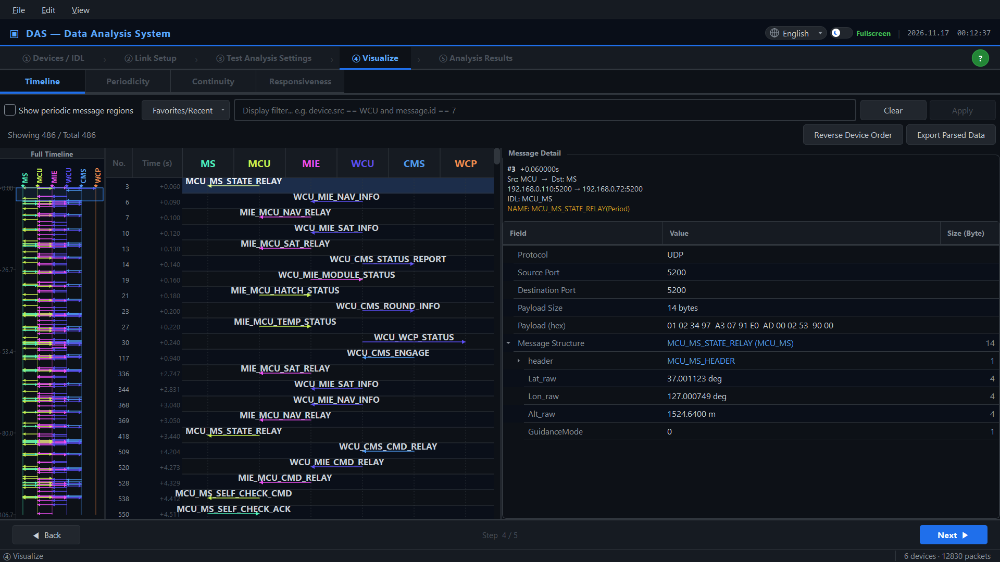

[한국어](README.md) | **English**

# DAS User Guide

DAS (Data Analysis System) is a Windows desktop program that decodes test-network captures against your device, link and IDL configuration, then turns the results into visualizations and documents.



**[⬇ Download the latest release](https://github.com/WildCork/DAS_PUBLIC/releases/latest)** · [Installation and First Run](guide/en/install.md) · [User Guide](#user-guide)

This repository contains the DAS **user guide** and the executable **releases**. It does not contain source code. The guide is generated from the same source as the in-app `F1` help (each tab's own help), plus common topics such as configuration file rules and troubleshooting, with screenshots and numbered callouts for each screen.

> DAS analyzes saved PCAPNG and legacy PCAP files. It does not capture packets itself, but its Live load mode can follow a file that dumpcap or a similar tool is still writing.

The program's UI can be switched between Korean and English while it runs.

## What can it do?

| Step | What you do | Main output |
|---|---|---|
| ① Devices / IDL | Register devices, IP/port sockets, IDL files and auxiliary rules | Test configuration |
| ② Link Setup | Link sending/receiving sockets to an IDL | Per-direction decoding rules |
| ③ Test Analysis Settings | Load a capture, message and Smart Filter, request–response relationships | Data to analyze |
| ④ Visualize | Timeline, Periodicity, Continuity and Responsiveness analysis | Charts, statistics, CSV/XLSX, images |
| ⑤ Analysis Results | Build a report and a multi-Y-axis dashboard | CSV/XLSX report, PDF dashboard |

It also saves configurations, templates and work sessions, builds diagnostic packages, and supports Korean/English UI, light/dark themes and font scaling.

## Quick start

```text
① Devices / IDL → ② Link Setup → ③ Test Analysis Settings
→ ④ Visualize → ⑤ Analysis Results
```

1. Load an existing DAS configuration JSON or `endpoints.lua`, or register devices, IDL files and links by hand.
2. In ③ Test Analysis Settings, load a `.pcapng` or `.pcap` file.
3. Check the message kinds to analyze in the message tree and press **Apply Filter**.
4. Review flow, periods, field values and response times in the four tabs of ④ Visualize.
5. Build and save a report or dashboard in ⑤ Analysis Results.

If a screen stays empty or messages are not decoded, first check that the device IP/ports, link directions and IDL in the earlier steps match the actual capture.

## User Guide

- [Installation and First Run](guide/en/install.md)
- [Quick Start](guide/en/00_quick-start.md)
- [Overall Workflow](guide/en/01_workflow.md)
- [Step 0: Test Config File Setup](guide/en/02_config-files.md) — Writing Rules for endpoints.lua, DAS Config JSON Format, Writing Rules for IDL Files
- [① Devices / IDL](guide/en/03_step1.md) — Edit IDL Message
- [② Link Setup](guide/en/04_step2.md)
- [③ Test Analysis Settings](guide/en/05_step3.md) — Smart Filter, Request-Response Relationships
- [④ Visualize · Timeline](guide/en/06_step4-timeline.md)
- [④ Visualize · Periodicity](guide/en/07_step4-periodic.md)
- [④ Visualize · Continuity](guide/en/08_step4-continuity.md)
- [④ Visualize · Responsiveness](guide/en/09_step4-response.md)
- [⑤ Analysis Results · Report](guide/en/10_step5.md)
- [⑤ Analysis Results · Dashboard](guide/en/11_step5-composite.md)
- [Mouse and Hidden Operations](guide/en/12_mouse-hidden.md)
- [Troubleshooting](guide/en/13_troubleshooting.md)
- [Shortcuts and Supported File Types](guide/en/14_shortcuts.md)
- [About](guide/en/15_about.md)

## Supported files

### Input

| Format | Purpose |
|---|---|
| `.pcapng`, `.pcap` | Test network capture |
| `.idl` | Message structures and field definitions |
| `.das-idl.json` | IDL metadata and auxiliary analysis rules |
| `.lua` | Device, socket and link configuration |
| `.json` | DAS configuration, report templates, dashboard templates |

### Output

| Format | Purpose |
|---|---|
| `.csv`, `.xlsx` | Parsed data and reports |
| `.png`, `.jpg` | Visualization images |
| `.pdf` | Dashboard results |
| `.txt`, `.zip` | Diagnostics and support packages |

JSON files share one extension; DAS tells them apart by the `format` and `version` fields inside.

## Command-line options

You can start DAS with a configuration and a capture.

```powershell
DAS.exe --config "C:\test\endpoints.lua" --pcapng "C:\test\capture.pcapng"
```

| Option | Description |
|---|---|
| `--config <path>` | Load a DAS configuration JSON or Lua configuration |
| `--pcapng <path>` | Load the capture, then go to the visualization step |

## System requirements

- Windows 10/11 64-bit
- 1280×720 or larger display recommended
- Memory needs depend on capture size and the kind of analysis.

## License

The DAS program and this guide are **free to use**, but **redistribution is not allowed**. To recommend it to others, please share a link to this repository. See [LICENSE](LICENSE) for details (Korean original + English translation).
