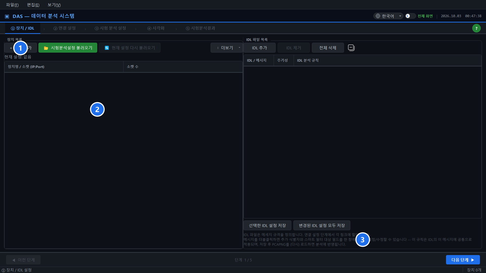

**한국어** | [English](en/00_quick-start.md)

# 빠른 시작

DAS는 발사 시험 네트워크 캡처(PCAPNG)를 장치/IDL 설정에 맞춰 해석하고, 시각화와 성적서로 정리하는 프로그램입니다. 상단 5개 단계를 순서대로 진행하면 됩니다.

**사용 순서**

1. ① 장치 / IDL 에서 장비와 소켓, IDL 파일을 등록합니다.
2. ② 연결 설정 에서 발신·수신 소켓과 IDL을 연결합니다.
3. ③ 시험 분석 설정 에서 PCAPNG를 불러오고 볼 메시지를 고릅니다.
4. ④ 시각화 에서 시간선 · 주기성 · 연속성 · 응답성으로 데이터를 확인합니다.
5. ⑤ 시험분석결과 에서 성적서 점검항목과 대시보드 분석 결과를 만듭니다.

**주의사항**

- 앞 단계의 설정이 뒤 단계 해석의 기준이 되므로, 순서를 건너뛰면 ④·⑤ 단계 화면이 비어 보일 수 있습니다.

- **1** 좌측 상단 버튼 줄. 지금은 등록된 장치가 없어 "현재 설정 다시 불러오기"가 회색으로 비활성화돼 있고, 그 아래에는 "현재 설정: 없음"으로 표시됩니다. "+ 장치 추가"로 처음부터 하나씩 등록하거나, 이미 만들어 둔 endpoints.lua나 DAS 설정 JSON이 있다면 초록색 "시험분석설정 불러오기"로 한 번에 채울 수 있습니다.
- **2** 장치 목록 (좌측). 지금은 장치가 하나도 없어 목록이 비어 있고, 화면 맨 아래 상태줄에도 "장치 0개"로 표시됩니다. 프로그램을 처음 열었을 때, 또는 "전체 삭제"를 누른 직후 보게 되는 화면이 바로 이 상태입니다.
- **3** 우측 IDL 파일 목록과 안내문. 아직 IDL도 등록되지 않아 목록이 비어 있고, 그 아래 "IDL 파일은 메세지 규격을 정의합니다. 연결 설정 단계에서 각 링크에 할당됩니다."라는 안내문으로 IDL이 앞으로 어떤 역할을 할지 미리 알려줍니다. 장치와 IDL을 모두 채우고 나면 ② 연결 설정 단계에서 이 둘을 서로 이어주게 됩니다.

---

[목차](../README.md#사용-가이드) · [전체 사용 순서 →](01_workflow.md)
