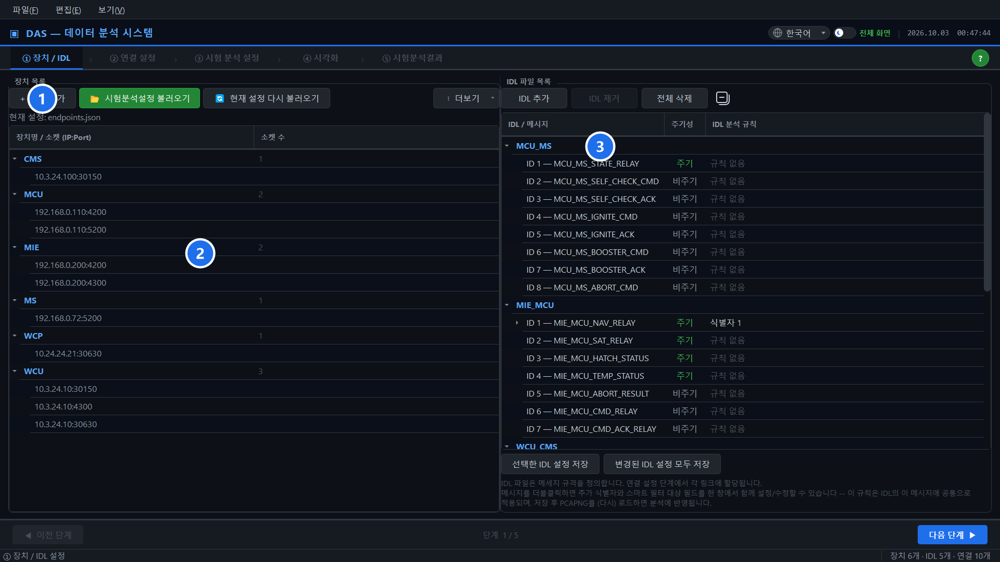

**한국어** | [English](en/03_step1.md)

# ① 장치 / IDL

분석에 참여하는 장치와 소켓(IP:Port), 그리고 payload를 해석할 IDL 파일을 등록하는 탭입니다. 설정 파일이 이미 있으면 불러오기 한 번으로 모두 채워집니다.

**사용 순서**

1. 설정 파일(endpoints.lua 또는 DAS 설정 JSON)이 있으면 초록색 "시험분석설정 불러오기"를 누르고 파일을 고릅니다.
2. 없으면 "+ 장치 추가"로 장치 이름을 넣고, "+ 소켓 추가"로 IP와 Port를 등록합니다.
3. "IDL 추가"로 .idl 파일을 등록합니다.
4. 장치 목록과 IDL 목록이 기대한 대로 채워졌는지 확인하고 ② 연결 설정으로 넘어갑니다.

**주의사항**

- IP는 캡처 안의 주소와 정확히 같아야 매칭됩니다. Port를 비우면 그 IP의 모든 트래픽과 매칭됩니다.
- 장치 이름은 시간선 열, 성적서 점검대상 등 프로그램 전체에서 그대로 쓰이므로 짧고 고유하게 짓습니다.
- 설정 불러오기는 지금의 장치·IDL·연결을 통째로 바꿉니다. 지금 구성을 남기려면 먼저 저장하세요.
- 장치나 IDL을 지워도 그것을 쓰던 ② 탭의 연결은 남습니다. 지운 뒤 ② 탭을 확인하세요.
- 장치를 고치거나 지우려면 장치 목록의 행을 더블클릭하거나 우클릭합니다.

- **1** 버튼 줄. "+ 장치 추가", "시험분석설정 불러오기", "현재 설정 다시 불러오기"가 있습니다.
- **2** 장치 목록. 장치마다 그 아래에 소켓(IP:Port)이 나열되며, 행을 더블클릭하면 편집 창이 열립니다.
- **3** IDL 목록. IDL 파일 → 메시지 → 규칙 필드의 3단 트리이며, 메시지 행을 더블클릭하면 "IDL 메시지 편집" 창이 열립니다.

## IDL 메시지 편집

IDL 목록에서 메시지 행(2단)을 더블클릭하면 열리는 창입니다. 메시지 설명과 주기 여부, 추가 식별자, 스마트 필터 대상을 한곳에서 정합니다.

**사용 순서**

1. "메시지 정보" 탭에서 설명을 적고, 필요하면 IDL 선언과 다르게 주기/비주기를 지정합니다.
2. "추가 식별자" 탭에서 한 메시지를 여러 변형으로 나눌 기준 필드를 오른쪽으로 옮깁니다.
3. "스마트 필터 대상 관리" 탭에서 필드를 "제외" 또는 "이산적 변화"로 고정합니다(주기 메시지만).
4. "적용"/"확인"으로 세 탭을 한 번에 반영하고, IDL 행의 "*"는 IDL 설정 저장으로 지웁니다.

**주의사항**

- 설정은 원본 .idl이 아니라 같은 폴더의 "<IDL 파일명>.das-idl.json"에 저장됩니다.
- 설명 외의 변경은 ③ 탭에서 PCAPNG를 다시 로드해야 분석에 반영됩니다("재로드 필요" 안내).
- 식별자 조합이 한 연결에서 10개를 넘으면 그 연결에는 규칙이 적용되지 않습니다.

---

[← 0단계: 시험 Config 파일 설정](02_config-files.md) · [목차](../README.md#사용-가이드) · [② 연결 설정 →](04_step2.md)
