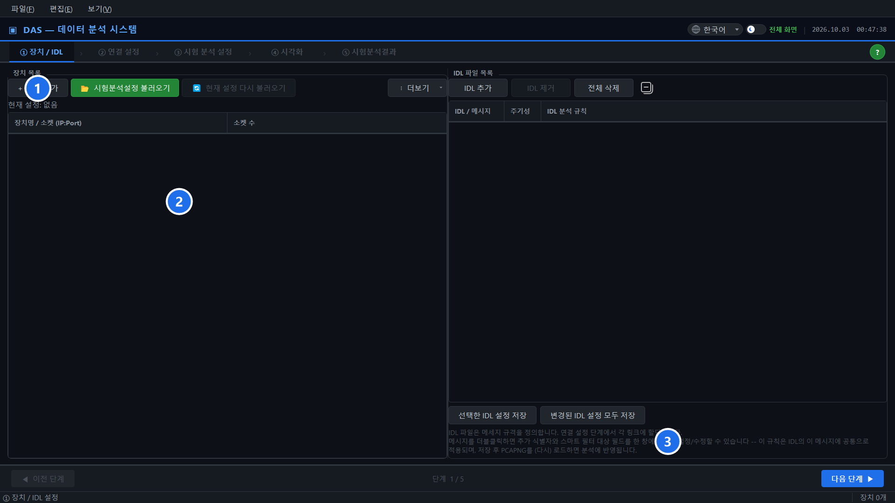
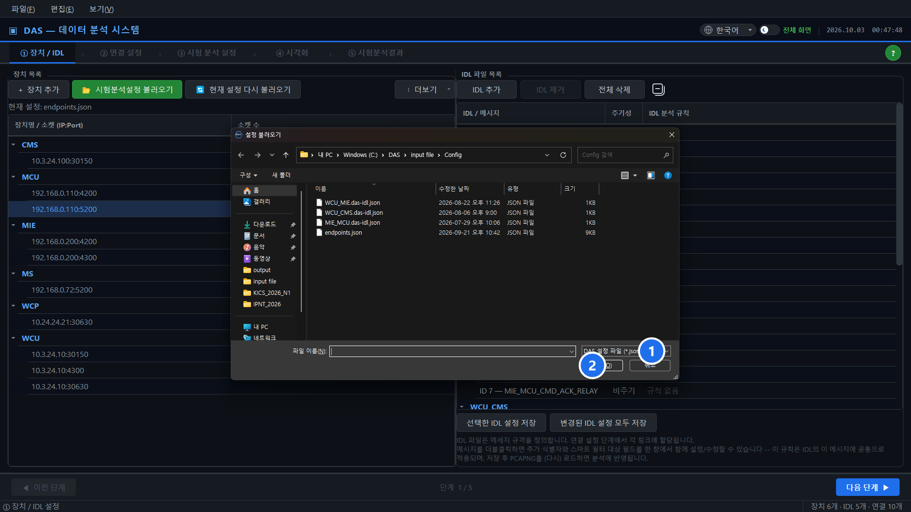
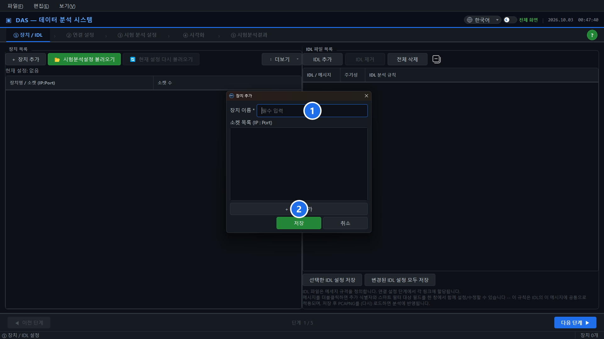
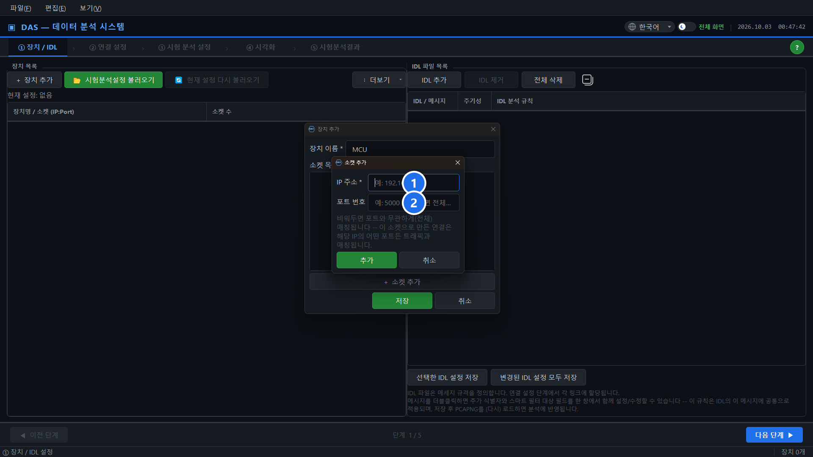
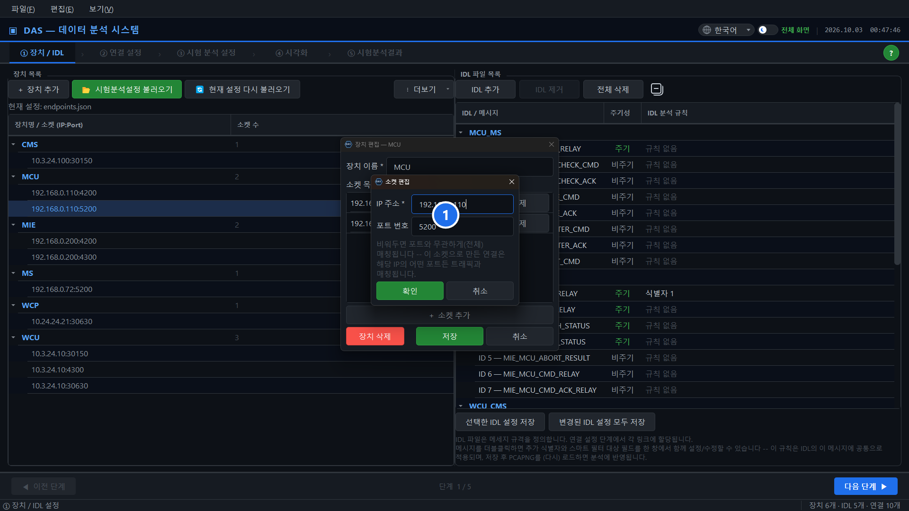
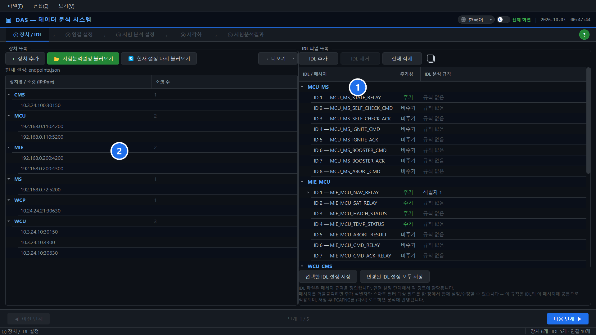

# 1단계 장치 / IDL

분석에 참여하는 장비와 소켓, 그리고 payload를 해석할 IDL 파일을 등록하는 단계입니다. "누가 통신하는가"와 "바이트를 어떤 규격으로 읽는가"를 준비합니다 — 아래 화면(장치와 IDL이 등록된 예시)의 ①②③ 설명은 이 단계를 마쳤을 때 화면에 무엇이 채워져 있어야 하는지를 영역별로 짚은 것입니다.

**사용 순서**

1. 이미 준비된 endpoints.lua나 설정 JSON이 있다면 "시험분석설정 불러오기"로 한 번에 불러옵니다.
2. 없다면 장치 추가/IDL 추가로 직접 등록합니다.
3. 장치 목록과 IDL 목록이 기대한 대로 채워졌는지 확인합니다.

- **1** 좌측 상단 버튼 줄. "+ 장치 추가"로 새 장비를 등록하고, 초록색 "시험분석설정 불러오기"는 endpoints.lua나 이전에 저장해 둔 DAS 설정 JSON을 통째로 불러와 장치·소켓·IDL·연결까지 한 번에 채워주는 지름길입니다. "⋮ 더보기"에는 항목 선택과 전체 삭제가 있고, 이미 등록된 장치를 고치거나 지우려면 목록에서 그 행을 더블클릭하거나 우클릭합니다.
- **2** 장치 목록 (좌측). 지금은 등록된 장치가 없어 비어 있지만, 여기 등록한 장치 이름은 이후 ② 연결 설정의 콤보, ④ 시각화 시간선의 장비 열 이름, ⑤ 성적서의 점검대상 선택 등 프로그램 전체에서 그대로 재사용됩니다.
- **3** IDL 파일 목록 (우측)과 안내문. IDL은 payload를 해석하는 필드 구조와 메시지 ID, 어떤 메시지가 주기(PERIODIC)인지를 정의합니다 — 안내문처럼 어떤 소켓이 이 IDL을 쓰는지는 다음 ② 연결 설정 단계에서 발신·수신 소켓과 함께 지정합니다.

- **1** 좌측 상단 버튼 줄. "+ 장치 추가"로 새 장비를 등록하고, 초록색 "시험분석설정 불러오기"는 endpoints.lua나 이전에 저장해 둔 DAS 설정 JSON을 통째로 불러와 장치·소켓·IDL·연결까지 한 번에 채워주는 지름길로, 이미 있는 설정 파일이 있다면 이 버튼부터 눌러보는 것이 좋습니다. 그 아래 "현재 설정" 줄에 지금 불러온 파일 이름이 표시되고, "현재 설정 다시 불러오기"는 그 파일과 거기서 참조하는 IDL을 다시 읽습니다.
- **2** 장치 목록 (좌측 트리). CMS·MCU·MIE·MS·WCP·WCU처럼 실제 시험에 참여하는 장비 이름이 굵게 표시되고, 그 아래로 그 장비가 쓰는 소켓(IP:Port)이 나열됩니다. 오른쪽 "소켓 수" 열은 그 장비에 등록된 소켓 개수로, 예시의 MCU처럼 한 장비가 서로 다른 포트(4200, 5200)로 여러 역할을 겸하는 경우 소켓이 여러 개로 늘어납니다. 여기서 등록한 장치 이름은 이후 ② 연결 설정의 장치 콤보, ④ 시각화 시간선의 장비 열 이름, ⑤ 성적서의 점검대상 선택 등 프로그램 전체에서 그대로 재사용되므로, 한 번 등록한 이름은 가급적 바꾸지 않는 것이 좋습니다.
- **3** IDL 파일 목록 (우측). MCU_MS, MIE_MCU, WCU_CMS처럼 등록된 IDL 파일 하나하나가 이름으로 나열되며, 이 이름은 보통 "발신 장치_수신 장치" 규칙을 따릅니다. 이 목록은 payload를 해석하는 데 필요한 필드 구조와 메시지 ID, 그리고 어떤 메시지가 주기(PERIODIC)인지를 정의할 뿐, 어떤 소켓이 이 IDL을 쓰는지는 아직 정하지 않은 상태입니다 — 그 연결은 다음 ② 연결 설정 단계에서 발신 소켓·수신 소켓과 함께 지정합니다.

## 설정 불러오기

Lua 엔드포인트 맵 또는 이전에 저장한 DAS 설정 JSON을 불러와 장치·소켓· IDL·연결을 한 번에 구성합니다.

**사용 순서**

1. "시험분석설정 불러오기" 버튼을 누릅니다.
2. .lua 또는 .json 파일을 선택합니다.
3. 진단 창이 열리면 오류/경고를 끝까지 확인합니다.
4. 장치 목록, 소켓 수, IDL 목록이 기대와 같은지 확인합니다.

**주의사항**

- Lua는 devices의 첫 번째 밑줄(_) 앞부분을 장치 이름으로 묶고, protos 이름과 같은 폴더의 <이름>.idl을 자동으로 찾습니다.
- 설정 JSON에는 IDL 파일 내용이 아니라 경로만 저장됩니다. 상대 경로 방식으로 저장했다면 설정 파일과 IDL을 같은 상대 위치로 함께 옮기면 다른 폴더나 PC에서도 그대로 열립니다 — 절대 경로 방식이면 IDL이 원래 위치에 있어야 합니다. 저장된 경로에 IDL이 없으면 설정 파일 폴더와 그 하위 폴더에서 같은 이름의 파일을 찾고, 내용이 저장 당시와 다르면 쓸지 먼저 묻습니다. 그래도 없으면 파일을 직접 고르는 창이 열립니다.

- **1** 파일 형식 필터. ".json"(이전에 저장한 DAS 설정)과 ".lua"(엔드포인트 맵) 두 확장자만 이 창에 표시됩니다 — 다른 형식의 파일을 찾고 있다면 먼저 이 드롭다운에서 필터를 바꿔야 목록에 나타납니다.
- **2** 파일을 고른 뒤 "열기"를 누르면 곧바로 파싱을 시작합니다 — .lua라면 devices/protos 테이블을 읽어 장치·소켓·IDL을 자동으로 구성하고, 문제가 있는 줄이 있으면 별도 진단 창에 오류/경고가 나타나므로 끝까지 확인해야 합니다.

## 장치와 소켓 등록

장치 하나는 이름과 하나 이상의 소켓(IP:Port)으로 이루어집니다. 여러 포트를 쓰는 장비는 소켓을 여러 개 등록합니다.

**사용 순서**

1. 장치 추가를 누르고 장치 이름을 입력합니다.
2. "+ 소켓 추가"를 눌러 IP와 Port를 입력합니다.
3. 포트를 더 쓰는 장비라면 소켓을 계속 추가합니다.
4. "저장"으로 저장하고, 나중에 고치려면 장치 목록에서 그 행을 더블클릭합니다.

**주의사항**

- 장치 이름은 시간선 열/필터/성적서 장비 선택에 그대로 쓰이므로 짧고 고유하게 짓는 것이 좋습니다.
- IP는 실제 PCAPNG 안의 주소와 정확히 같아야 매칭됩니다.
- 장치 이름을 나중에 고쳐도 ② 연결 설정 등 다른 화면은 그 장치 id로 이름을 다시 찾아 표시하므로 새 이름이 즉시 반영됩니다 — 다만 장치 삭제(장치 삭제·선택 삭제·전체 삭제)는 그 장치를 참조하던 ② 단계의 연결(링크)을 함께 정리하지 않습니다. 삭제된 장치를 참조하던 연결은 없어지지 않고 남아, ② 화면에 "Dev12"처럼 임시 이름으로 표시됩니다 — 장치를 지운 뒤에는 ② 단계에서 그런 연결이 남아 있지 않은지 직접 확인하세요.

- **1** 장치 이름 입력. 이 프로그램 전체에서 이 장치를 가리킬 이름입니다 — 필수 입력이며, 나중에 ② 연결 설정 콤보, ④ 시간선 열 이름, ⑤ 성적서 점검대상에서 그대로 다시 나타나므로 짧고 명확하게 짓는 것이 좋습니다.
- **2** 소켓 목록 (IP:Port)과 "+ 소켓 추가". 이 버튼으로 이 장치가 쓰는 IP:Port를 하나 이상 등록합니다 — 한 장치가 여러 포트를 쓴다면(예: 상태 보고용과 명령 수신용 포트가 다른 경우) 소켓을 여러 개 추가하면 되고, 추가한 소켓은 목록의 각 행에 있는 "편집"/"삭제"로 고치거나 지웁니다. 다 채운 뒤 아래 초록색 "저장"을 눌러야 저장됩니다.

- **1** IP 주소. 실제 PCAPNG 캡처 안에 찍힌 주소와 정확히 같은 문자열이어야 그 장치의 트래픽으로 인식됩니다 — "예: 192.168.0.1" 형태의 회색 글자는 실제 값이 아니라 입력 형식을 보여주는 placeholder일 뿐입니다.
- **2** 포트 번호. 이 소켓이 실제로 쓰는 UDP/TCP 포트 번호입니다. IP+포트 조합 전체가 하나의 소켓을 식별하므로, 같은 IP라도 포트가 다르면 서로 다른 소켓으로 등록해야 합니다. 비워 두면 포트와 무관하게 그 IP의 모든 트래픽과 매칭됩니다.

- **1** 소켓 편집 창. 장치 목록에서 소켓 행을 더블클릭하면(또는 우클릭 > 편집) 그 장치의 편집 창이 열리고, 고칠 소켓 행의 "편집"을 누르면 이 창이 뜹니다 — 새로 추가하는 것이 아니라 기존 IP/포트 값을 고치는 용도입니다. 예시는 MCU의 192.168.0.110:5200을 고치는 중이며, 초록색 버튼을 누른 뒤 장치 편집 창의 "저장"까지 눌러야 반영됩니다.

## IDL 등록

IDL 파일은 payload 바이트를 메시지 ID·구조체·필드로 해석하는 규격입니다. 주기 메시지 목록(PERIODIC)도 IDL이 선언합니다.

**사용 순서**

1. IDL 추가를 누르고 .idl 파일을 선택합니다.
2. IDL 목록에 이름이 나타나는지 확인합니다.
3. 파싱 진단이 있으면 헤더/메시지 태그/구조체를 다시 확인합니다.

**주의사항**

- IDL 제거는 파일 자체를 지우는 것이 아니라 현재 설정에서의 참조만 없앱니다.
- 같은 메시지 ID를 여러 구조체에 중복 선언하면 해석이 모호해집니다.
- 장치 삭제와 마찬가지로, IDL 제거·IDL 전체 삭제도 그 IDL을 지정해 둔 ② 단계 연결의 IDL 지정을 자동으로 "(없음)"으로 되돌리거나 그 연결을 지우지 않습니다 — IDL을 지운 뒤에는 ② 단계에서 그 IDL을 쓰던 연결이 있었는지 직접 확인하고 다른 IDL로 다시 지정하거나 그 연결을 정리하세요.

- **1** IDL 파일 목록 (우측). MCU_MS, MIE_MCU, WCU_CMS처럼 등록된 IDL 파일 하나하나가 이름으로 나열되며, 이 이름은 보통 "발신 장치_수신 장치" 규칙을 따릅니다. "IDL 추가"로 .idl 파일을 더 등록하거나 "IDL 제거"로 참조만 없앨 수 있습니다.
- **2** 장치 목록 (좌측). IDL이 실제로 어느 소켓에 쓰이는지는 이 화면에서 정하지 않습니다 — 장치/소켓과 IDL은 각각 독립적으로 등록되고, 둘을 실제로 이어주는 것은 다음 ② 연결 설정 단계입니다.

## IDL 메시지 편집

장치/IDL 설정 탭의 IDL 트리에서 메시지 행을 더블클릭하면 IDL 메시지 편집 창이 열립니다. 메시지 정보, 추가 식별자, 스마트 필터 대상 관리의 세 탭에서 해당 메시지의 모든 사용자 설정을 관리할 수 있습니다.

**사용 순서**

1. ① 장치/IDL 설정 탭의 IDL 목록은 IDL 파일 → 메시지(Message ID) → 설정된 규칙 필드의 3단 트리로 표시됩니다. 메시지 행(2단)을 더블클릭하면 열리고, IDL 파일 행 이나 3단 규칙 필드 행을 더블클릭해도 아무 일도 일어나지 않습니다 — IDL 트리에는 우클릭 메뉴가 없으며, 더블클릭이 유일한 편집 진입점입니다.
2. "메시지 정보" 탭에서는 메시지 설명과 주기/비주기 설정을, "추가 식별자" 탭에서는 메시지 식별자 규칙을, "스마트 필터 대상 관리" 탭에서는 스마트 필터 수동 분류를 각각 관리합니다 — 세 탭의 변경 사항은 하단의 "적용"/"확인" 버튼으로 한 번에 반영됩니다(부분 적용 없음, 하나라도 검증에 실패하면 넷 다 반영되지 않습니다).
3. 미적용 변경이 있는 탭은 이름 뒤에 " *"가 붙고, "적용"/"확인"이 성공하면 사라집니다. "전체 초기화"는 설명·주기성·추가 식별자·스마트 필터 대상을 모두 기본값으로 되돌리되, 버튼만 눌렀을 때는 아무것도 반영되지 않고 "적용"/"확인"을 눌러야 실제로 반영됩니다.
4. 이 창에서 "적용"/"확인"을 눌러도 이미 로드된 PCAPNG 분석 결과는 즉시 바뀌지 않습니다 — 설명 변경은 분석에 쓰이지 않아 재로드가 필요 없지만, 주기성/추가 식별자/스마트 필터 변경은 ③ 시험 분석 설정에서 PCAPNG를 다시 로드해야 반영됩니다.

**주의사항**

- [원본 보존] 사용자 설명과 주기성 설정 모두 원본 .idl 파일을 수정하지 않습니다 — "<IDL 파일명>.das-idl.json"에만 저장됩니다.
- [충돌 금지] 하나의 필드는 추가 식별자와 스마트 필터 수동 분류(제외/강제 이산)를 동시에 가질 수 없습니다 — 어느 한쪽으로 지정하면 다른 쪽에서 자동으로 제외됩니다.
- [비주기 메시지] 최종 적용 상태가 비주기이면 "스마트 필터 대상 관리" 탭이 비활성화됩니다 — 스마트 필터는 주기 메시지에만 적용됩니다. 편집해 둔 내용은 삭제되지 않고 보존되며, 다시 주기로 바꾸면 그대로 남아 있습니다.
- [다른 화면에서 이동] ③ 시험 분석 설정의 "스마트 필터 설정" 팝업에서 "필드별 세부 설정으로 이동..."을 누르면 ① 장치/IDL 설정 탭으로 이동합니다 — 그 팝업은 특정 메시지를 가리키지 않으므로, 이어서 원하는 주기 메시지 행을 더블클릭하면 "스마트 필터 대상 관리" 탭이 곧바로 선택된 채로 열립니다.
- [저장 정책] 네 설정 모두 세션이 아니라 ".das-idl.json" 파일에 저장됩니다 — 프로그램을 다시 시작해도 유지됩니다. 다만 저장하지 않은 변경은 프로그램 종료, IDL 제거/전체 삭제, 새 설정 불러오기, 그리고 이 창 자체를 닫을 때(Esc 포함, 취소 버튼은 확인 없이 곧장 폐기) 저장/폐기/취소를 묻는 창이 뜹니다.

## 메시지 정보(설명·주기성)

"IDL 메시지 편집" 창의 첫 번째 탭 — 이 메시지에 대한 사용자 설명을 남기고, IDL의 "//PERIODIC=[...]" 선언과 별개로 주기/비주기 처리를 이 메시지 하나에 한해 강제로 바꿀 수 있습니다.

**사용 순서**

1. "사용자 메시지 설명" 입력란에 자유롭게 설명을 적을 수 있습니다(최대 약 2,000자, 앞뒤 공백은 저장 시 제거). 비워두면 설명 없음으로 취급됩니다.
2. "주기/비주기 설정"에서 "IDL 정의 사용"(원본 "//PERIODIC=[...]" 그대로), "주기 메시지로 지정"(원본이 비주기여도 강제로 주기 처리), "비주기 메시지로 지정"(원본이 주기여도 강제로 비주기 처리) 중 하나를 고릅니다 — "실제 적용될 최종 주기성" 표시가 즉시 갱신됩니다.
3. 이 탭의 설정은 IDL 트리의 주기성 표시(사용자 지정 시 "(사용자 지정)" 접미어가 붙음), "추가 식별자"/"스마트 필터 대상 관리" 탭의 동작, 그리고 ③·④ 단계의 주기성/연속성 분석과 스마트 필터 적용 대상에 모두 같은 기준으로 반영됩니다(PCAP 재로드 후).

**주의사항**

- [원본 미변경] 설명과 주기성 설정 모두 원본 .idl 파일의 내용을 절대 바꾸지 않습니다.
- [재로드 필요 여부] 설명만 바꾼 경우 IDL 행에는 "*"가 붙지만(저장 대상 포함) "재로드 필요" 배너는 뜨지 않습니다 — 분석에 쓰이지 않기 때문입니다. 주기성을 바꾼 경우에는 다른 규칙 변경과 마찬가지로 "재로드 필요" 배너가 뜹니다.
- [스마트 필터 탭과의 관계] 최종 적용 상태가 비주기이면 "스마트 필터 대상 관리" 탭이 비활성화됩니다 — 자세한 내용은 "IDL 메시지 편집" 항목을 참고하세요.

## 추가 식별자 관리

IDL이 같은 메시지 ID로 정의한 하나의 메시지 안에, 상태나 모드에 따라 실제로는 서로 다른 의미를 갖는 여러 경우가 섞여 있을 때, 그 메시지 안의 필드 값(또는 여러 필드의 조합)을 기준으로 하위 종류로 나누어 보는 기능입니다. "IDL 메시지 편집" 창의 "추가 식별자" 탭에서 편집하며, 규칙은 IDL의 그 메시지에 공통으로 적용되어 그 IDL을 쓰는 모든 연결에 동일하게 반영됩니다 — 연결별 예외는 없습니다.

**사용 순서**

1. 이 탭은 PCAPNG 없이도 동작합니다 — 왼쪽 "사용 가능한 필드"에 이 IDL 메시지의 모든 말단(leaf) 필드가 구조체 선언 순서대로 나열되고, 오른쪽 "식별자로 선택됨" 목록에는 IDL 자신의 메시지 ID 필드(굵은 글씨, "(IDL 기본 식별자)")가 이미 고정되어 있어 제거할 수 없습니다.
2. 추가로 나눌 기준이 될 필드를 왼쪽에서 골라 ">" 버튼이나 더블클릭으로 오른쪽으로 옮기고 "적용" 또는 "확인"을 누르면(다른 두 탭의 변경사항과 함께 한 번에), IDL 트리와 다음 저장 대상에는 즉시 반영되지만 이미 로드된 PCAPNG 분석 결과는 바뀌지 않습니다 — 실제 패킷이 없어 조합 수를 미리 계산할 수 없기 때문입니다 (창 안의 안내 문구 참고).
3. 적용 후 IDL 행에 "*"가 붙어 저장하지 않은 변경이 있음을 표시합니다. "선택한 IDL 설정 저장" 또는 "변경된 IDL 설정 모두 저장"을 누르면 IDL과 같은 폴더의 "<IDL 파일명>.das-idl.json"에 기록되고(원본 .idl 파일은 건드리지 않음) "*" 표시가 사라집니다.
4. IDL을 다시 불러올 때(프로그램 시작, IDL 추가/제거, 설정 불러오기 등) 같은 폴더의 ".das-idl.json"이 있으면 자동으로 함께 읽혀 저장된 규칙이 그대로 복원됩니다 — 파일이 없으면 오류가 아니라 그냥 식별자 없이 시작합니다.
5. 규칙을 저장/적용한 뒤에는 ③ 시험 분석 설정 탭에서 PCAPNG를 (다시) 로드해야 분석 화면에 반영됩니다 — 로드 전까지는 ① 탭과 ③ 탭 양쪽에 "재로드 필요" 안내 문구가 나타납니다.

**주의사항**

- [적용 범위] 규칙은 IDL 메시지 공통이지만 실제 그룹은 항상 연결(Link)별로 유지됩니다 — 같은 IDL을 쓰는 서로 다른 연결의 발생이 하나로 합쳐지지 않습니다.
- [안전 상한] PCAPNG를 로드하면 연결별로 실제 관측된 정상 식별자 조합 수를 계산해 10개를 넘으면 그 연결에서만 규칙을 적용하지 않습니다("식별자 조합 10개 초과 — 규칙 미적용") — 같은 IDL을 쓰는 다른 연결이 10개 이하라면 그 연결에는 정상 적용됩니다. 디코딩 실패·식별자 필드 없음 발생은 이 10개 계산에 포함되지 않고 항상 별도 상태로 표시됩니다.
- [영향 범위] 규칙이 적용되면 ③ 시험 분석 설정의 메시지 트리, ④ 시각화의 시간선· 주기성·연속성이 모두 같은 분석 스냅샷(마지막으로 PCAPNG를 성공적으로 로드했을 때의 규칙)을 기준으로 동일하게 나뉘어 표시됩니다.
- [제거·초기화] 규칙을 없애려면 다시 이 탭을 열어 오른쪽 목록의 필드를 모두 왼쪽으로 되돌린 뒤 "적용"/"확인"을 누르거나, "전체 초기화" 버튼(설명·주기성과 함께 추가 식별자도 한 번에 모두 제거)을 누른 뒤 "적용"/"확인"을 누릅니다.
- [저장 정책] 규칙은 세션이 아니라 ".das-idl.json" 파일에 저장됩니다 — 프로그램을 다시 시작해도 유지됩니다. 다만 저장하지 않은 변경은 프로그램 종료, IDL 제거/전체 삭제, 새 설정 불러오기, 그리고 이 창 자체를 닫을 때(Esc 포함, 취소 버튼은 확인 없이 곧장 폐기) 저장/폐기/취소를 묻는 창이 뜹니다.
- [문제 해결] IDL 행에 경고 아이콘이 보인다면 ".das-idl.json"에 문제가 있다는 뜻입니다 — 툴팁에서 JSON 문법 오류, 지원하지 않는 버전, 없는 Message ID, 구조체명 불일치, 없는 필드 경로 중 어떤 문제인지 확인하고, 필요하면 이 탭에서 규칙을 다시 설정해 저장하세요(파일이 자동으로 고쳐지거나 삭제되지는 않습니다).
- [문제 해결] ① 탭이나 ③ 탭에 "재로드 필요" 문구가 계속 보인다면, ③ 시험 분석 설정에서 PCAPNG를 다시 로드하세요 — 규칙을 적용/저장한 것만으로는 이미 로드된 분석 결과가 바뀌지 않습니다.

## 스마트 필터 대상 관리

④ 시각화의 스마트 필터가 각 필드를 "이산적 변화"/"연속적 변화"로 나누는 자동 판정을, 특정 필드에 한해 수동으로 고정합니다 — ① 장치/IDL 설정 탭의 IDL 트리에서 메시지 행을 더블클릭하면 열리는 "IDL 메시지 편집" 창의 "스마트 필터 대상 관리" 탭입니다("메시지 정보"/"추가 식별자"와 같은 창의 다른 탭).

**사용 순서**

1. ① 장치/IDL 설정 탭의 IDL 트리에서 메시지 행을 더블클릭해 "IDL 메시지 편집" 창을 엽니다 — 최종 적용 상태가 비주기인 메시지에서는 같은 창이 열리지만 "스마트 필터 대상 관리" 탭 자체가 비활성화되고 그 이유를 알려주는 안내 문구가 대신 표시됩니다 ("메시지 정보" 탭에서 강제로 주기 지정하면 다시 활성화됩니다).
2. 가운데 "자동 판정 필드" 목록에서 화살표 버튼으로 필드를 왼쪽 "스마트 필터 제외 필드" 또는 오른쪽 "이산적 변화 필드"로 옮깁니다 — 제외↔이산 직접 이동은 없고 반드시 자동 판정을 거칩니다.
3. "이산적 변화 필드"로 옮긴 필드는 실제 값이 거의 안 바뀌어도 항상 "바뀐 것"으로 취급되고, "스마트 필터 제외 필드"로 옮긴 필드는 아무리 자주 바뀌어도 항상 무시됩니다 — 자동 판정 비율(스마트 필터 설정, 이 탭에는 읽기 전용으로만 표시)보다 이 수동 분류가 항상 우선합니다.
4. "적용" 또는 "확인"을 누르면(다른 두 탭의 변경사항과 함께 한 번에) IDL 트리와 다음 저장 대상에는 즉시 반영되지만, 이미 로드된 PCAPNG 분석 결과는 바뀌지 않습니다 — ③ 시험 분석 설정에서 PCAPNG를 다시 로드해야 반영됩니다.

**주의사항**

- [식별자와의 관계] 이 메시지를 이미 여러 변형으로 나누는 데 쓰이는 필드(그리고 IDL 자신의 메시지 ID 필드)는 "[식별자]" 표시와 함께 회색으로 잠겨 옮길 수 없습니다 — 한 필드가 추가 식별자이자 동시에 수동 분류 대상일 수는 없습니다. "추가 식별자" 탭에서 이미 수동 분류된 필드를 새로 식별자로 옮기면, 창을 나가기도 전에 그 자리에서 곧바로 "자동 판정"으로 옮겨지고 잠깁니다(확인창 없이 즉시) — 반대로 식별자에서 다시 빼면 잠금이 풀리고 일반 자동 판정 필드로 돌아갑니다(예전 제외/이산 분류는 복원되지 않습니다).
- [적용 범위] 규칙은 IDL 메시지 공통이며, 실제 이산/연속 판정과 숨김 여부는 연결·변형 별로 독립적으로 계산됩니다 — 같은 IDL을 쓰는 다른 연결이나 다른 변형의 결과에 서로 영향을 주지 않습니다.
- [이산 필드가 하나도 없을 때] 자동 판정 필드를 모두 제외로 옮기고 강제 이산 필드도 지정하지 않으면, 적용 전 "이 메시지는 첫 번째 발생만 표시됩니다"라는 확인창이 뜹니다 — 그 메시지 종류의 반복 발생이 스마트 필터에서 전부 숨겨진다는 뜻입니다.
- [저장 정책] 메시지 설명·주기성·식별자 규칙과 같은 "<IDL 파일명>.das-idl.json"에 함께 저장됩니다 — 별도 파일이 없고, 저장/변경 확인창도 하나로 통합되어 있습니다.
- [이동 방식] 세 목록 모두 더블클릭으로는 옮길 수 없습니다 — 화살표 버튼만 사용합니다.
- [비주기 메시지와 전체 초기화] "전체 초기화" 버튼을 눌렀을 때 이 탭이 비활성화 상태(비주기)라면 이미 있던 스마트 필터 규칙은 그대로 둡니다 — 지금 보이지도 편집할 수도 없는 내용을 다른 버튼의 부수효과로 지우지 않기 위함입니다. 이 탭이 활성화된 상태(주기)라면 필터 제외/강제 이산 분류를 모두 자동 판정으로 되돌립니다.

---

[← 0단계: 시험 Config 파일 설정](02_config-files.md) · [목차](../README.md#사용-가이드) · [2단계 연결 설정 →](04_step2.md)
