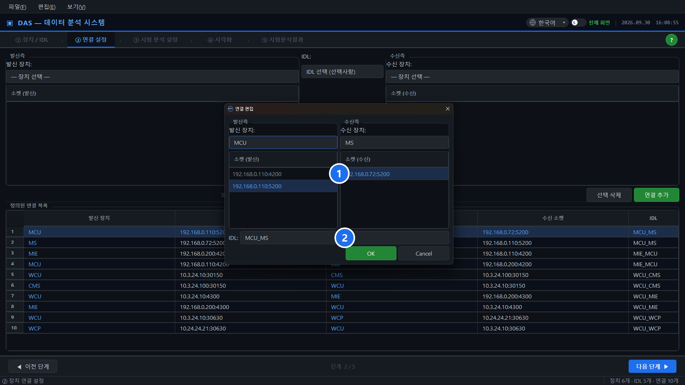
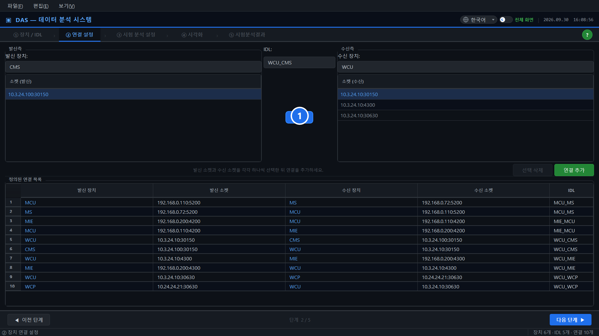

# 2단계 연결 설정

한 방향의 네트워크 흐름과 그 흐름을 해석할 IDL을 연결하는 단계입니다. "어느 소켓에서 어느 소켓으로 온 패킷을 어느 IDL로 읽을 것인가"를 정의합니다.

**사용 순서**

1. 발신 장치/소켓과 수신 장치/소켓, IDL을 선택합니다.
2. 연결 추가로 정의된 연결 목록에 등록합니다.
3. 실제 캡처에 필요한 방향이 모두 있는지 확인 후 설정을 저장합니다.

- **1** 발신측. 발신 장치와 소켓을 고릅니다.
- **2** IDL 선택과 방향 전환. 이 연결의 payload를 해석할 규격을 고르고, 필요하면 발신/수신을 맞바꿔 반대 방향 연결을 빠르게 추가합니다.
- **3** 수신측. 발신측과 대칭 구조로 수신 장치와 소켓을 고릅니다.
- **4** 정의된 연결 목록. 지금까지 추가한 모든 연결이 발신·수신 소켓과 IDL 정보와 함께 한 행씩 쌓입니다.

## 연결 추가 및 편집

발신측·IDL·수신측을 각각 고른 뒤 연결 추가로 한 방향의 연결을 만듭니다 — 아래 연결 목록 화면의 ①②③④ 설명은 이 화면의 각 영역이 무엇을 하는지를 짚은 것입니다.

**사용 순서**

1. 발신 장치 콤보와 소켓 트리에서 발신측을 고릅니다.
2. IDL 콤보에서 이 링크의 payload 규격을 고릅니다.
3. 수신 장치 콤보와 소켓 트리에서 수신측을 고릅니다.
4. 연결 추가를 누릅니다.
5. 반대 방향도 필요하면 가운데 방향 전환 버튼으로 발신/수신을 바꿔 다시 추가합니다.

**주의사항**

- 발신과 수신이 같은 장치/소켓이면 추가할 수 없습니다.
- 방향 전환(⇄) 버튼은 발신·수신의 장치와 소켓만 맞바꿀 뿐, 가운데 IDL 선택은 그대로 유지됩니다 — 반대 방향이 다른 IDL을 쓴다면 방향을 바꾼 뒤 IDL도 직접 다시 골라야 합니다.
- "이미 동일한 연결이 존재합니다" 중복 검사는 발신·수신의 IP:Port 쌍만 비교합니다 — 같은 소켓 쌍에 IDL만 다르게 지정해 두 번째 연결을 추가하려 해도 중복으로 간주되어 추가할 수 없으므로, IDL을 바꾸려면 새로 추가하지 말고 그 행을 더블클릭해 편집하세요.
- 방향을 바꿔 추가할 때 그 방향이 같은 IDL을 쓰는지 다시 확인하세요 — 양방향의 규격이 다를 수 있습니다.
- 정의된 연결 목록에서 선택 삭제로 잘못된 행을 지운 뒤 다시 추가할 수 있습니다.

- **1** 발신측 (좌측). 위쪽 "발신 장치" 콤보에서 ① 단계에서 등록한 장비 하나를 고르면, 그 아래 "소켓 (발신)" 목록에 그 장비의 소켓(IP:Port)들이 나타납니다 — 그중 이 연결의 출발점이 될 소켓 하나를 클릭해 선택합니다. 한 장비가 여러 소켓을 갖고 있다면(예: MCU의 4200/5200 포트) 실제로 이 메시지를 내보내는 포트를 정확히 골라야 합니다.
- **2** 가운데 IDL 선택 + 방향 전환. "IDL 선택" 콤보는 이 발신-수신 소켓 쌍 사이를 오가는 payload를 어떤 IDL 규격으로 해석할지 정합니다 — 선택하지 않으면 이 연결은 payload를 해독하지 못한 채 raw 상태로만 남습니다. 그 아래 화살표 아이콘(⇄) "방향 전환" 버튼은 지금 고른 발신측과 수신측을 서로 맞바꿔주는 기능으로, 같은 두 장비 사이의 반대 방향 연결(A→B에 이어 B→A)을 처음부터 다시 고르지 않고 빠르게 추가할 때 씁니다.
- **3** 수신측 (우측). 발신측과 대칭 구조로, "수신 장치" 콤보에서 장비를 고르면 "소켓 (수신)" 목록에 그 장비의 소켓들이 나타납니다. 발신측과 수신측에 같은 장치/같은 소켓을 고르면 연결을 추가할 수 없으므로, 반드시 서로 다른 소켓을 선택해야 합니다.
- **4** 정의된 연결 목록 (하단 표). 지금까지 "연결 추가"로 만든 모든 연결이 발신 장치·발신 소켓·수신 장치·수신 소켓·IDL 다섯 열로 한 행씩 쌓입니다. 예시의 1~2번 행(MCU→MS, MS→MCU)처럼 같은 장비 쌍이라도 방향이 다르면 서로 다른 연결로 별도 등록해야 하며, 실제 캡처에 두 방향이 모두 있다면 두 행이 모두 있어야 그 트래픽 전부가 해석됩니다. 잘못 추가한 행은 선택한 뒤 "선택 삭제"로 지우고 다시 추가할 수 있습니다.

- **1** 연결 편집 창. "정의된 연결 목록"에서 행을 더블클릭하면 뜨며, 그 행의 발신 장치/소켓과 수신 장치/소켓이 이미 선택된 채로 열립니다 — 새로 만드는 것이 아니라 기존 연결의 발신·수신 소켓을 다른 것으로 바꾸는 용도입니다.
- **2** IDL 필드와 OK. 이 연결에 지정된 IDL 이름이 표시되며, 필요하면 다른 IDL로 바꿀 수 있습니다. OK를 누르면 정의된 연결 목록의 그 행이 새 값으로 갱신됩니다.

- **1** 방향 전환 버튼. 지금 고른 발신측(CMS)과 수신측(WCU)을 서로 맞바꿉니다 — 예시처럼 이미 WCU→CMS 방향(WCU_CMS)을 등록했다면, 반대 방향(CMS→WCU)도 필요할 때 발신·수신을 처음부터 다시 고르지 않고 이 버튼으로 빠르게 채운 뒤 IDL만 확인하고 "연결 추가"를 누르면 됩니다.

---

[← 1단계 장치 / IDL](03_step1.md) · [목차](../README.md#사용-가이드) · [3단계 시험 분석 설정 →](05_step3.md)
