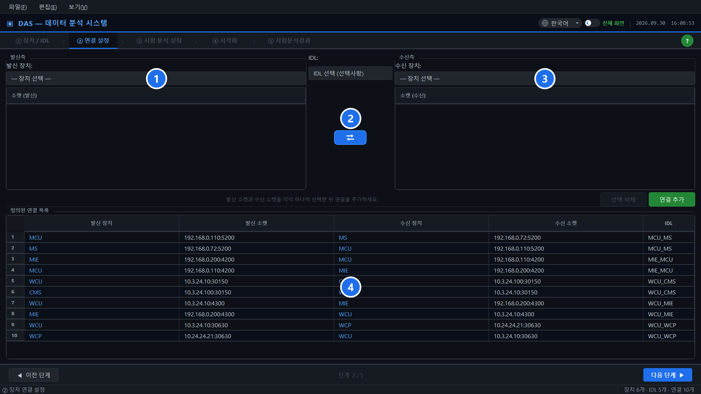

**한국어** | [English](en/04_step2.md)

# ② 연결 설정

"어느 소켓에서 어느 소켓으로 온 패킷을 어느 IDL로 읽을지"를 한 방향씩 정하는 탭입니다. 캡처에 있는 방향마다 연결이 하나씩 있어야 해석됩니다.

**사용 순서**

1. 왼쪽에서 발신 장치를 고르고, 소켓(발신) 목록에서 소켓 하나를 클릭합니다.
2. 오른쪽에서 같은 방법으로 수신 장치와 소켓을 고릅니다.
3. 가운데 "IDL 선택"에서 이 연결의 payload를 읽을 IDL을 고르고 "연결 추가"를 누릅니다.
4. 반대 방향도 필요하면 가운데 방향 전환(⇄)으로 발신·수신을 바꾸고, IDL을 확인한 뒤 다시 추가합니다.

**주의사항**

- 방향 전환은 장치와 소켓만 바꾸고 IDL은 그대로 둡니다. 반대 방향의 IDL이 다르면 직접 다시 고르세요.
- 같은 소켓 쌍은 IDL이 달라도 중복으로 보아 추가되지 않습니다. IDL을 바꾸려면 그 행을 더블클릭해 편집합니다.
- IDL을 고르지 않은 연결은 payload가 해석되지 않고 원시 바이트로만 남습니다.
- 잘못 넣은 행은 선택한 뒤 "선택 삭제"로 지웁니다.

- **1** 발신측. 발신 장치와 소켓을 고릅니다.
- **2** IDL 선택과 방향 전환. 이 연결의 payload를 해석할 규격을 고르고, 필요하면 발신/수신을 맞바꿔 반대 방향 연결을 빠르게 추가합니다.
- **3** 수신측. 발신측과 대칭 구조로 수신 장치와 소켓을 고릅니다.
- **4** 정의된 연결 목록. 지금까지 추가한 모든 연결이 발신·수신 소켓과 IDL 정보와 함께 한 행씩 쌓입니다.

---

[← ① 장치 / IDL](03_step1.md) · [목차](../README.md#사용-가이드) · [③ 시험 분석 설정 →](05_step3.md)
