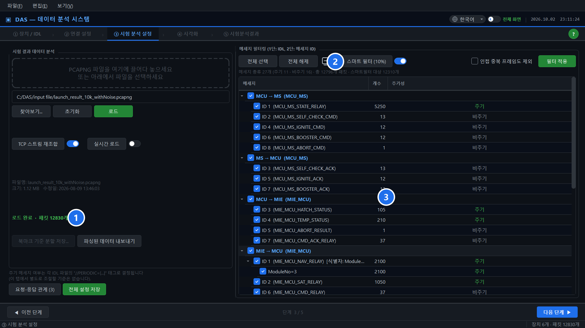

**한국어** | [English](en/05_step3.md)

# ③ 시험 분석 설정

PCAPNG를 불러와 ①·② 탭의 설정대로 해석하고, ④·⑤ 탭에서 볼 메시지를 고르는 탭입니다. 요청-응답 관계 정의와 전체 설정 저장도 여기서 합니다.

**사용 순서**

1. "찾아보기..."로 .pcapng를 고르거나 점선 영역에 끌어다 놓고 "로드"를 누릅니다.
2. "로드 완료 · 패킷 N개"와 오른쪽 메시지 트리가 채워졌는지 확인합니다.
3. 볼 메시지의 체크박스를 고르고 초록색 "필터 적용"을 누릅니다.
4. 반복되는 상태 메시지가 많으면 "스마트 필터" 토글을 켭니다.
5. "전체 설정 저장"으로 장치·IDL 경로·연결·요청-응답 관계를 JSON 파일에 저장합니다.

**주의사항**

- 지원 형식은 Ethernet + IPv4 + UDP/TCP입니다. 패킷 수가 기대보다 훨씬 적으면 ② 탭 연결의 IP:Port를 확인하세요.
- 체크박스 변경은 "필터 적용"을 눌러야 반영되지만, 스마트 필터 토글과 비율은 바꾸는 즉시 반영됩니다.
- 주기/비주기는 캡처 간격이 아니라 IDL의 //PERIODIC 선언(또는 IDL 메시지 편집의 지정)을 따릅니다.
- "실시간 로드" 토글을 켜면 dumpcap이 쓰는 파일을 1~10초마다 따라가며 최근 패킷을 보여 줍니다.
- "파싱된 데이터 내보내기"는 해석 결과를 장치쌍별 CSV/XLSX 파일로 저장합니다.

- **1** PCAPNG 로드 패널. 파일을 고르고 "로드"를 누르면 파일 정보와 패킷 수가 표시됩니다.
- **2** 필터 툴바. 전체 선택/해제, 모두 접기/펼치기, 스마트 필터 토글과 비율, "필터 적용"이 있습니다.
- **3** 메시지 트리. 1단은 발신 → 수신(IDL), 2단은 메시지 ID이며, 개수와 주기 여부가 함께 보입니다.

## 스마트 필터

주기 메시지에서 값이 바뀌지 않은 반복 발생을 숨겨 검토량을 줄입니다. 패킷 자체는 지우지 않습니다.

**주의사항**

- 변경이 판정 기준 비율(기본 10%)보다 드문 필드가 "이산 필드"이며, 직전 발생과 이산 필드가 모두 같으면 숨깁니다.
- "스마트 필터 (N%)" 버튼으로 비율을 바꿉니다. 낮추면 더 많이 숨겨지고, 높이면 덜 숨겨집니다.
- 로드 직후에는 뒤에서 계산되며, 끝날 때까지 토글·비율 버튼과 성적서 내보내기를 잠시 쓸 수 없습니다.

## 요청-응답 관계

④ 응답성 탭이 분석할 요청·응답 주기 메시지 쌍을 정의합니다. 추가·수정·삭제는 이 탭에서만 합니다.

**사용 순서**

1. "관계 추가"를 눌러 요청과 응답으로 쓸 주기 메시지와 색상을 고릅니다.
2. 목록의 행을 선택해 편집하거나 삭제합니다.

**주의사항**

- 가리키던 장치·IDL·메시지를 나중에 지우면 관계는 "참조 누락"으로 남습니다.

---

[← ② 연결 설정](04_step2.md) · [목차](../README.md#사용-가이드) · [④ 시각화 · 시간선 →](06_step4-timeline.md)
