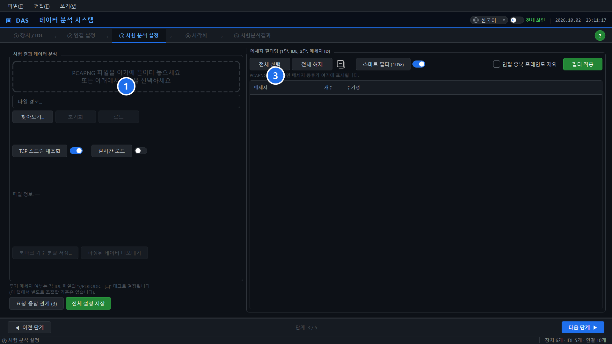
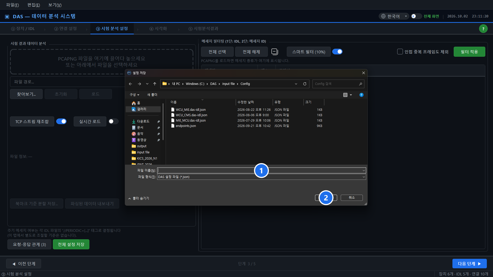
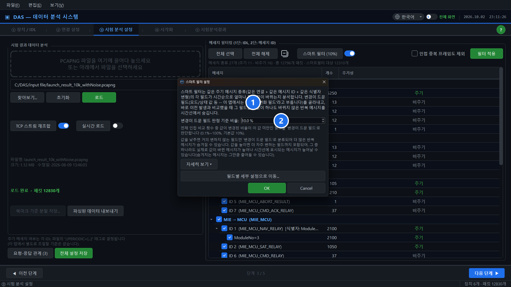

# 3단계 시험 분석 설정

실제 PCAPNG를 읽고, 앞 단계의 연결/IDL을 적용해 메시지 종류를 분류한 뒤 이후 볼 메시지를 고르는 단계입니다. 이 단계가 끝나야 ④·⑤ 단계에 값이 채워집니다 — 아래 화면의 ①②③ 설명은 좌측 로드 패널과 우측 필터 트리가 각각 무엇을 보여주는지를 짚은 것입니다.

**사용 순서**

1. PCAPNG 파일을 불러옵니다.
2. 메시지 필터 트리에서 볼 메시지를 고르고 필터 적용을 누릅니다.
3. 필요하면 스마트 필터로 반복되는 상태 메시지를 줄입니다.

- **1** 좌측 PCAPNG 로드 전 화면. 아직 파일을 불러오지 않아 회색 점선 영역과 "찾아보기..."/"로드" 버튼만 있는 초기 상태입니다 — 여기에 .pcapng 파일을 끌어다 놓거나 "찾아보기..."로 고른 뒤 "로드"를 눌러야 오른쪽 필터 트리와 이후 ④·⑤ 단계가 채워지기 시작합니다.
- **3** 우측 "메세지 필터링" 안내문. "PCAPNG를 로드하면 메세지 종류가 여기에 표시됩니다."라는 문구만 있는 빈 상태로, 왼쪽에서 PCAPNG가 실제로 로드되고 ①·② 단계의 연결/IDL 설정에 맞춰 패킷이 분류돼야 비로소 이 자리에 발신→수신 장비별 메시지 트리가 채워집니다.

- **1** 좌측 PCAPNG 로드 패널. 찾아보기...로 실제 시험에서 캡처한 .pcapng 파일을 고르거나 점선 영역에 끌어다 놓은 뒤 "로드" 버튼을 누릅니다. 로드가 끝나면 파일명·크기·수정일과 함께 예시처럼 "로드 완료 · 패킷 12830개"가 초록색으로 표시되는데, 이 숫자가 0이거나 기대보다 훨씬 적다면 캡처 형식(Ethernet+IPv4+UDP/TCP 이외는 지원 밖)이나 ② 연결 설정의 IP:Port가 실제 캡처와 다른 것을 의심해야 합니다. 아래쪽 "파싱된 데이터 내보내기"로 해석 결과를 CSV/XLSX로 따로 뽑아낼 수도 있습니다.
- **2** 상단 필터 툴바. "전체 선택"/"전체 해제"로 아래 트리의 모든 메시지 체크박스를 한 번에 켜고 끌 수 있고, "스마트 필터 (10%)" 버튼 옆 토글로 켜고 끄면 반복되는 상태 메시지 중 값이 바뀌지 않은 발생을 숨겨 검토량을 줄일 수 있습니다(버튼 텍스트의 괄호 안 숫자는 이산 필드로 볼 기준 비율입니다). 체크박스를 아무리 바꿔도 오른쪽 초록색 "필터 적용" 버튼을 눌러야 ④ 시각화 · ⑤ 성적서 단계에 실제로 반영되고, "전체 해제" 바로 옆 아이콘 버튼은 아래 트리를 모두 접거나 펼칩니다. 그 아래 "메세지 종류 27개 (주기 11 · 비주기 16) · 총 12796개 패킷 · 스마트필터 대상 12310개" 문구로 지금 이 캡처에 실제로 몇 종류·몇 건의 메시지가 있는지 요약을 먼저 확인할 수 있습니다.
- **3** 메시지 트리 (1단: 발신→수신과 IDL, 2단: 메시지 ID). 1단은 "MCU → MIE (MIE_MCU)"처럼 발신 장치 → 수신 장치와 그 연결에 지정된 IDL 이름이고, 2단은 그 IDL 안에 정의된 개별 메시지 ID입니다(식별자 규칙으로 나뉜 메시지는 그 아래 변형이 한 단 더 붙습니다). "개수" 열은 이 캡처에서 그 메시지가 실제로 몇 번 나타났는지, "주기성" 열은 IDL의 PERIODIC 선언에 따른 주기/비주기 여부입니다 — 예시의 MIE_MCU_HATCH_STATUS(105회, 주기)처럼 발생이 2회 이상이면서 주기로 선언된 메시지는 ④ 시각화의 주기성 탭에서 선 그래프로, 비주기 메시지는 그 위 비주기 영역에 점으로 나타납니다. 관심 없는 메시지의 체크박스를 꺼서 이후 화면에서 아예 제외할 수 있습니다.

## 설정 저장

현재 장치, IDL 파일 경로, 연결 구성, 요청-응답 관계를 DAS 설정 JSON 파일로 저장합니다 — 버튼은 ③ 시험 분석 설정 탭에 있습니다.

**사용 순서**

1. ③ 시험 분석 설정 탭 왼쪽 아래 "전체 설정 저장" 버튼을 누릅니다.
2. 저장 위치와 파일 이름을 지정합니다.
3. 이어서 뜨는 "설정 저장 옵션" 창에서 IDL 경로 기록 방식을 고르고 "저장"을 누릅니다 — 설정 파일 기준 상대 경로(권장)면 폴더째 옮기거나 다른 PC에서도 열리고, 절대 경로면 이 PC의 같은 위치에서만 열립니다.

**주의사항**

- PCAPNG 패킷 자체와 성적서 점검항목은 이 파일에 포함되지 않습니다.
- IDL 경로는 절대 경로와 설정 파일 기준 상대 경로가 모두 기록되고, 고른 방식은 불러올 때 먼저 찾을 경로입니다. 그 경로에 파일이 없으면 다른 경로의 파일을 쓰되, 저장 당시와 내용(SHA-256)이 같을 때만 씁니다 — 이름만 같은 다른 IDL을 잘못 불러오지 않기 위해서입니다. 두 경로 모두에 없으면 설정 파일 폴더와 그 하위 폴더에서 같은 이름의 파일을 찾아, 내용이 같으면 그대로 쓰고 다르면 쓸지 묻습니다. 다른 드라이브에 있는 IDL은 상대 경로를 만들 수 없어 기록되지 않습니다.
- 연결이나 요청-응답 관계를 수정한 직후, 또는 다른 PC로 프로젝트를 전달하기 전에 저장해 두는 것을 권장합니다.

- **1** 파일 이름. 이 창은 처음에 비어 있는 이름으로 열리므로, 여러 시험을 병행한다면 발사체나 시험 일자를 넣어 구분되는 이름을 입력해 두는 것이 나중에 알아보기 좋습니다. 확장자를 빼고 입력해도 .json이 붙고, "파일 형식"은 항상 DAS 설정 파일(*.json)입니다.
- **2** "저장"을 누르면 IDL 경로 기록 방식을 고르는 "설정 저장 옵션" 창이 이어서 뜨고, 거기서 "저장"까지 누르면 지금까지의 장치·소켓·IDL 경로·연결 구성과 요청-응답 관계가 이 JSON 파일 하나에 그대로 담깁니다 — PCAPNG 패킷이나 ⑤ 성적서 점검항목은 포함되지 않으므로, 그 둘은 각자의 저장 기능으로 따로 보관해야 합니다.

## PCAPNG 불러오기

시험 중 캡처한 PCAPNG 파일을 불러와 패킷을 해독합니다.

**사용 순서**

1. 찾아보기...로 .pcapng 파일을 고르거나, 점선 영역에 끌어다 놓습니다.
2. 로드 버튼을 누릅니다.
3. "로드 완료 · 패킷 N개" 표시와 메시지 필터 트리를 확인합니다.

**주의사항**

- 현재 리더는 Ethernet + IPv4 + UDP/TCP의 PCAPNG(.pcapng)만 안정적으로 지원합니다 — IPv6, VLAN, 일반 .pcap은 지원 범위 밖입니다. TCP로 나뉘어 온 메시지는 왼쪽 "TCP 스트림 재조합" 토글을 켠 채 로드하면 하나로 이어 붙여 해석합니다.
- 패킷 수가 예상보다 훨씬 적으면 캡처 형식이나 연결 설정 불일치를 의심하세요.
- "파싱된 데이터 내보내기" 창은 캡처에 실제로 있는 장치 간 연결(예: MCU_WCU)을 체크해 고르고, 문서 저장 경로 아래 parsed_data_<캡처명>_<시각> 폴더에 장치쌍별 폴더를 만들어 시간선 색인과 메시지별 파일을 CSV 또는 XLSX로 한꺼번에 저장합니다. 시간선은 패킷마다 한 행이고, 각 메시지의 세부 필드는 메시지별 파일에서 프레임 번호로 찾습니다. 저장은 뒤에서 진행되며 진행률을 보면서 취소할 수 있고, 행이 너무 많으면 XLSX 대신 CSV를 안내합니다.

- **1** PCAPNG 로드 영역. 회색 점선 안에 .pcapng 파일을 끌어다 놓거나, "찾아보기..."로 직접 고른 뒤 "로드"를 누릅니다. 로드가 끝나면 이 자리 아래에 파일명·크기· 수정일과 함께 "로드 완료 · 패킷 N개"가 초록색으로 표시됩니다.
- **3** 우측 메시지 필터링 영역. PCAPNG가 로드되기 전에는 "PCAPNG를 로드하면 메세지 종류가 여기에 표시됩니다."라는 안내문만 보이고, 로드가 끝나야 ①·② 단계의 연결/IDL에 맞춰 분류된 메시지 트리가 이 자리에 나타납니다.

## 메시지 트리

1단은 발신·수신 장치와 IDL, 2단은 메시지 ID/구조체입니다. 각 행에는 발생 개수와 주기/비주기 여부가 표시됩니다.

**사용 순서**

1. 볼 메시지 종류의 체크박스를 켜고 끕니다 (전체 선택/전체 해제로 한 번에 처리 가능).
2. 필터 적용을 눌러야 이후 화면(④·⑤ 단계)에 반영됩니다.

**주의사항**

- 주기 여부는 캡처 간격을 보고 추정하는 것이 아니라 IDL의 //PERIODIC=[...] 선언을 그대로 따릅니다.
- 필터는 원본 PCAPNG 파일을 수정하지 않고 화면 표시만 숨깁니다.

- **1** 좌측 PCAPNG 로드 상태. 이미 로드가 끝나 파일명·크기와 함께 "로드 완료 · 패킷 12830개"가 초록색으로 표시된 상태입니다 — 오른쪽 메시지 트리는 이 로드가 끝나야만 채워집니다.
- **2** 필터 툴바. "전체 선택"/"전체 해제"로 체크박스를 한 번에 켜고 끄고, "스마트 필터 (10%)" 버튼 옆 토글로 반복되는 상태 메시지를 줄일 수 있습니다. 체크박스를 바꾼 뒤에는 반드시 "필터 적용"을 눌러야 ④·⑤ 단계에 반영되며, "전체 해제" 바로 옆 아이콘 버튼으로 트리를 모두 접거나 펼칠 수 있습니다.
- **3** 메시지 트리. 1단은 발신→수신 장비와 IDL, 2단은 그 IDL 안의 메시지 ID이며, "개수"·"주기성" 열로 실제 발생 횟수와 IDL의 PERIODIC 선언 여부를 함께 확인할 수 있습니다.

## 스마트 필터

동일 상태를 자주 반복하는 주기 메시지에서, 값이 바뀌지 않은 반복 발생을 목록에서 숨겨 검토량을 줄입니다 — 아래 설정 창의 ①②는 판정 알고리즘 설명과 실제 조작 항목을 각각 짚은 것입니다.

**사용 순서**

1. 메시지 트리 위쪽의 스마트 필터 버튼으로 켜고 끕니다.
2. 필요하면 변경이 드문 필드 판정 기준 비율(기본 10%)을 조정합니다.

**주의사항**

- 직전 발생과 비교해 값이 바뀐 비율이 기준보다 낮은 필드만 "이산 필드"로 보고, 그 필드들이 직전 발생과 모두 같을 때만 숨깁니다 — 하나라도 바뀌면 표시합니다.
- 패킷 자체를 삭제하지 않으며, 기준 비율을 낮출수록 더 적은 필드만 이산 필드로 분류되어 반복 메시지가 더 많이 숨겨질 수 있고, 반대로 기준 비율을 높이면 더 많은 필드가 이산 필드로 분류되어 그 중 하나라도 실제로 바뀐 메시지가 늘어나므로 숨겨지는 메시지는 오히려 줄어들 수 있습니다.
- 이 줄에는 서로 다른 역할을 하는 세 조작이 붙어 있습니다 — 토글 스위치는 스마트 필터 자체를 켜고 끄며 누르는 즉시(별도 적용 버튼 없이, 재계산도 없이) 반영되고, "스마트 필터 (N%)" 버튼은 그 옆 팝업으로 판정 기준 비율만 바꾸며(OK를 누르면 적용되지만, 대용량 PCAPNG에서는 배경 계산이 필요할 수 있습니다 — 아래 [배경 계산] 항목 참고), "필터 적용" 버튼은 이것과 전혀 무관하게 메시지 트리의 체크박스 선택 결과만 반영합니다 — 즉 스마트 필터를 켜거나 비율을 바꿀 때는 "필터 적용"을 누를 필요가 없습니다.
- [배경 계산] 판정 기준 비율을 실제로 바꿨을 때만 재계산이 실행됩니다 — 같은 값을 다시 적용하거나 토글만 켜고 끌 때는 재계산 없이 즉시 반영됩니다. 재계산이 잠깐이라도 걸릴 만큼 큰 캡처에서는 "스마트 필터 적용 중" 진행률 팝업(PCAPNG 로드 팝업과 같은 형태 — 단계 표시, 진행률, 경과 시간, 취소 버튼)이 뜨며, 계산이 끝나기 전까지 화면은 이전 결과 그대로입니다. 취소하거나 계산이 실패하면 이전 비율과 결과가 그대로 유지됩니다.
- [로드 직후] PCAPNG를 로드하면 스마트 필터는 로드가 끝난 뒤 백그라운드에서 계산됩니다 — 그동안 요약 줄에 "스마트 필터 계산 중..."이 표시되고 시간선에는 모든 메시지가 보이며, 스마트 필터 토글과 비율 버튼, 성적서 내보내기는 계산이 끝날 때까지 잠시 쓸 수 없습니다. 계산이 끝나면 자동으로 적용됩니다. 그 사이 다른 파일을 로드하거나 초기화하면 진행 중인 계산은 취소됩니다.
- [실시간 로드] 시험 분석 설정 탭의 "실시간 로드" 토글을 켜고 "실시간 로드 시작"을 누르면 DAS가 선택한 pcapng 파일(같은 폴더에 dumpcap 링 버퍼 파일이 이어지면 그중 최신 파일)을 설정한 주기(1~10초)로 따라가며 최근 전시 범위(1~10분) 안의 패킷을 시간선에 보여 줍니다. 전시 범위보다 오래된 패킷은 버려지고, 시간선의 0초는 시작 시점의 첫 패킷으로 고정됩니다. 따라가는 동안 성적서 내보내기·북마크 기준 분할·파싱 데이터 내보내기·스마트 필터·되돌리기는 쓸 수 없으며, "실시간 로드 중지"를 누르면 그 시점의 데이터로 일반 모드가 됩니다. 전체를 보려면 dumpcap이 쓴 파일을 일반 로드로 여세요. 주기·전시 범위는 "실시간 로드" 버튼의 팝업에서 바꿉니다. 시간선과 지금 보고 있는 주기성·연속성·응답성 그래프는 갱신 주기마다 새 데이터로 다시 그려지고, 확대·범례 선택·고른 필드·고정한 정보 팝업은 그대로 유지됩니다(창이 커서 다시 그리는 데 오래 걸리면 그래프는 몇 주기에 한 번씩 갱신됩니다).
- [파일 잠금] 캡처를 열어 둔 동안 DAS는 원본 파일을 메모리에 매핑해 직접 읽습니다 — 그동안 다른 프로그램이 그 파일을 삭제하거나 이름을 바꾸거나 줄일 수 없습니다(읽기와 뒤에 덧붙이기는 됩니다). 다른 캡처를 열거나 초기화하면 풀립니다. 또 1GB가 넘는 캡처는 세션 저장 때 캐시 폴더로 복사하지 않고 원본 경로만 기록하므로, 원본을 옮기거나 지우면 다음 실행에서 복원되지 않습니다.
- 일반 체크박스 필터는 사용자가 직접 끈 메시지 종류를 통째로 숨기는 것이고, 스마트 필터는 켜 둔 메시지 종류 안에서 "직전 발생과 실질적으로 달라진 것이 없는" 개별 발생만 자동으로 골라 숨기는 것입니다 — 둘은 동시에 적용되며 서로를 대체하지 않습니다.
- 메시지 식별자 관리로 한 메시지 종류를 여러 변형으로 나누면, 스마트 필터의 이산/연속 판정과 숨김 여부도 변형마다 독립적으로 다시 계산됩니다 — 원본 메시지 전체가 아니라 각 변형 자신의 발생만 놓고 판단합니다.

- **1** 판정 알고리즘 설명. 같은 주기 메시지 종류 안에서 필드별로 직전 발생과 비교해 값이 바뀐 비율을 계산합니다 — 이 비율이 아래 "변경이 드문 필드 판정 기준 비율"보다 낮으면 그 필드는 "이산적 변화 필드"(예: 모드 값처럼 가끔만 바뀌는 값)로, 그 반대로 자주 바뀌면 "연속적 변화 필드"(예: 카운터, 타임스탬프)로 분류됩니다. 바로 이전 발생과 비교했을 때 이산적 변화 필드가 모두 같다면(연속적 변화 필드만 바뀐 것이라면) 그 메시지를 목록에서 숨깁니다 — 패킷 자체를 삭제하지는 않으며, ④ 시각화의 시간선/메시지 목록에서만 숨겨집니다. "자세히 보기"를 누르면 더 긴 설명이 펼쳐집니다.
- **2** "변경이 드문 필드 판정 기준 비율" 입력. 비율을 낮추면(예: 10% → 5%) 더 적은 필드만 "이산적"으로 분류되어 반복 메시지가 더 많이 숨겨지며, 반대로 비율을 높이면 더 많은 필드가 이산 필드로 분류되어 그 중 하나라도 실제로 바뀐 메시지가 늘어나므로 숨겨지는 메시지는 오히려 줄어들 수 있습니다. 스마트 필터를 켜고 끄는 것은 이 창이 아니라 메시지 필터링 툴바의 토글이 하고, 특정 필드를 항상 이산/제외로 지정하려면 "필드별 세부 설정으로 이동..."을 누릅니다.

## 요청-응답 관계 설정

PCAPNG 로드 영역 아래, ④ 시각화 > 응답성 탭이 분석할 요청-응답 관계를 정의하는 곳입니다 — 관계의 추가·수정·삭제는 이 탭에서만 하고, 응답성 탭은 여기서 정의한 관계를 읽기 전용으로 보여주기만 합니다(표시/숨김, 전체 선택/해제만 그 탭의 몫).

**사용 순서**

1. 관계 추가를 눌러 요청/응답으로 쓸 주기 메시지 두 개와 색상을 고릅니다.
2. 관계 목록에서 행을 선택해 편집하거나 삭제합니다.
3. 아래 설정 저장으로 관계를 포함한 시험 구성 전체를 JSON 파일에 저장합니다.

**주의사항**

- 관계는 PCAPNG를 아직 로드하지 않아도 정의할 수 있습니다 — 후보 메시지는 지금까지 등록한 장치·IDL·연결에서 나오고, 실제 캡처와 비교/분석하는 일은 응답성 탭의 몫입니다.
- 요청과 응답 후보에는 주기 메시지만 나타납니다 — 요청-응답 관계의 의미 자체가 "이 주기 메시지를 보냈으면 저 주기 메시지가 응답으로 와야 한다"이므로, 등록된 주기 메시지가 2개 미만이면 관계 추가 버튼이 비활성화되고 이유가 함께 표시됩니다.
- 관계 이름을 따로 입력하지 않습니다 — 목록과 응답성 탭에 보이는 표시명은 고른 요청→응답 메시지 경로를 조합해 자동으로 만들어집니다.
- 관계가 가리키는 장치·IDL·연결·메시지를 나중에 지워도 관계 자체는 삭제되지 않습니다 — 목록에 "참조 누락"으로 표시되며, 응답성 탭에서는 "사용 불가"로 취급되어 분석되지 않습니다. 새 메시지로 다시 연결하거나 직접 삭제할 수 있습니다.

---

[← 2단계 연결 설정](04_step2.md) · [목차](../README.md#사용-가이드) · [4단계 시각화 →](06_step4.md)
