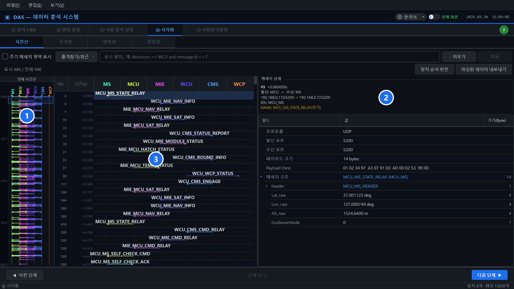

# ④ 시각화 · 시간선

장치별 세로 열과 시간 순서로 메시지를 늘어놓아 "언제 누가 누구에게 무엇을 보냈는가"를 보는 탭입니다. 메시지를 누르면 오른쪽에 해석된 필드가 펼쳐집니다.

**사용 순서**

1. 가운데 목록에서 메시지 행을 클릭하면 오른쪽 상세에 프레임·시각·IP:Port와 IDL 필드 값이 나옵니다.
2. 왼쪽 미니맵의 강조 상자를 끌어 원하는 시점으로 이동합니다.
3. 장치 열 머리글을 클릭하면 그 장치를 끄고 켜며, 좌우로 끌면 열 순서가 바뀝니다.
4. "시간(s)" 머리글을 누르면 상대/절대 시간이 바뀌고, "No." 머리글을 누르면 프레임 번호로 이동합니다.
5. 위쪽 검색창에 조건식(예: device.src == WCU and message.id == 7)을 넣고 Enter로 표시를 좁힙니다.

**주의사항**

- 화면이 비어 있으면 ③ 탭에서 PCAPNG 로드와 "필터 적용"을 확인하세요.
- 장치 열 머리글을 우클릭해 "송신 메시지 전시 관리"를 열면 그 장치가 보내는 메시지 종류를 시간선에서만 숨깁니다(저장되지 않음).
- 검색창 필터와 전시 관리는 시간선에만 적용되며 다른 탭이나 성적서에는 영향이 없습니다.
- lsb/msb가 있는 필드는 단위가 붙은 물리값으로 표시됩니다.
- 뒤로 가기/앞으로 가기(Ctrl+Z/Ctrl+Y)는 시각화 하위 탭마다 따로 기록됩니다.

- **1** 미니맵. 캡처 전체를 압축해 보여 주며, 강조 상자가 지금 보이는 구간입니다.
- **2** 메시지 상세. 선택한 메시지의 헤더 정보와 IDL 구조체를 필드/값/크기로 펼칩니다.
- **3** 메시지 목록. 화살표가 보낸 장치 열에서 받는 장치 열로 이어집니다.

---

[← ③ 시험 분석 설정](05_step3.md) · [목차](../README.md#사용-가이드) · [④ 시각화 · 주기성 →](07_step4-periodic.md)
