# 4단계 시각화

로드된 데이터를 시간선 · 주기성 · 연속성 · 응답성, 서로 다른 관점에서 확인합니다. 화면 위쪽 하위 탭으로 전환합니다.

**사용 순서**

1. 시간선: 장비 간 메시지 순서와 상세 필드를 확인합니다.
2. 주기성: 같은 메시지가 반복되는 간격의 이상/지터를 확인합니다.
3. 연속성: 특정 숫자 필드 하나의 시간에 따른 변화를 확인합니다.
4. 응답성: 요청-응답으로 지정한 주기 메시지 두 개 사이의 응답시간과 응답 누락·중복· 고아를 확인합니다.

- **1** 시간선: 왼쪽 미니맵으로 전체 캡처 중 위치를 가늠하고, 가운데 목록에서 메시지 흐름을 순서대로 확인합니다.
- **2** 선택한 메시지의 IDL 구조체를 필드/값/크기(Byte)로 펼쳐 보여주는 상세 패널입니다.
- **3** 장비별 세로 열에 배치된 메시지 시퀀스 — 이름과 화살표 방향으로 누가 누구에게 무엇을 보냈는지 바로 읽을 수 있습니다.

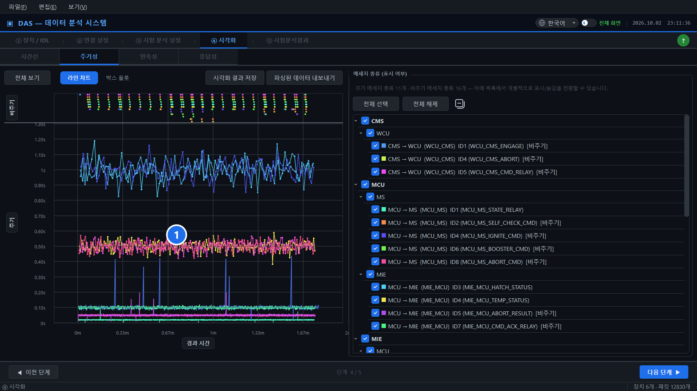

- **1** 주기성: 같은 메시지가 반복되는 간격을 라인 차트로 그려 누락·지연·지터를 확인합니다.

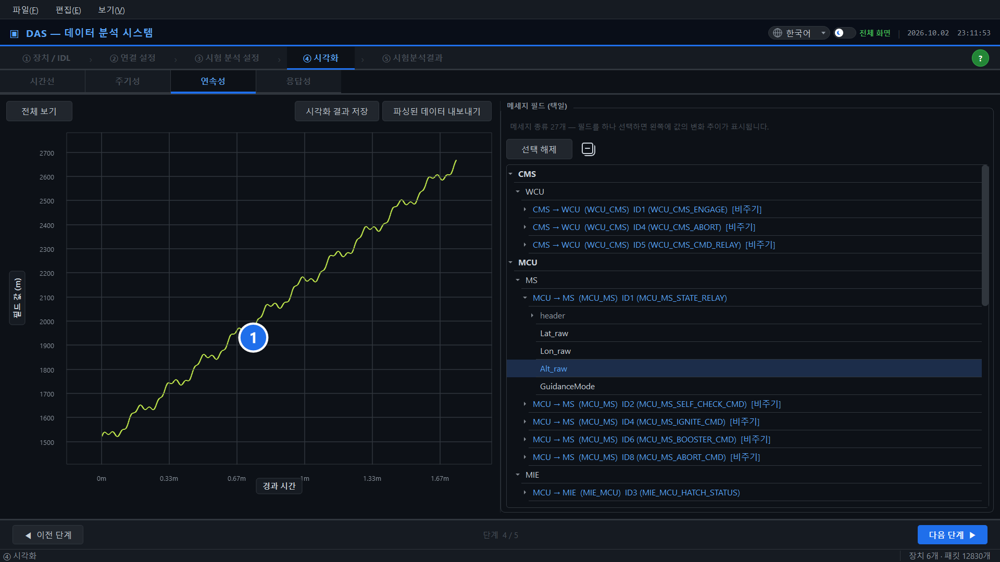

- **1** 연속성: 주기 메시지 안의 숫자 필드 하나를 골라 시간에 따른 값 변화(추세, 급변, 결측)를 확인합니다.

## 시간선 분석

장비별 세로 열과 시간축에 메시지를 배치해 "언제 누가 누구에게 무엇을 보냈는가"를 확인하는 기본 화면입니다.

**사용 순서**

1. 왼쪽 미니맵으로 전체 캡처 중 보고 있는 구간을 확인합니다.
2. 가운데 시퀀스/목록에서 메시지를 클릭하면 오른쪽 상세가 갱신됩니다.
3. "시간(s)" 열 머리글을 클릭할 때마다 상대 시간(+0.060000s)과 절대 시간(13:53:20.120) 표시를 오갑니다.
4. 장비 열 헤더를 클릭해 관심 없는 장치를 비활성화해 흐름을 단순화하거나, 헤더를 좌우로 드래그해 열 순서를 바꿀 수 있습니다.
5. "No." 열 머리글을 클릭해 프레임으로 이동 대화상자를 열고 특정 패킷 번호로 바로 이동합니다.
6. 장비 열 헤더를 우클릭하면 "<장비명> 송신 메시지 전시 관리" 메뉴가 뜨며, 이 장치가 보내는 메시지 종류(연결·식별자 변형별)를 하나씩 골라 시간선에서만 숨길 수 있습니다 — 자세한 내용은 "송신 메시지 전시 관리" 항목을 참고하세요.

**주의사항**

- 화면이 비어 있다면 ③ 단계에서 PCAPNG 로드와 필터 적용을 먼저 확인하세요.
- "시간(s)"/"No." 열 머리글의 이 클릭 동작은 좌클릭만 반응하며, 우클릭에는 따로 반응하지 않습니다 — 우클릭은 장비 열 헤더에서만 "송신 메시지 전시 관리" 메뉴를 엽니다.

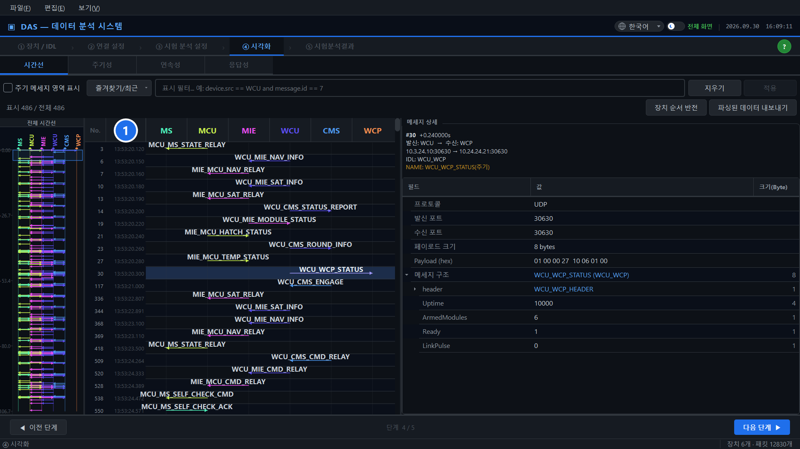

- **1** "절대시간" 열. 이 열의 머리글(평소에는 "시간(s)")을 클릭할 때마다 시간 표시 방식이 바뀌어, 캡처 시작 대비 경과 초(+0.060000s 형식) 대신 예시처럼 실제 벽시계 시각(13:53:20.120)으로 표시되고 머리글도 "절대시간"으로 바뀝니다 — 같은 날 여러 번 캡처했을 때 실제 몇 시에 무슨 일이 있었는지 확인하고 싶다면 이 표시가 더 직관적입니다.

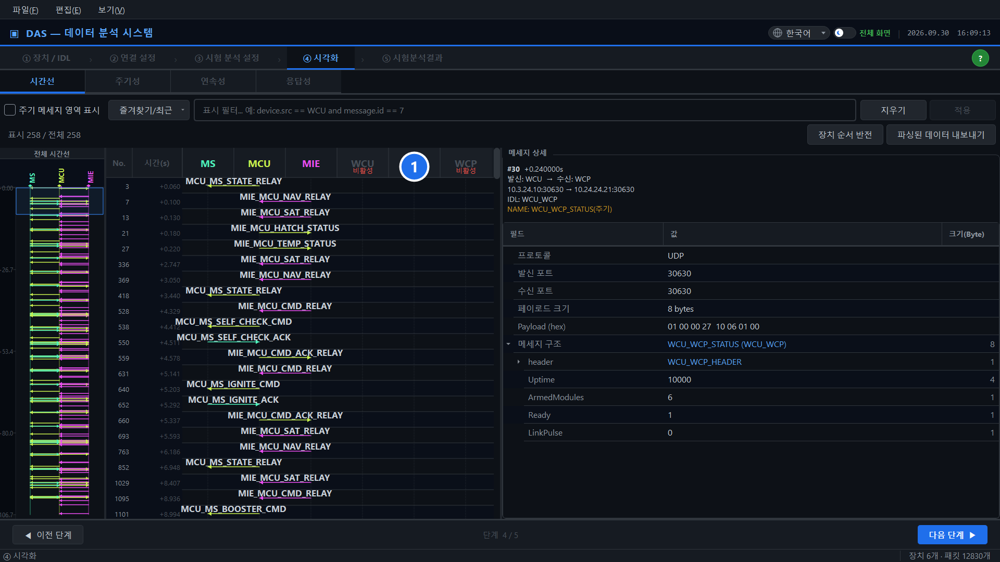

- **1** 장비 열 비활성화. WCU·CMS·WCP 열 헤더 아래 붉은 "비활성" 표시처럼, 관심 없는 장치의 헤더를 클릭해 끄면 그 장치가 보내거나 받는 메시지가 목록과 왼쪽 미니맵에서 통째로 사라집니다 — 예시는 MS·MCU·MIE 세 장비 사이의 흐름만 남기고 나머지를 비활성화한 상태로, 특정 통신 경로만 추적하고 싶을 때 나머지 장치를 꺼서 화면을 단순화하는 데 씁니다. 헤더를 다시 클릭하면 되살아납니다.

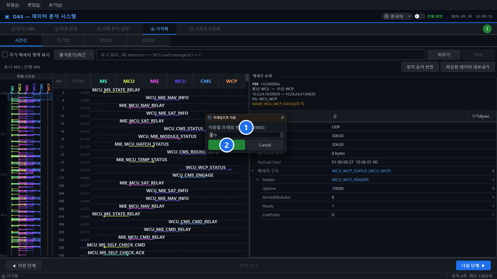

- **1** 이동할 프레임 번호 입력. 라벨의 범위(예: 1~12892)는 캡처 파일에 기록된 마지막 원본 프레임 번호까지이며 — 지원하지 않는 프레임도 번호를 차지하므로 로드된 패킷 수보다 클 수 있습니다 — 이 범위를 벗어나는 번호는 입력할 수 없습니다.
- **2** OK를 누르면 가운데 목록이 그 프레임 번호의 행으로 즉시 스크롤·강조되고 오른쪽 상세도 그 메시지로 갱신됩니다 — 수천 개 메시지를 일일이 스크롤하는 대신, 로그나 다른 도구에서 이미 알고 있는 특정 패킷 번호로 곧장 이동할 때 유용합니다.

## 송신 메시지 전시 관리

④ 시각화의 시간선 하위 탭에서만, 특정 장치가 보내는 메시지 종류를 연결·식별자 변형 단위로 하나씩 숨기거나 다시 보이게 하는 기능입니다. 시간선 화면에서 장비 열 헤더를 우클릭해 "<장비명> 송신 메시지 전시 관리"를 선택하면 열리며, 화면에 보이는 메시지만 줄이는 표시 전용 설정이라 ③ 단계의 메시지 필터·스마트 필터, ④ 주기성· 연속성 그래프 등 다른 어떤 화면에도 영향을 주지 않습니다.

**사용 순서**

1. ④ 시각화 → 시간선 탭에서 관리하려는 장비의 열 헤더를 우클릭하고 "<장비명> 송신 메시지 전시 관리"를 선택합니다 — 이 장치가 발신 측인 연결에서 실제로 보낸 메시지만 대상이며, 이 장치가 수신만 하는 메시지는 여기 나타나지 않습니다 (그런 메시지는 상대 장치 쪽 헤더에서 관리합니다).
2. 창 제목은 "송신 메시지 전시 관리 — <장비명>"이며, 트리는 연결(발신→수신, IDL 이름) 단위로 묶이고 그 아래 실제 관측된 메시지 종류(메시지명·ID·발생 개수· 주기/비주기)가 한 줄씩 자식으로 나열됩니다 — 같은 메시지라도 메시지 식별자 규칙으로 여러 변형(예: GuidanceMode=0, GuidanceMode=1)으로 나뉘어 있다면 변형마다 별도 행으로 나타납니다.
3. 체크박스를 꺼서 개별 메시지(자식 행)를 숨기거나, 연결(부모 행)을 통째로 껐다 켤 수 있습니다 — 위쪽 검색란("검색 (메시지명, ID, IDL, 연결, 장치, 식별자 필드...)")으로 목록을 좁히거나, "전체 선택"/"전체 해제"로 한 번에 다 켜고 끌 수 있습니다.
4. "적용"을 눌러야 실제로 반영됩니다 — 실제로 숨김 상태가 바뀐 경우에만 시간선 목록과 왼쪽 미니맵이 즉시 다시 그려집니다. "취소"를 누르거나 창을 닫으면 체크박스 변경 내용은 모두 버려집니다.

**주의사항**

- [영향 범위] 이 설정은 ④ 시각화의 시간선 목록과 그 왼쪽 미니맵에만 적용됩니다 — 숨긴 메시지도 원본 패킷 데이터에는 전혀 손대지 않으며, ③ 시험 분석 설정의 메시지 트리·개수, ④ 주기성/연속성 그래프, ⑤ 성적서의 측정값에는 아무 영향이 없습니다.
- [독립성] 연결(링크)별로, 그리고 식별자 변형별로 완전히 독립적으로 켜고 끕니다 — 같은 메시지 ID라도 연결이 다르면 따로 숨겨야 하고, 메시지 식별자로 나뉜 변형도 하나를 숨긴다고 다른 변형까지 함께 숨겨지지 않습니다.
- [저장 정책] 이 창의 설정은 디스크에 전혀 저장되지 않는 임시(메모리) 상태입니다 — ".das-idl.json"에도, 설정 저장(JSON)에도 포함되지 않으며 프로그램을 다시 시작하면 사라집니다.
- [초기화 시점] 새 PCAPNG 파일을 로드하거나 새 실시간(라이브) 세션을 시작할 때마다 자동으로 "전부 표시" 상태로 초기화됩니다 — 반대로 ①·② 단계에서 장치· 연결·IDL 설정만 고치고 PCAPNG를 다시 로드하지 않으면, 지금까지 골라 둔 숨김 상태는 그대로 유지됩니다.
- [빈 상태] 이 장치가 실제로 보낸 메시지가 현재 분석 데이터에 하나도 없으면 "현재 분석 데이터에서 <장비명>이 송신한 메시지를 찾을 수 없습니다." 안내만 표시되고 목록/검색/전체 선택 버튼은 보이지 않습니다.
- [문제 해결] 시간선에서 특정 메시지가 안 보이는데 ③ 단계 필터·스마트 필터는 모두 켜져 있다면, 이 기능으로 그 장치의 해당 메시지(또는 변형)를 꺼 둔 것은 아닌지 먼저 확인하세요 — 다른 화면(주기성·연속성 등)에는 여전히 나타나는 것이 정상입니다.

## 시간선 표시 필터

④ 시각화의 시간선 하위 탭 위쪽 검색창에 조건식을 입력해 화면에 보이는 메시지를 더 세밀하게 좁히는 기능입니다 — 원본 패킷 데이터나 ③ 단계의 메시지 필터·스마트 필터, 다른 어떤 화면에도 영향을 주지 않는 시간선 전용 표시 필터입니다.

**사용 순서**

1. 검색창에 조건식을 입력하는 동안은 문법만 검사됩니다 — 테두리가 초록이면 유효한 표현식, 빨강이면 오류이며 오류 위치와 이유가 툴팁으로 표시됩니다.
2. Enter를 누르거나 "적용" 버튼을 눌러야 실제로 목록이 다시 걸러집니다 — 입력만 하고 적용하지 않으면 기존 결과가 그대로 유지됩니다.
3. 필드 이름 일부를 입력하면 알려진 필드·연산자·값(장비명, 메시지명, IDL명, tcp/udp 등) 자동완성 목록이 뜹니다.
4. ==, !=, >, >=, <, <= 비교, contains(문자열 포함), matches(정규식), and/or/not, 괄호를 지원합니다 — 예: device.src == WCU and message.id == 7
5. "지우기" 버튼은 입력창과 실제 적용된 필터를 모두 초기화합니다.
6. "즐겨찾기/최근" 드롭다운에서 이전에 적용했던 필터를 고르면 입력창에 채워지고 즉시 적용됩니다 — 현재 입력을 이름 붙여 즐겨찾기로 저장하거나, 즐겨찾기 관리 창에서 이름을 바꾸고 삭제할 수 있습니다.
7. 오른쪽 "표시 N / 전체 M"에서 N은 이 필터까지 통과해 실제로 보이는 개수, M은 이 필터를 적용하기 직전(장비 열 비활성화·③ 메시지 필터·스마트 필터·송신 메시지 전시 관리까지)까지 통과한 개수입니다.

**주의사항**

- 이 필터는 기존 필터들(장비 열 비활성화, ③ 메시지 필터, 스마트 필터, 송신 메시지 전시 관리) 뒤에 마지막으로 추가 적용됩니다 — 어떤 메시지가 이미 다른 필터로 숨겨져 있다면 이 필터를 지워도 다시 나타나지 않을 수 있습니다.
- 즐겨찾기와 최근 필터(최대 10개)는 프로그램을 다시 시작해도, 새 PCAPNG를 불러와도 그대로 유지됩니다 — 다만 적용된 필터 자체는 새 PCAPNG를 불러오면 초기화됩니다(같은 캡처 안에서 다른 단계·탭에 갔다가 돌아오는 것만으로는 초기화되지 않습니다).
- 선택돼 있던 메시지가 이 필터로 가려지면 선택과 오른쪽 상세 패널이 초기화됩니다.

## 메시지 상세

시간선 화면은 왼쪽 미니맵, 가운데 메시지 시퀀스/목록, 오른쪽 메시지 상세 패널, 세 영역이 하나로 맞물려 동작합니다. 미니맵에서 전체 캡처 중 지금 보고 있는 구간의 위치를 가늠하고, 가운데 목록에서 실제 메시지 흐름을 순서대로 훑다가, 특정 메시지를 클릭하면 그 메시지의 IDL 구조체가 오른쪽에 필드/값/크기 트리로 펼쳐집니다 — 아래 ①②③ 설명은 스크린샷의 각 영역이 정확히 무엇을 보여주고 서로 어떻게 연동되는지를 하나씩 짚은 것입니다.

**사용 순서**

1. 가운데 목록(③)에서 확인하려는 메시지 행을 클릭합니다 — 선택된 행은 파란색으로 강조되고, 오른쪽 상세(②)가 그 메시지 내용으로 즉시 갱신됩니다.
2. 상세 패널(②) 맨 위에서 프레임 번호(#3), 캡처 시작 대비 발생 시각(+0.060000s), 발신 → 수신 장치 이름, 실제 IP:포트 쌍, 그리고 이 메시지가 매칭된 IDL 이름을 확인합니다.
3. 그 아래 필드 표에서 프로토콜(UDP/TCP)·발신/수신 포트·페이로드 크기(byte)·원본 페이로드 hex 값을 확인합니다.
4. "메시지 구조" 트리를 펼쳐 IDL에 정의된 필드 하나하나의 해석된 값과 크기(byte)를 확인합니다 — header처럼 하위 필드를 더 가진 구조체 노드는 펼침/접힘만 가능하고, 실제 값은 리프(leaf) 필드에만 표시됩니다.
5. 왼쪽 미니맵(①)을 드래그하면 가운데 목록이 그 시간대로 즉시 점프합니다 — 반대로 가운데 목록을 스크롤하면 미니맵의 강조 박스도 함께 움직여, 지금 보고 있는 구간이 전체 캡처의 어느 지점인지 항상 알 수 있습니다.

**주의사항**

- 스마트 필터가 이산 필드로 분류한 값이 직전 발생과 달라졌다면 상세 트리에서 강조 표시됩니다 — 합격/불합격 판정이 아니라 "값이 바뀌었다"는 표시일 뿐입니다.
- IDL에 lsb/msb·bitsize 주석이 있는 필드는 원시 바이트가 아니라 스케일이 적용된 물리값과 단위로 표시됩니다 (예: Lat_raw → 37.001123 deg).
- 장비 열 헤더의 체크박스를 끄면 그 장치가 가운데 목록과 미니맵에서 함께 사라져 특정 통신 경로만 남겨 볼 수 있습니다.

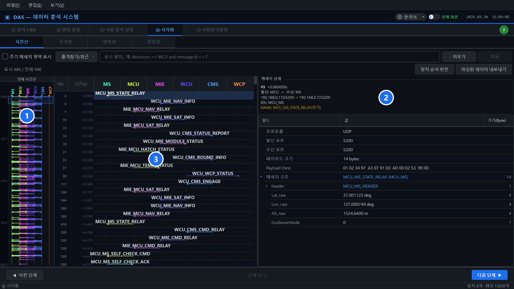

- **1** 왼쪽 미니맵 — "전체 시간선". 지금 열려 있는 PCAPNG 전체 구간을 압축된 하나의 축소판으로 보여줍니다. 맨 위 MS·MCU·MIE·WCU·CMS·WCP 라벨은 가운데 목록의 장비 열과 같은 순서·같은 색으로 매칭되고, 그 아래로 뻗은 색색의 화살표 선 하나하나가 실제 메시지 한 건에 대응합니다. 테두리가 있는 사각형은 지금 가운데 목록에 표시 중인 시간 구간을 나타내며, 이 사각형을 마우스로 드래그하면 수천 개 메시지를 일일이 스크롤하지 않고도 원하는 시점으로 즉시 이동할 수 있습니다. 왼쪽 가장자리의 +26.7, +53.4, +80.0 같은 숫자는 그 지점까지의 경과 시간(초)이므로, 미니맵만 훑어봐도 캡처 전체에서 트래픽이 몰리거나 끊긴 구간(예: 특정 장비가 통신을 멈춘 구간)을 한눈에 짚어낼 수 있습니다.
- **2** 오른쪽 "메세지 상세" 패널. 가운데 목록(③)에서 방금 클릭한 메시지 단 하나에 대한 전체 정보를 보여주며, 다른 행을 클릭할 때마다 통째로 다시 그려집니다. 맨 위 헤더 줄에는 프레임 번호(#3)와 캡처 시작 시각 기준 발생 시각(+0.060000s), "발신: MCU → 수신: MS"처럼 ①단계에서 등록한 장치 이름으로 표시되는 통신 방향, 실제 192.168.x.x:포트 형태의 IP/포트 쌍, 이 메시지가 어떤 IDL 정의(MCU_MS)와 매칭됐는지, 그리고 메시지 이름과 주기/비주기 여부(NAME: MCU_MS_STATE_RELAY(주기))가 차례로 나옵니다. 그 아래 필드 표는 프로토콜·발신 포트·수신 포트·페이로드 크기(byte)·원본 payload의 16진수 값을 보여주고, "메시지 구조" 트리는 그 payload를 IDL 구조체 그대로 해석해 필드명·값·크기(byte) 순으로 펼쳐 보여줍니다. header처럼 하위 필드를 여러 개 가진 노드는 화살표를 눌러 더 펼칠 수 있고, Lat_raw·Lon_raw·Alt_raw처럼 IDL에 스케일 정보(lsb/msb)가 있는 필드는 원시 바이트값이 아니라 이미 단위가 붙은 물리값(37.001123 deg 등)으로 표시됩니다.
- **3** 가운데 메시지 시퀀스/목록. 캡처된 패킷 하나가 한 행이며, No. 열은 PCAPNG상의 실제 프레임 번호, 시간(s) 열은 캡처 시작 대비 경과 시간(머리글을 클릭하면 절대 시간 표시로 바뀜)을 나타냅니다. 그 오른쪽으로는 ①단계에서 등록한 장치 이름 그대로 세로 열(MS/MCU/MIE/WCU/CMS/WCP)이 이어지고 — 열 순서는 통신 관계에 따라 자동으로 배정되며 "장치 순서 반전"이나 헤더 드래그로 바꿀 수 있습니다 — 메시지 이름(예: WCU_MIE_NAV_INFO)은 밑줄과 함께 표시되면서 화살표 선이 보낸 장치의 열에서 받는 장치의 열까지 이어져, 어느 장비에서 어느 장비로 무엇이 전달됐는지를 이름과 화살표 방향만으로 바로 읽을 수 있습니다. 지금 강조된 3번 행처럼 아무 행이나 클릭하면 그 메시지가 선택되어 오른쪽 상세(②)가 즉시 갱신되고, 이 목록을 스크롤하면 왼쪽 미니맵(①)의 강조 박스도 함께 이동합니다. 장비 열 헤더를 클릭해 끄면 그 장치가 관련된 메시지가 통째로 숨겨지므로, 특정 두 장비 사이의 통신만 골라서 순서대로 추적하고 싶을 때 나머지 장치를 꺼서 흐름을 단순화할 수 있습니다.

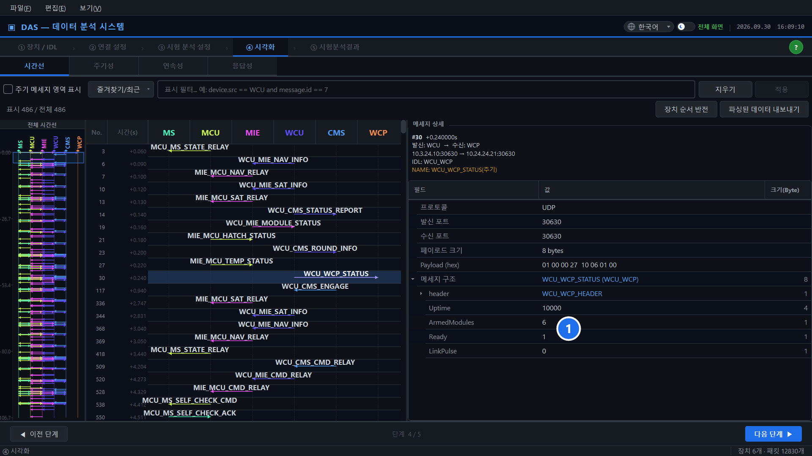

- **1** 또 다른 예시. #30 WCU_WCP_STATUS 메시지가 선택된 경우로, 왼쪽 미니맵·가운데 목록·오른쪽 상세 패널이 서로 연동되는 방식은 앞서 본 예시와 완전히 동일합니다 — 다만 메시지 구조가 header/Uptime/ArmedModules/Ready/LinkPulse로 전혀 다른데, 이는 IDL마다 정의하는 필드 구성이 메시지 종류별로 완전히 다르기 때문입니다.

## 주기 분석

IDL이 주기로 선언한 메시지의 연속 발생 간 시간 간격을 라인 차트로 분석해 누락·지연·지터를 확인합니다 — 아래 라인 차트 화면의 ①②③ 설명은 탭 전환, 그래프 읽는 법, 시리즈 목록을 각각 짚은 것입니다.

**사용 순서**

1. 오른쪽 목록에서 볼 메시지 종류(시리즈)를 체크합니다.
2. 그래프의 점을 클릭하면 메뉴가 뜹니다 — "해당 노드에 대한 정보 보기"를 고르면 그 발생 하나의 프레임/시간/간격/평균 대비 정보가, "해당 주기메세지에 대한 정보 보기"를 고르면 그 종류 전체의 통계 요약이 고정 표시됩니다.
3. 같은 메뉴의 "해당 주기메세지만 보기"/"해당 주기메세지를 전시에서 제외"로 오른쪽 범례를 거치지 않고 바로 그 종류만 남기거나 뺄 수 있습니다.
4. 필요하면 그래프 위에서 우클릭해 y=a 기준선을 추가하고, 그 아이콘을 드래그해 옮기거나 다시 우클릭해 삭제할 수 있습니다.

**주의사항**

- 그래프가 비어 있다면 IDL의 PERIODIC 선언, 해당 메시지의 실제 발생 횟수(2회 이상 필요), ③ 단계 필터 상태를 확인하세요.
- 노드 정보 팝업과 툴팁의 시간 간격·주파수는 지금 Y축 격자 간격의 100분의 1 자리까지 보여 줍니다(시간 간격은 소수 셋째 자리, 주파수는 여섯째 자리가 최대). 이 자리에서 0으로 보일 만큼 작은 표준편차는 유효숫자 두 자리로 표시됩니다.

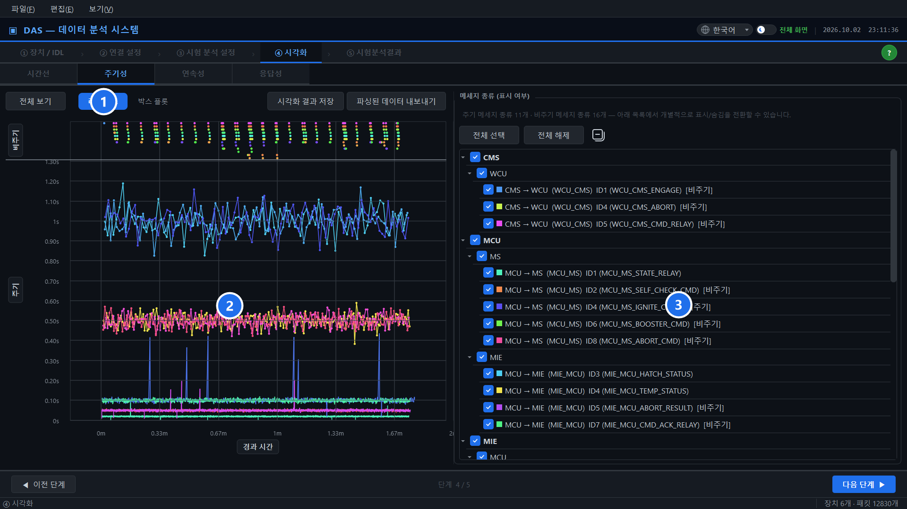

- **1** 상단 보기 전환과 저장. "라인 차트"/"박스 플롯" 버튼으로 같은 주기 메시지 데이터를 서로 다른 방식으로 봅니다 — 지금처럼 "라인 차트"가 눌려 있으면 시간 흐름에 따른 간격 변화를, "박스 플롯"으로 바꾸면 종류별 분포 요약을 봅니다. "전체 보기"는 확대/축소와 스크롤을 처음 상태로 되돌리고, "시각화 결과 저장" 버튼은 지금 화면에 그려진 그래프 그대로를 PNG 또는 JPG 이미지 파일로 저장하며, 그 옆 "파싱된 데이터 내보내기" 버튼은 이미지가 아니라 오른쪽 범례에서 체크된 모든 메시지 종류의 실제 분석 데이터(발생 시각·프레임·간격·주기 또는 주파수 등)를 CSV/Excel로 내보냅니다 — 전체 데이터 또는 지금 화면에 보이는 구간만 고를 수 있습니다. 일반 필터(③ 단계 체크박스)는 이 내보내기에도 반영되지만, 스마트 필터는 주기성 탭 자체에 영향을 주지 않으므로 내보내기 결과에도 영향이 없습니다.
- **2** 라인 차트 (메인 그래프). X축은 캡처 시작부터의 경과 시간(0m, 0.33m, 0.67m…), Y축은 같은 메시지의 연속된 두 발생 사이 시간 간격(초)입니다. 선 하나가 메시지 종류(시리즈) 하나에 대응하며 오른쪽 목록의 색과 그대로 매칭되므로, 예시에서 1초 근처에 몰려 있는 선들은 1Hz, 0.5초 근처는 2Hz 주기로 설계된 메시지들이고 맨 아래 0.1초대의 촘촘한 선은 10Hz급 고빈도 메시지입니다. 평소보다 값이 튀는 뾰족한 봉우리는 그 시점에 실제 발생 간격이 갑자기 벌어졌다는 뜻으로, 메시지 누락이나 일시적 지연을 의심할 수 있는 지점입니다. 그래프 맨 위 "비주기" 영역에는 비주기 메시지의 각 발생이 점으로 찍힙니다. 점 하나를 클릭하면 뜨는 메뉴에서 그 발생의 프레임 번호·시간·간격·평균 대비 편차 정보가 담긴 콜아웃을 열 수 있습니다.
- **3** 우측 "메세지 종류 (표시 여부)" 목록. 이 캡처의 주기·비주기 메시지 종류가 송신 장비 → 수신 장비 두 단으로 묶여 나열되고(비주기 종류는 이름 뒤에 [비주기]가 붙습니다), 각 항목 앞 색상 사각형이 왼쪽 차트에서 그 메시지가 그려지는 색입니다. 체크박스를 꺼서 관심 없는 시리즈를 차트에서 숨기면, 여러 선이 겹쳐 알아보기 어려울 때 특정 메시지 하나(또는 몇 개)의 추이만 골라 볼 수 있습니다. "전체 선택"/"전체 해제" 버튼으로 한 번에 다 켜거나 끌 수 있고, 바로 옆 아이콘 버튼으로 목록을 모두 접거나 펼칠 수 있습니다.

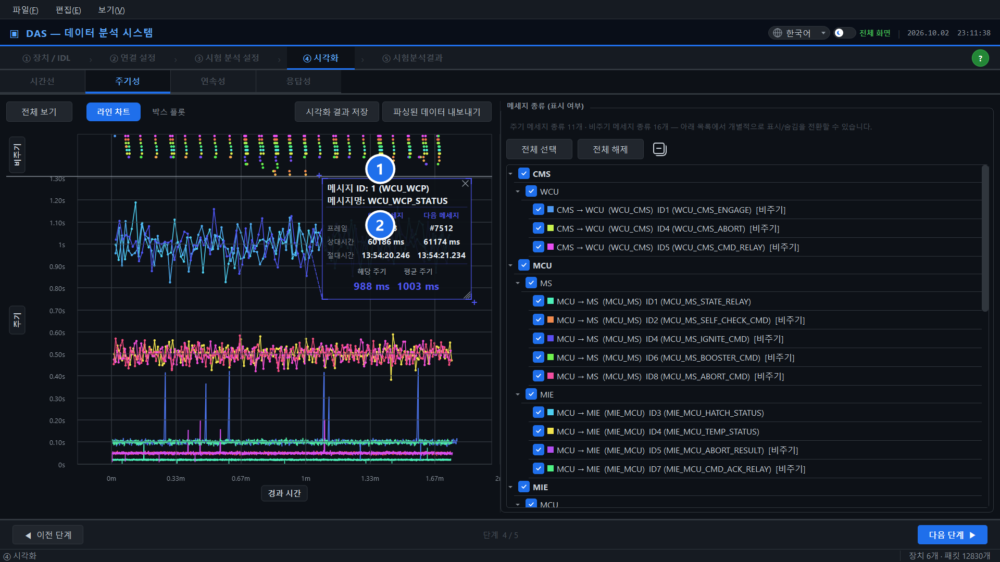

- **1** 팝업 제목과 닫기(X). "메시지 ID: 1 (WCU_WCP)"와 "메시지명: WCU_WCP_STATUS" 두 줄로 지금 고정된 점이 어느 메시지 종류의 발생인지 보여줍니다 — 이 발생 하나의 정보 대신 그 메시지 종류 전체의 통계를 보려면 그래프의 점을 다시 클릭해 뜨는 메뉴에서 "해당 주기메세지에 대한 정보 보기"를 고르세요. 이런 노드 정보 팝업은 최대 3개까지 함께 띄울 수 있고, 제목 줄을 끌어 원하는 곳으로 옮길 수 있습니다. 오른쪽 아래 모서리를 끌면 가로·세로 비율을 유지한 채 팝업 크기(글자 포함)를 바꿀 수 있고, 새로 여는 팝업도 그 크기로 열립니다. X를 누르면 그 팝업만, 차트의 빈 곳을 클릭하면 모두 닫힙니다.
- **2** 이전/다음 메세지 비교와 주기 값. 지금 클릭한 점 앞뒤 두 발생의 프레임 번호·상대시간·절대시간을 나란히 보여주고, 그 아래 "해당 주기"(이번 간격, 988ms)와 "평균 주기"(이 메시지 종류 전체의 평균 간격, 1003ms)를 비교해 지금 이 발생이 평소보다 빠른지 느린지 바로 판단할 수 있습니다.

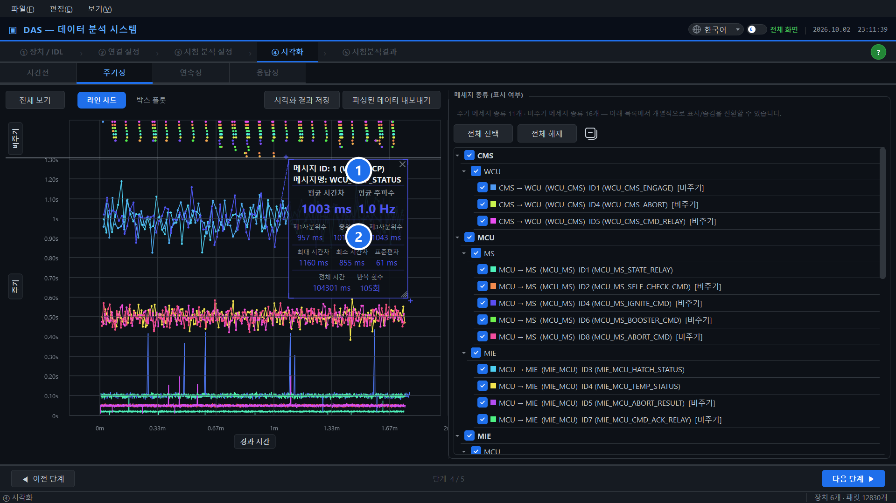

- **1** 이 화면(종류 전체 통계)에서 특정 발생 하나의 상세 정보로 돌아가려면, 제목을 클릭하는 것이 아니라 그래프의 점을 다시 클릭해 뜨는 메뉴에서 "해당 노드에 대한 정보 보기"를 고르세요.
- **2** 메시지 종류 전체 통계. 평균 시간차/평균 주파수(1003ms, 1.00Hz)를 크게 보여주고, 그 아래 제1사분위수·중위값·제3사분위수로 분포의 중심을, 최대/최소 시간차·표준편차로 흔들림의 정도를, 전체 시간과 반복 횟수(104301ms 동안 105회)로 이 메시지 종류가 캡처 내내 얼마나 꾸준히 나타났는지를 한 번에 확인합니다.

## Box Plot

메시지 종류별 간격 분포를 중앙값·사분위 범위·이상치로 요약해 한눈에 비교합니다 — 아래 전체 보기 화면의 ①②③ 설명은 박스 하나하나를 어떻게 읽는지를 짚은 것입니다.

**사용 순서**

1. 주기성 탭에서 박스 플롯 버튼을 누릅니다.
2. 박스를 클릭하면 중앙값/사분위수/이상치 비율 등 통계 콜아웃이 뜹니다.
3. 전체 보기로 모든 메시지 종류를 한 화면에서 비교하거나, 하나만 골라 자세히 봅니다.

**주의사항**

- 특정 시점의 발생을 보려면 라인 차트를, 종류별 분포 전체를 비교하려면 박스 플롯을 사용하세요.

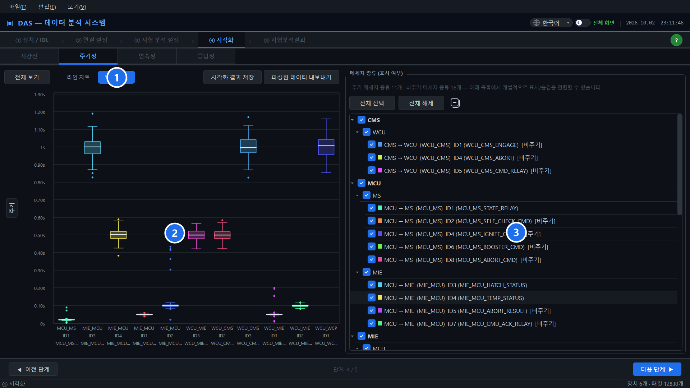

- **1** 상단 탭 — "박스 플롯" 선택됨. 같은 주기 메시지 데이터를 라인 차트 대신 통계 요약 형태로 봅니다. 왼쪽 위 "전체 보기" 버튼을 누르면 지금처럼 선택된 모든 메시지 종류의 박스를 한 화면에 나란히 비교할 수 있고, 특정 시리즈 하나만 우측 목록에서 골라 선택하면 그 메시지 하나의 박스만 확대해서 볼 수 있습니다.
- **2** 박스 플롯 차트. 각 세로 박스 하나가 메시지 종류(시리즈) 하나의 발생 간격 분포를 요약합니다 — 박스 가운데 굵은 선이 중앙값, 박스의 위아래 테두리가 각각 3사분위수(Q3)·1사분위수(Q1), 박스 위아래로 뻗은 수염(whisker)이 정상 범위의 최댓값·최솟값, 그리고 수염 밖에 찍힌 낱개 점들이 이상치(outlier)입니다. 박스 높이가 낮고 수염이 짧으면 그 메시지의 발생 간격이 항상 일정했다는 뜻이고, 박스 위아래에 점이 여러 개 찍혀 있으면 그 메시지에서 간격이 비정상적으로 벌어지거나 짧아진 경우가 여러 번 있었다는 뜻입니다. 박스 아래에는 메시지 이름이 세 줄(IDL·ID·구조체)로 표시되고, 박스를 클릭하면 중앙값·사분위수·이상치 비율 등을 담은 통계 콜아웃이 뜹니다.
- **3** 우측 시리즈 목록. 라인 차트와 같은 목록·같은 색 규칙을 그대로 공유합니다 — 여기서 체크박스를 끄면 그 메시지의 박스가 차트에서 사라지므로, 너무 많은 박스가 한 화면에 몰려 있을 때 비교하고 싶은 몇 종류만 남겨 간격을 넓게 볼 수 있습니다.

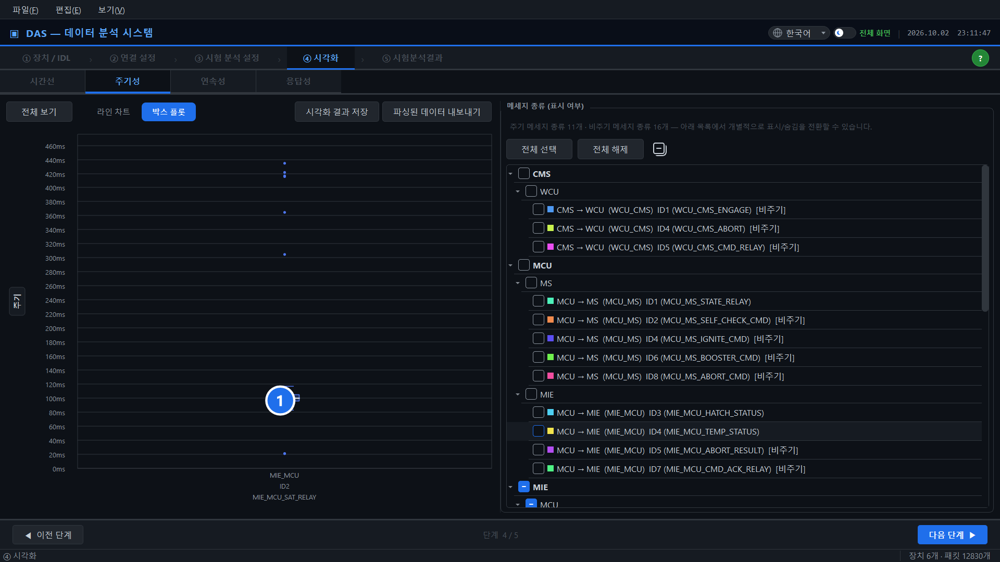

- **1** 단일 시리즈 보기. 오른쪽 목록에서 하나(MIE_MCU ID2)만 체크하면 그 메시지의 박스만 확대되어, 전체 보기에서는 다른 박스들 사이에 묻혀 잘 보이지 않던 사분위 범위·수염·이상치 점들을 세밀하게 볼 수 있습니다 — 박스 위아래의 낱개 점들이 정상 범위를 벗어난 이상치(outlier) 발생들입니다.

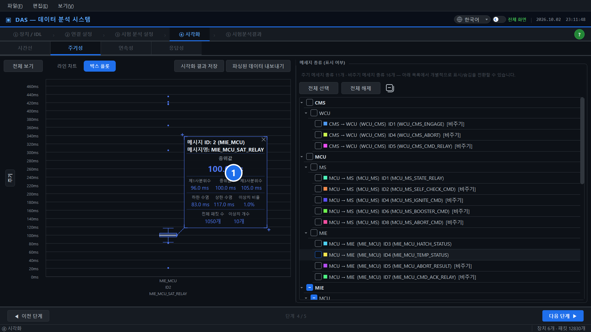

- **1** 박스를 클릭하면 뜨는 통계 콜아웃. 중위값(100ms)을 크게 보여주고, 제1/3사분위수(96/105ms)로 박스의 실제 범위를, 하한/상한 수염(83/117ms)으로 정상 변동 범위를, "이상치 비율"(1.0%)과 "전체 패킷 수/이상치 개수"(1050개 중 10개)로 이 메시지가 전체 발생 대비 얼마나 자주 정상 범위를 벗어났는지를 함께 확인합니다.

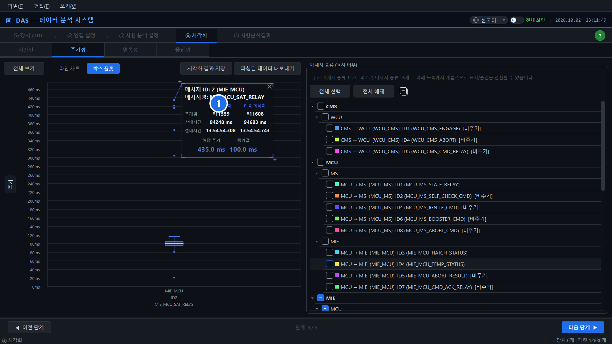

- **1** 수염 밖 이상치 점을 클릭하면 뜨는 콜아웃. 그 이상치 발생 앞뒤의 프레임 번호·상대시간·절대시간을 보여주고, "해당 주기"(435ms)와 "중위값"(100ms)을 나란히 비교해 이 발생이 평소 간격의 4배 이상 벌어졌다는 것을 바로 확인할 수 있습니다 — 실제로 어떤 시각에 무슨 지연이 있었는지 원인을 추적할 때의 출발점이 됩니다.

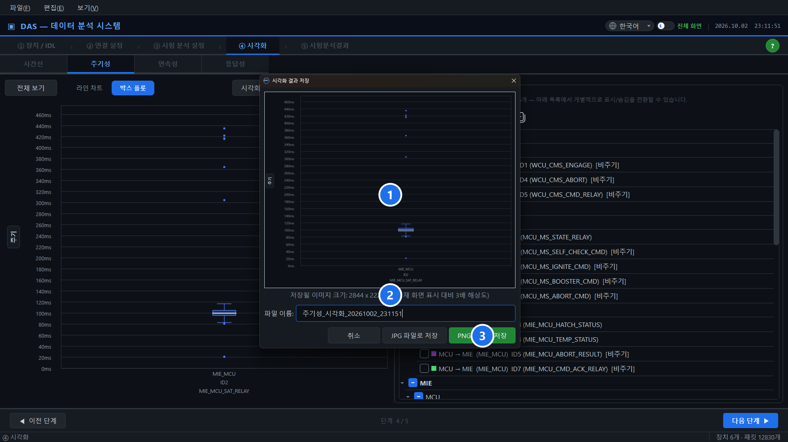

- **1** 저장될 박스 플롯 미리보기. 지금 화면의 박스·수염·이상치 점이 그대로 이미지로 저장될 모습입니다.
- **2** "저장될 이미지 크기: 2844 x 2229 px (현재 화면 표시 대비 3배 해상도)" — 라인 차트 저장과 동일하게 고해상도로 저장되어 보고서에 확대해 넣어도 흐려지지 않습니다.
- **3** 파일 이름을 입력한 뒤 PNG(선명도 우선) 또는 JPG(용량 우선)로 저장합니다.

## 연속성 분석

주기 메시지 안의 숫자 필드 하나를 골라 시간에 따른 값 변화(추세, 급변, 결측)를 확인합니다 — 아래 화면의 ①②③ 설명은 툴바·그래프·필드 트리를 각각 짚은 것입니다.

**사용 순서**

1. 오른쪽 필드 트리에서 송신 장치 → 수신 장치 → 메시지 종류 → 구조체 → 숫자 필드 순서로 펼쳐 하나를 고릅니다.
2. 왼쪽 그래프의 제목과 Y축 단위를 확인합니다.
3. 그래프의 점을 클릭하면 메뉴가 뜹니다 — "해당 노드에 대한 정보 보기"로 그 발생의 프레임/시간/필드값을, "해당 주기메세지에 대한 정보 보기"로 그 필드 전체의 평균·사분위·표준편차 통계를 고정 표시합니다.
4. "선택 해제" 버튼을 누르면 필드 트리의 선택이 풀리고 그래프도 빈 상태로 돌아갑니다.

**주의사항**

- IDL의 lsb 또는 msb/bitsize 주석이 있는 필드는 스케일이 적용된 물리값과 단위로 표시됩니다.
- 노드 정보 팝업과 툴팁의 값은 지금 Y축 격자 간격의 100분의 1 자리까지 보여 주되, 필드 자체의 분해능보다 자세히 보이지는 않습니다 — lsb=0.1 필드는 소수 첫째 자리까지, 스케일 없는 정수 필드는 정수로 표시됩니다.
- 구조체 부모 노드는 탐색용일 뿐이며, 실제 그래프는 숫자 잎 필드를 선택해야 그려집니다.
- 주기성 탭과 달리 한 번에 필드 하나만 선택할 수 있어 범례가 없으며, 우클릭으로 y=a 기준선을 추가·이동·삭제하는 방식은 주기성 탭과 같습니다.
- 노드 정보 콜아웃 제목은 메시지 정보·메시지명·필드 이름 세 줄입니다. 콜아웃은 최대 3개까지 동시에 띄울 수 있고, 제목 줄을 끌어 옮기고 오른쪽 아래 모서리를 끌어 비율을 유지한 채 크기를 바꿀 수 있습니다. X로 하나씩 닫거나 그래프의 빈 곳을 클릭해 한꺼번에 닫습니다 — 주기성 탭과 같습니다. 다른 필드를 보다가 돌아오면 그 필드에서 띄워 둔 팝업·확대 배율·y=a 기준선이 그대로 남아 있습니다.

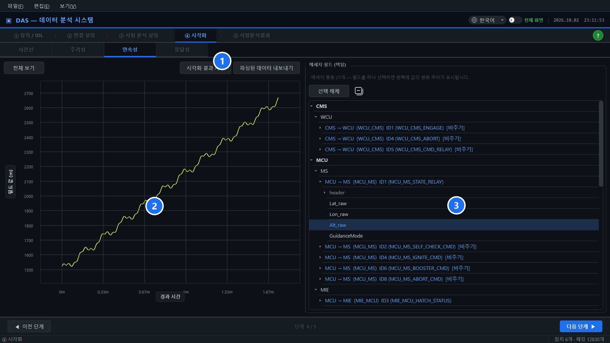

- **1** 상단 툴바. "전체 보기"는 지금 선택된 필드 그래프의 확대/축소를 초기 상태로 되돌리고, "시각화 결과 저장"은 지금 화면의 그래프를 PNG 또는 JPG 이미지로 내보냅니다. 그 옆 "파싱된 데이터 내보내기"는 이미지가 아니라 지금 선택된 필드 하나의 실제 값 변화 데이터(발생 시각·프레임·필드값 등)를 CSV/Excel로 내보내며, 전체 데이터 또는 지금 화면에 보이는 구간만 고를 수 있습니다 — 일반 필터는 반영되지만 스마트 필터는 이 탭 자체에 영향을 주지 않으므로 내보내기 결과에도 영향이 없습니다. 연속성 탭은 주기성 탭과 달리 한 번에 필드 하나만 선택할 수 있으므로, 라인 차트/박스 플롯 같은 보기 전환 버튼 자체가 없습니다.
- **2** 필드 값 추이 그래프. X축은 경과 시간, Y축은 오른쪽에서 고른 숫자 필드의 실제 값(스케일이 적용된 물리값)입니다. 예시는 Alt_raw(고도)가 선택된 상태로, 시간이 지나며 값이 완만하게 오르는 구간과 군데군데 미세하게 출렁이는 구간이 함께 보이는데, 이런 완만한 상승/하강 추세는 실제 비행 프로파일(예: 상승 중인 고도)을 반영하는 것이고 갑작스러운 수직 단절이나 값이 0으로 뚝 떨어지는 구간이 있다면 결측이나 센서 이상을 의심할 지점입니다. 그래프 위 아무 점이나 클릭하면 그 발생의 프레임 번호·시간·필드값을 확인할 수 있습니다.
- **3** 우측 "메세지 필드 (택일)" 트리. 송신 장치(예: MCU) → 수신 장치(MS) → 메시지 종류(MCU → MS (MCU_MS) ID1 (MCU_MS_STATE_RELAY)) → 그 안의 구조체(header) → 실제 숫자 필드(Lat_raw, Lon_raw, Alt_raw, GuidanceMode) 순서로 펼쳐지며, 예시처럼 Alt_raw를 클릭해 선택해야 왼쪽 그래프가 그려집니다. header처럼 하위 필드를 여러 개 가진 구조체 노드 자체는 펼치기 전용이라 선택해도 그래프가 그려지지 않으며, 반드시 맨 끝의 숫자 리프(leaf) 필드까지 펼쳐 들어가 선택해야 합니다. "선택 해제" 바로 옆 아이콘 버튼으로 트리를 모두 접거나 펼칠 수 있습니다.

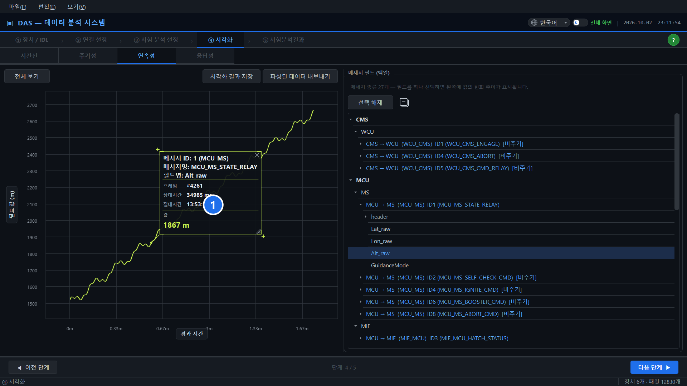

- **1** 점을 클릭한 뒤 메뉴에서 "해당 노드에 대한 정보 보기"를 고르면 뜨는 콜아웃. 제목 세 줄("메시지 ID: 1 (MCU_MS)" / "메시지명: MCU_MS_STATE_RELAY" / "필드명: Alt_raw")로 어느 메시지의 어느 필드인지 표시되고, 그 발생의 프레임 번호·상대시간·절대시간과 함께 그 시점의 실제 필드 값(1867m)을 보여줍니다 — 그래프 곡선의 굴곡이 정확히 몇 미터였는지 숫자로 확인하고 싶을 때 고릅니다.

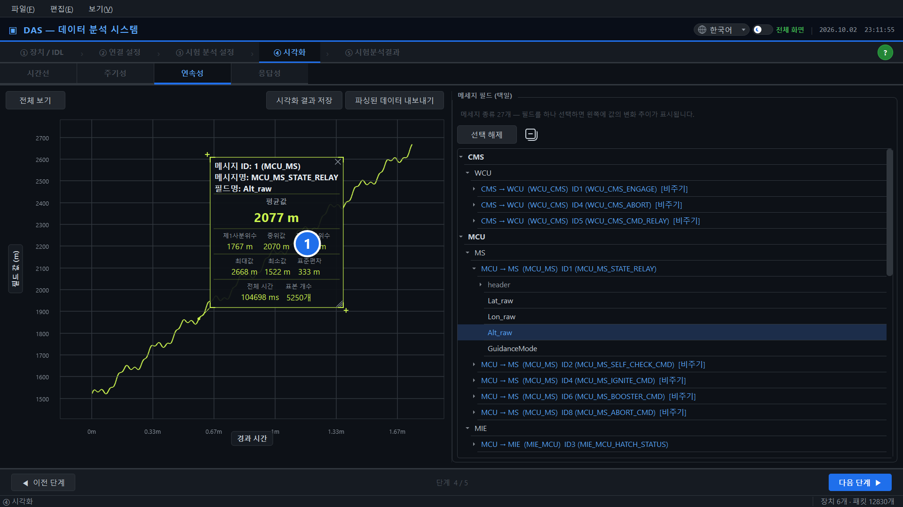

- **1** 점을 클릭한 뒤 메뉴에서 "해당 주기메세지에 대한 정보 보기"를 고르면 뜨는 필드 전체 통계. 평균값(2077m)을 크게 보여주고, 제1사분위수·중위값·제3사분위수, 최대값·최소값·표준편차, 그리고 전체 시간과 표본 개수(104698ms 동안 5250개)로 이 필드가 캡처 전체에서 어떤 범위로 얼마나 촘촘히 움직였는지 한 번에 요약해 확인할 수 있습니다.

## 응답성 분석

주기 메시지 종류 두 개를 각각 요청과 응답으로 지정해 관계를 정의하면, PCAP의 시간 순서에 따라 각 요청을 뒤따르는 응답과 연결해 요청부터 응답까지 걸린 시간(응답시간)을 시계열로 보여줍니다. 패킷을 수정하거나 새 데이터를 만들지 않는 분석 전용 기능입니다.

**사용 순서**

1. 요청-응답 관계는 이 탭이 아니라 ③ 시험 분석 설정에서 정의합니다 -- 그 탭의 "관계 추가"를 누르면 요청/응답 각 줄에 읽기 전용 표시란과 "선택..." 버튼이 있는 팝업이 열립니다. 표시란에는 직접 타이핑할 수 없고, 버튼을 눌러 뜨는 검색 가능한 메시지 목록(주기 메시지만 표시)에서 실제 메시지를 고릅니다. 같은 이름의 메시지도 송신·수신 장치와 IDL로 구분되어 각각 별도 행으로 나오므로 혼동 없이 고를 수 있습니다. 색상을 정하면(관계 이름은 따로 입력하지 않고 요청→응답 메시지 표시명을 그대로 조합해 자동으로 붙습니다) 이 응답성 탭이 곧바로 반영합니다 -- 여기서는 관계 목록의 체크박스로 차트 표시 여부만 고르고, 행을 선택하면 아래에서 상세를 볼 수 있습니다.
2. 그래프의 X축은 요청이 발생한 경과 시간, Y축은 응답시간(ms)입니다 -- 점이나 이상 마커를 선택하면 오른쪽 아래 "선택 이벤트 상세"가 펼쳐져 판정(정상/누락/중복/고아/대기)의 근거가 되는 요청·응답 프레임·시각·응답시간을 보여줍니다. 아무 것도 선택하지 않은 동안에는 이 패널이 한 줄 안내만 남기고 접혀 있습니다. 프레임이 있는 요청/응답 블록마다 기본 이동 버튼 "시간선에서 보기"와, 주기성·연속성으로도 이동할 수 있는 "다른 화면에서 보기" 메뉴가 함께 나타납니다.
3. "전체 보기"로 확대/이동을 초기화하고, "시각화 결과 저장"으로 현재 그래프를 PNG/JPG로, "선택된 데이터 내보내기"로 표시 체크된 관계의 정상·이상 이벤트를 CSV/Excel로 저장할 수 있습니다.

**주의사항**

- 다음 요청이 오기 전까지 응답이 한 번도 없으면 "응답 누락"(붉은 하이라이트 + X 마커), 두 번 이상 있으면 "중복 응답"(첫 응답만 대표 응답시간으로 쓰고 나머지는 주황색 하이라이트 + 겹친 원 마커), 어떤 요청 구간에도 속하지 않는 응답(대개 첫 요청보다 먼저 발생)은 "고아 응답"(보라색 역삼각형)으로 표시됩니다 — 세 경우 모두 실제 응답시간 값이 없으므로 0ms로 대체해 그리지 않고, 누락 앞뒤의 정상 점도 선으로 잇지 않습니다.
- 그래프는 대시보드가 아니라 ④ 시각화의 네 번째 하위 탭입니다 -- 시간선/주기성/연속성이 공유하는 시간 북마크·구간 영역을 이 탭에서도 그대로 보고 우클릭으로 추가·수정·삭제할 수 있으며, 어느 탭에서 바꾸든 나머지 세 탭에 즉시 반영됩니다. 구간을 우클릭해 "구간 수정..."을 고르면 이름·색상·시작시간·종료시간을 한 창에서 함께 고칠 수 있고(네 시각화 탭 모두 같은 창), 적용은 Undo 한 단계로 묶여 되돌릴 때도 넷이 함께 돌아갑니다.
- 관계 정의(요청/응답 메시지·색상)는 ③ 시험 분석 설정의 다른 구성(장치·IDL·연결)과 함께 설정 파일로 저장·복원되고 세션 안에서도 자동으로 유지되지만, 정상/누락/중복/고아 판정 결과 자체는 저장되지 않고 매번 다시 계산됩니다 -- 메시지를 지금 데이터에서 찾지 못한 관계는 삭제되지 않고 "사용 불가"로 표시됩니다.
- 관계 정의의 추가·수정·삭제는 ③ 시험 분석 설정에서의 구성 편집이라 이 탭의 Undo/Redo 대상이 아닙니다 -- 이 탭에서 편집한 시간 북마크·구간과 표시 체크(전체 선택/해제 포함)만 응답성 전용 Undo/Redo(Ctrl+Z/Ctrl+Y)에 기록되며, 다른 세 시각화 탭의 이력과는 완전히 분리됩니다.

## 축 설정 및 차트 내보내기

그래프의 X/Y축 범위·격자 간격을 직접 지정하거나, 현재 그래프를 이미지 파일로 저장합니다.

**사용 순서**

1. 축 제목을 클릭해 축 설정 창을 엽니다.
2. 시작값/끝값/격자 간격을 입력하거나 권장값 사용으로 자동 채웁니다.
3. 시각화 결과 저장 버튼으로 현재 그래프를 PNG 또는 JPG로 저장합니다.
4. 그 옆 "파싱된 데이터 내보내기" 버튼으로는 그래프가 아니라 그 안의 실제 분석 데이터를 CSV/Excel로 내보낼 수 있습니다 (주기성: 범례에서 체크된 메시지 종류 전부, 연속성: 현재 선택된 필드 하나) — 전체 데이터 또는 지금 보이는 구간만 선택 가능하며, 일반 필터는 반영되지만 스마트 필터는 영향을 주지 않습니다.

**주의사항**

- 시작값이 끝값 이상이거나 격자 간격이 0 이하이면 오류가 표시됩니다.
- 선과 글자를 또렷하게 보존하려면 PNG를, 파일 크기를 줄이려면 JPG를 권장합니다.

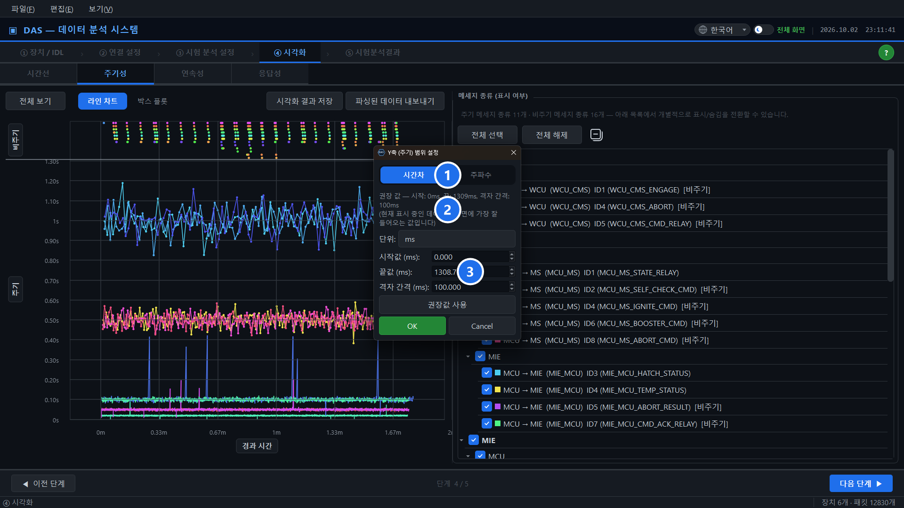

- **1** "시간차"/"주파수" 탭. 같은 Y축 값을 시간 간격(ms 등) 단위로 볼지, 그 역수인 주파수(Hz) 단위로 볼지 전환합니다 — 서로 다른 데이터가 아니라 같은 값을 보는 두 가지 단위일 뿐입니다.
- **2** 권장 값 안내문. "현재 표시 중인 데이터가 화면에 가장 잘 들어오는 값"을 자동으로 계산해 보여주며, 아래 "권장값 사용" 버튼을 누르면 이 값이 그대로 입력란에 채워집니다.
- **3** 단위·시작값·끝값·격자 간격 직접 입력. 시작값이 끝값 이상이거나 격자 간격이 0 이하면 OK를 눌러도 오류가 표시되고 적용되지 않습니다 — 정밀하게 맞추고 싶을 때만 권장값 대신 이 값들을 직접 수정하세요.

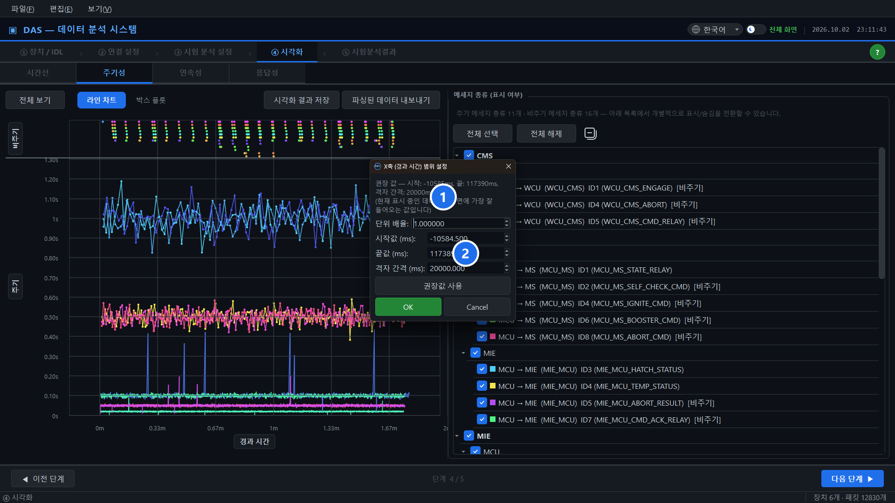

- **1** 권장 값 안내문. Y축 설정과 같은 방식으로, 지금 표시 중인 데이터 범위에 맞춘 시작·끝·격자 간격을 자동 계산해 보여줍니다.
- **2** 시작값·끝값·격자 간격 직접 입력. 여기서는 ms 단위의 경과 시간 범위를 다루므로, 특정 구간(예: 이상 신호가 의심되는 앞뒤 몇 초)만 확대해서 보고 싶을 때 시작값/ 끝값을 좁혀 입력하면 됩니다.

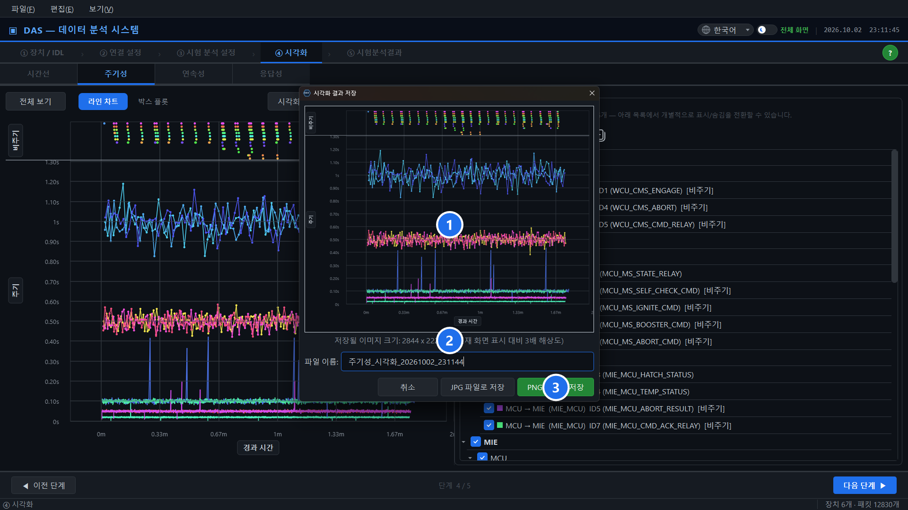

- **1** 저장될 그래프 미리보기. 지금 화면에 그려진 그래프(색상·범례 포함)가 그대로 이미지로 저장될 모습을 미리 보여줍니다.
- **2** "저장될 이미지 크기: 2844 x 2229 px (현재 화면 표시 대비 3배 해상도)"처럼, 실제 저장 파일은 화면에 보이는 것보다 고해상도로 만들어져 보고서나 인쇄물에 확대해 넣어도 흐려지지 않습니다.
- **3** 파일 이름을 입력한 뒤, 선과 글자를 또렷하게 보존하려면 "PNG 파일로 저장"을, 파일 크기를 줄이려면 "JPG 파일로 저장"을 누릅니다.

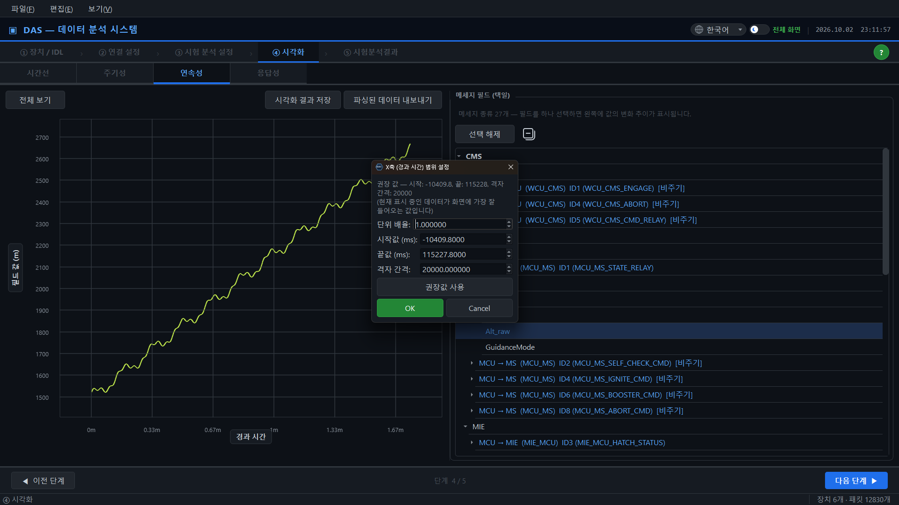

## 뒤로 가기 / 앞으로 가기

상단 툴바의 뒤로 가기/앞으로 가기 버튼은 시간선 · 주기성 · 연속성 각 탭마다 완전히 독립된 이력을 갖습니다 — 한 탭에서 되돌리거나 다시 실행해도 다른 두 탭의 이력에는 전혀 영향이 없습니다.

**사용 순서**

1. 지금 열려 있는 하위 탭(시간선/주기성/연속성)의 이력만 버튼에 반영됩니다 — 버튼 위에 마우스를 올리면 되돌릴/다시 실행할 동작 이름이 함께 표시됩니다.
2. 메시지 선택, 범례 체크박스, 가로 기준선 추가/이동, 축 설정, 전체 보기, 연속성 필드 전환처럼 그 탭 안에서 화면을 바꾸는 조작 대부분이 기록됩니다.
3. 시간 북마크/구간(시간선·주기성·연속성이 함께 보는 데이터)에 대한 추가·삭제·이름/색/시간 변경도 기록되지만, 항상 그 조작을 실제로 수행한 탭의 이력에만 쌓입니다 — 다른 탭은 그 북마크/구간이 바뀐 결과만 보일 뿐, 자신의 이력에는 아무것도 남지 않습니다.

**주의사항**

- 하위 탭을 클릭해 전환하는 것 자체는 어떤 탭의 이력에도 기록되지 않습니다 — 시간선 → 주기성으로 옮겨간 뒤 뒤로 가기를 눌러도 시간선으로 돌아가지 않고, 지금 탭(주기성)의 마지막 동작이 취소됩니다.
- "메시지 보기"로 다른 탭의 특정 메시지/북마크/구간으로 건너뛰는 이동도 마찬가지로 기록되지 않습니다 — 건너뛴 뒤 뒤로 가기를 눌러도 원래 있던 탭으로는 돌아가지 않습니다.
- 세 탭의 이력은 모두 새 PCAPNG를 성공적으로 불러오거나 새 실시간 세션을 시작할 때 한꺼번에 비워집니다 — 탭 전환, 다른 단계로 이동, 테마/언어 변경, 창 크기 조절, 팝업을 열고 닫는 것으로는 지워지지 않으므로 안심하고 다른 화면을 오가도 됩니다.
- 축 설정 창처럼 별도 팝업이 열려 있는 동안은 뒤로 가기/앞으로 가기 버튼이 항상 비활성화됩니다 — 팝업을 닫은 뒤 다시 사용할 수 있습니다.

---

[← 3단계 시험 분석 설정](05_step3.md) · [목차](../README.md#사용-가이드) · [5단계 시험분석결과 →](07_step5.md)
