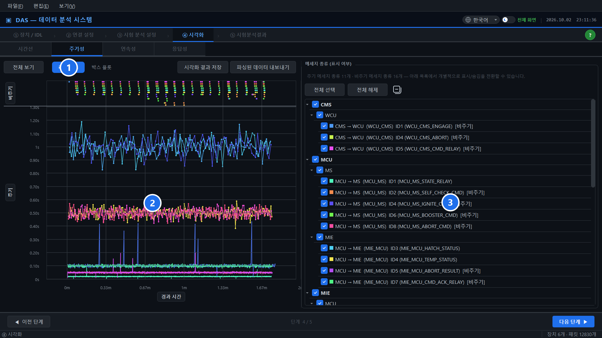

**한국어** | [English](en/07_step4-periodic.md)

# ④ 시각화 · 주기성

IDL이 주기로 선언한 메시지의 연속 발생 간격을 그래프로 그려 누락·지연·지터를 찾는 탭입니다. 라인 차트와 박스 플롯 두 가지로 볼 수 있습니다.

**사용 순서**

1. 오른쪽 목록에서 볼 메시지 종류를 체크합니다.
2. 그래프의 점을 클릭하고 메뉴에서 "해당 노드에 대한 정보 보기"(발생 하나) 또는 "해당 주기메세지에 대한 정보 보기"(종류 전체 통계)를 고릅니다.
3. "박스 플롯"으로 바꾸면 종류별 중앙값·사분위·이상치를 비교하고, 박스나 이상치 점을 눌러 통계를 봅니다.
4. 축 제목 글자를 누르면 범위와 격자 간격을 정하는 축 설정 창이 열립니다.
5. "시각화 결과 저장"은 그래프 이미지(PNG/JPG)를, "파싱된 데이터 내보내기"는 체크한 종류의 데이터(CSV/Excel)를 저장합니다.

**주의사항**

- 그래프가 비어 있으면 IDL의 PERIODIC 선언, 발생 횟수(2회 이상), ③ 탭 필터를 확인하세요.
- 빈 곳을 우클릭하면 y=a 기준선이 생기고, 아이콘을 끌어 옮기거나 우클릭해 지웁니다(라인 차트에서만).
- Ctrl+휠로 확대하고, 끌기나 Shift+휠로 이동하며, "전체 보기"로 처음 상태로 돌아갑니다.
- 정보 팝업은 3개까지 띄울 수 있고, 제목 줄로 옮기고 오른쪽 아래 모서리로 크기를 바꿉니다.

- **1** 보기 전환과 저장. 라인 차트/박스 플롯, 전체 보기, 시각화 결과 저장, 파싱된 데이터 내보내기가 있습니다.
- **2** 라인 차트. X축은 경과 시간, Y축은 연속된 두 발생의 간격이며, 뾰족하게 튄 곳이 누락이나 지연 후보입니다.
- **3** 메시지 종류 목록. 색 사각형이 그래프의 선 색이며, 체크를 끄면 그래프에서 빠집니다.

---

[← ④ 시각화 · 시간선](06_step4-timeline.md) · [목차](../README.md#사용-가이드) · [④ 시각화 · 연속성 →](08_step4-continuity.md)
