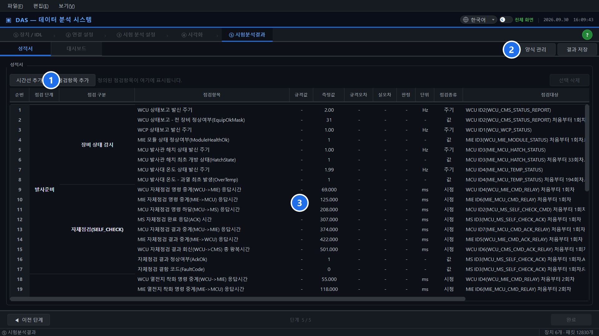
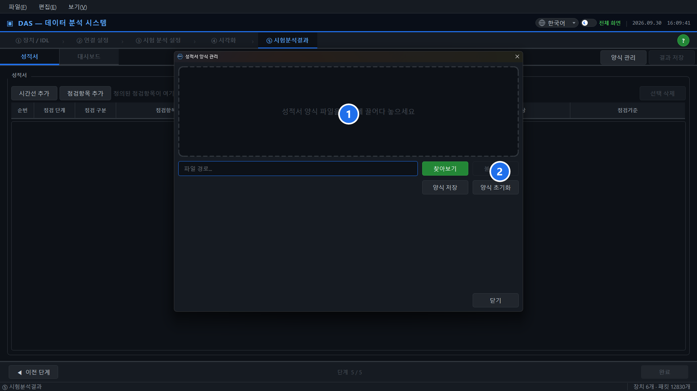
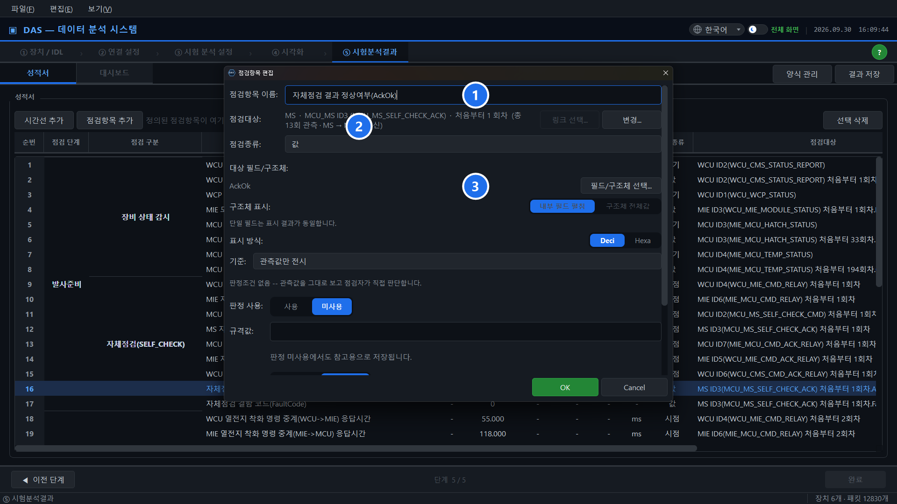
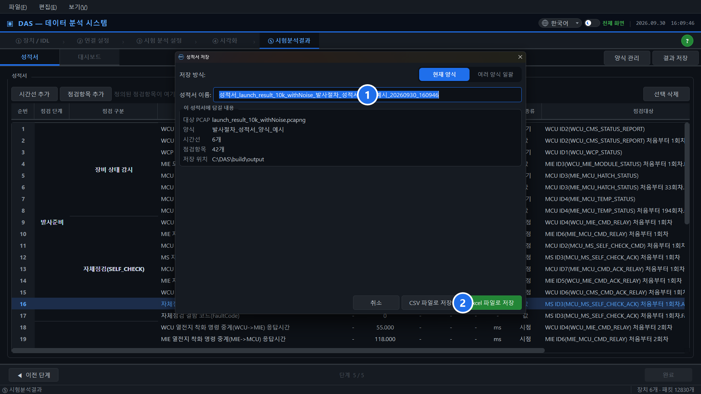

# 5단계 시험분석결과

화면 위쪽 하위 탭(성적서/대시보드)으로 전환합니다. "성적서" 탭은 로드한 PCAPNG에서 특정 메시지 시각·시간차·필드값·평균 주파수를 뽑아 점검항목 표와 Excel/CSV 성적서를 만드는 화면이고, "대시보드" 탭은 여러 그래프를 한 화면에 배치해 분석 결과를 정리하는 화면입니다(자세한 내용은 "대시보드" 항목 참고).

**사용 순서**

1. 필요하면 성적서 양식 JSON을 불러옵니다.
2. 시간선과 점검항목을 추가합니다.
3. "결과 저장" 버튼으로 실제 측정값이 담긴 XLSX/CSV를 만듭니다.

**주의사항**

- 각 점검항목에 규격값을 켜면 정상/비정상을 자동으로 판정하고, 켜지 않은 항목은 측정값만 자동 계산해 보여줄 뿐 판정은 사용자가 직접 합니다.

- **1** 왼쪽 위 "시간선 추가"/"점검항목 추가" 버튼으로 시간선과 점검항목(시점/값/주기/응답시간)을 추가합니다.
- **2** 오른쪽 위 "양식 관리"에서 이전에 저장해 둔 성적서 양식 JSON을 불러와 구성을 재사용하거나, 지금 구성을 양식으로 저장할 수 있습니다.
- **3** 정의된 점검항목과 실제 측정값이 표로 채워지며, 성적서/대시보드 탭 옆의 공통 "결과 저장"으로 XLSX/CSV 파일을 만듭니다.

## 성적서 형식 불러오기

이전에 저장해 둔 성적서 양식 JSON을 불러와 시간선/점검항목 "구성"을 재사용합니다.

**사용 순서**

1. 오른쪽 위 "양식 관리"를 누르고, 창에서 "찾아보기"로 양식 JSON을 고르거나 점선 영역에 끌어다 놓습니다.
2. "불러오기"를 눌러 현재 프로젝트에 연결합니다.
3. 선언된 시간선의 상대/절대 시간이 채워지는지 확인합니다.

**주의사항**

- 양식은 장치 이름·IDL 이름·메시지 ID로 다시 연결되므로, 양식을 만든 프로젝트와 이름/ID가 같아야 합니다 — 다르면 진단 경고가 표시될 수 있습니다.
- 장치 이름·IDL 이름 중 하나라도 현재 프로젝트에서 찾을 수 없거나, 찾은 IDL이 그 메시지 ID를 더는 선언하지 않으면 그 항목만 건너뛰는 것이 아니라 불러오기 전체가 실패로 처리되고 오류 대화상자가 뜹니다 — 이 경우 현재 프로젝트의 장치· IDL 이름을 양식을 만들 때와 똑같이 맞춘 뒤 다시 시도하세요.
- 메시지 ID는 찾았지만 구조체 이름이 양식을 저장할 때와 달라진 경우는 불러오기 자체는 성공하고, 그 사실만 경고로 표시됩니다.
- 양식을 불러오면 현재 화면의 시간선·점검항목 구성 전체가 양식의 내용으로 교체됩니다(기존 항목에 이어붙는 것이 아닙니다) — 직접 만들어 둔 항목이 있다면 먼저 양식으로 저장해 두세요.
- 양식 JSON에는 측정값이 아니라 "무엇을 측정할지"만 들어 있습니다.

- **1** 양식 파일을 놓는 점선 영역과 파일 경로. 성적서 양식 JSON 파일을 점선 영역에 끌어다 놓거나 "찾아보기"로 고르면 아래 파일 경로 칸이 채워집니다.
- **2** "불러오기"를 누르면 그 양식이 즉시 로드되어, 그 안에 정의된 시간선·점검항목 구성이 현재 프로젝트의 장치·IDL·메시지 이름과 다시 연결됩니다 — 이름이나 ID가 달라진 항목이 있으면 이 시점에 진단 경고가 표시될 수 있습니다. 그 아래 "양식 저장"은 지금 구성을 양식 파일로 저장하고, "양식 초기화"는 현재 구성을 비웁니다.

## 점검 항목 작성 및 편집

시간선(기준 시각)을 먼저 선언한 뒤, 점검항목으로 시점/값/주기/응답시간 네 종류의 측정을 추가합니다 — 아래 화면의 ①②③ 설명은 입력 폼·양식 저장/로드· 결과 표를 각각 짚은 것입니다.

**사용 순서**

1. 시간선 추가로 이름·송신 장비·메시지 ID·N번째 발생을 지정해 기준 시각을 만듭니다.
2. 항목 추가로 점검항목 편집 창을 열고 점검대상(장비/메시지/순서)을 고릅니다.
3. 점검종류를 시점(시간차) · 값(필드값) · 주기(평균 주파수) · 응답시간(요청-응답 소요시간) 중에서 고릅니다.
4. 필요하면 규격값(기대값)을 켜서 오차를 함께 표시할 수 있습니다.
5. 필요하면 여러 항목을 묶어 점검 단계/점검 구분으로 그룹화합니다.

**주의사항**

- 시점은 대상 시각에서 기준(시간선 또는 다른 메시지) 시각을 뺀 값(ms), 주기는 첫/마지막 발생 사이 평균 간격으로 계산한 평균 주파수(Hz)입니다.
- 지정한 N번째 발생이 실제 캡처에 없으면 "해당 발생 없음"으로 표시됩니다.
- 규격값은 선택 입력입니다 — 켜면 허용오차 모드(측정값과 규격값의 차이가 규격오차 미만이면 정상, 값은 일치 여부) 또는 범위 모드(=/>=/<=/>/< 다섯 연산자 중 하나로 규격값과 직접 비교) 중 하나로 "판정" 열에 정상/비정상을 자동으로 채웁니다 — 규격오차·실오차 열도 함께 채워져 그 근거를 그대로 보여줍니다. 다만 이 자동 판정은 규격값을 켠 항목에만 적용되며, 규격값을 켜지 않은 항목은 여전히 측정값만 보여줄 뿐이라 합격 여부를 점검자가 표를 보고 직접 판단해야 합니다.
- 순번 앞부분(왼쪽 손잡이 영역)을 눌러 드래그하면 표 안에서 항목의 순서를 바꿀 수 있습니다.
- 우클릭으로 여러 항목을 점검 단계/점검 구분으로 묶는 기능은 서로 인접한 행을 연속으로 선택했을 때만 나타나며, 실제로는 선택한 각 항목에 같은 이름표 문자열을 붙이는 것일 뿐 별도의 그룹 개체를 만들지 않습니다 — 이미 전부 같은 이름표를 가진 행을 다시 선택하면 "이름 바꾸기"·"그룹 해제" 메뉴로 바뀝니다.
- 시간선을 삭제하면 그 시간선을 기준값으로 참조하던 점검항목은 자동으로 지워지지 않고 그대로 남으며, 기준을 "(삭제된 시간선)"으로 표시합니다 — 그 항목을 다시 편집해 다른 기준을 지정해야 합니다.

- **1** 왼쪽 위 "시간선 추가"/"점검항목 추가" 버튼. "점검항목 추가"를 누르면 점검항목 편집 창이 열려 점검항목 이름을 입력하고, "변경..."으로 점검대상(장비·메시지·몇 번째 발생인지)을 고른 뒤 "점검종류"를 시점(시간차)·값(필드값)·주기(평균 주파수)·응답시간(요청-응답 소요시간) 중에서 고릅니다. 시점은 시간선 또는 다른 메시지를 기준으로 지정할 수 있고, 판정을 켜면 기대값을 입력해 허용오차 또는 범위(=/>=/<=/>/<) 조건으로 정상/비정상을 자동 판정할 수 있으며, 끄면(기본값) 규격값·규격오차·실오차·판정 열은 모두 "-"로 남습니다. OK를 누르면 성적서 표에 새 행으로 들어가고, 새 기준 시각 자체가 필요하면 "시간선 추가"로 먼저 만듭니다.
- **2** 오른쪽 위 "양식 관리". 지금까지 만든 시간선·점검항목 구성을 JSON 양식 파일로 저장해 두면(예시의 발사절차_성적서_양식_예시.json), 다음에 같은 종류의 시험을 분석할 때 매번 항목을 새로 만들지 않고 이 창에서 "불러오기"만 눌러 구성을 그대로 재사용할 수 있습니다. 다만 이 양식은 측정값이 아니라 "무엇을 측정할지"의 정의만 담고 있고, 장치 이름·IDL 이름·메시지 ID로 다시 연결되므로 양식을 만든 프로젝트와 이름/ID가 달라지면 일부 항목이 연결되지 않을 수 있습니다.
- **3** 성적서 테이블. 정의된 점검항목이 순번·점검 단계·점검 구분·점검항목·규격값·측정값·규격오차·실오차·판정·단위·점검종류·점검대상·점검기준 열로 한 행씩 표시되며, 왼쪽 굵은 글씨의 "발사준비"·"장비 상태 감시"·"자체점검(SELF_CHECK)" 같은 셀은 여러 행을 세로로 묶은 점검 단계/점검 구분 그룹입니다. "측정값" 열은 로드된 PCAPNG를 바탕으로 자동 계산된 실제 값이고, "규격값"·"규격오차"·"실오차"·"판정"은 그 항목에서 판정을 켰을 때만 채워지며(끄면 전부 "-"), 여기 있는 항목을 지우거나 순서를 바꿔도 값 자체는 다시 계산되어 채워집니다. 다 확인했으면 성적서/대시보드 탭 옆의 공통 "결과 저장" 버튼으로 XLSX 또는 CSV 파일을 만듭니다.

- **1** 점검항목 이름. 성적서 표의 "점검항목" 열에 그대로 표시될 이름으로, 예시의 "열전지 착화 결과 정상여부(AckOk)"처럼 실제 측정 대상 필드 이름을 괄호로 함께 적어두면 나중에 성적서만 봐도 어떤 필드를 측정한 것인지 바로 알 수 있습니다.
- **2** 점검대상과 점검종류. "변경..."으로 어느 장비가 보낸 어느 메시지의 몇 번째 발생을 볼지 다시 고를 수 있고, "점검종류"는 시점(시간차)·값(필드값)·주기 (평균 주파수)·응답시간(요청-응답 소요시간) 중 하나로 이미 정해져 있어 이 창에서는 바꿀 수 없습니다 — 종류를 바꾸려면 항목을 새로 만들어야 합니다.
- **3** 대상 필드/구조체와 기준. "필드/구조체 선택..."으로 이 메시지의 IDL 구조체 중 실제로 값을 뽑아낼 필드(예: AckOk)를 고르고, "기준"에서 관측값만 전시할지 기준 메세지와 비교할지 정합니다. 어느 쪽이든 그 자체만으로는 "판정조건 없음 — 관측값을 그대로 보고 점검자가 직접 판단합니다."처럼 자동 합격/불합격을 가리지 않지만, 아래 "규격값 사용"을 따로 켜면 기대값과의 차이를 허용오차 또는 범위 조건으로 비교해 "판정" 열에 정상/비정상을 자동으로 채웁니다.

## 성적서 저장

현재 점검항목 구성과 실제 측정값을 Excel(XLSX) 또는 CSV 성적서 파일로 저장합니다.

**사용 순서**

1. 성적서/대시보드 탭 옆의 공통 "결과 저장" 버튼을 누릅니다.
2. 저장 방식을 "현재 양식"(지금 화면에 로드·편집 중인 양식 하나)과 "여러 양식 일괄"(양식 파일 여러 개) 중에서 고릅니다.
3. Excel 파일로 저장 또는 CSV 파일로 저장을 고릅니다.
4. 저장 경로를 지정합니다 — "현재 양식"은 파일 하나, "여러 양식 일괄"은 폴더 하나만 고르면 됩니다.

**주의사항**

- XLSX와 CSV 모두 순번/점검 단계/점검 구분/점검항목/규격값/측정값/규격오차/실오차/판정/단위/점검종류/점검대상/점검기준, 같은 13개 열을 담습니다 — 차이는 XLSX만 점검 단계/점검 구분의 연속된 같은 이름표 행을 표처럼 하나로 병합하고 제목 병합 행과 굵은 글씨 서식을 더해 제출·검토용 문서로 바로 쓰기 좋다는 점이며, CSV는 병합 없이 매 행에 같은 이름표를 그대로 반복해 다른 도구에서 다시 가공하기 쉽습니다.
- 규격값을 켠 항목만 규격오차·실오차·판정(정상/비정상)이 자동으로 계산돼 채워지고 (끄면 셋 다 "-"), 나머지 항목은 측정값만 보여줄 뿐입니다 — "점검종류/점검대상/점검기준" 열은 그 자체로 판정 결과가 아니라 "시점/값/주기/응답시간 · 무엇을 · 어떤 기준으로 계산했는지"의 설명일 뿐이며, 규격값을 켜지 않은 항목의 합격 여부는 여전히 점검자가 표를 보고 직접 판단해야 합니다.
- 성적서 저장과 별도로, 구성 자체를 재사용하려면 "양식 관리" 창의 "양식 저장" 버튼으로 양식 JSON을 따로 저장해 두세요.
- 이름 뒤 확장자는 고르는 형식(Excel/CSV)에 맞춰 자동으로 붙거나 바뀌므로 이름 입력란에 직접 .xlsx/.csv를 적을 필요는 없습니다.
- "여러 양식 일괄"은 성적서 양식 JSON 파일을 목록에 모아 두고("양식 추가..." 버튼 또는 파일을 표 위로 끌어다 놓기) 저장할 폴더 하나만 고르면, 양식마다 성적서 파일을 하나씩 차례로 만듭니다 — 목록은 팝업을 닫았다 다시 열어도, 프로그램을 껐다 켜도 그대로 남습니다.
- "현재 양식" 모드에는 이름 입력란 아래에 "이 성적서에 담길 내용" 요약이 있어, 저장 버튼을 누르기 전에 대상 PCAP·양식·시간선과 점검항목 수(그중 규격 판정 대상 수)·저장 위치를 한눈에 확인할 수 있습니다 — 양식 이름 뒤의 "(저장 안 한 편집 있음)"은 이름에 "_편집본"이 붙는 것과 같은 상태를 가리킵니다.
- 일괄 저장이 끝나면 완료 안내가 양식마다 한 행인 표로 결과를 보여줍니다 — "양식 이름 / 결과 / 만들어진 파일 · 사유" 세 열이며, 성공한 항목에는 실제로 만들어진 파일 이름이, 실패하거나 건너뛴 항목에는 그 사유가 들어갑니다. 처음에는 실행한 순서대로 놓이고 열 머리글을 눌러 정렬할 수 있으며, 양식이 많으면 표가 스크롤됩니다.
- 결과 열의 "성공 (경고 N)"은 파일은 만들어졌지만 계산 불가 항목 같은 경고가 N건 있다는 뜻이고, 실패 사유가 여러 줄이면 셀에는 첫 줄과 "외 N건"만 보입니다 — 그런 행을 더블클릭하면 그 양식의 전체 사유와 경고를 양식 불러오기 진단과 같은 창으로 볼 수 있습니다.
- 일괄로 만든 파일 이름에는 원본 PCAP 이름과 양식 파일 이름이 함께 들어가고, 한 번에 만든 파일들은 모두 같은 생성 시각을 공유합니다 — 목록의 양식을 불러오는 것이 아니라 읽기만 하므로, 일괄 생성은 지금 화면에서 편집 중인 양식을 전혀 바꾸지 않습니다.

- **1** 성적서 이름. 기본값은 "성적서_현재 분석 중인 PCAP 파일명[_불러온 양식 이름][_편집본]_생성 시각" 순서로 자동으로 채워집니다(예: 성적서_flight_test_03_발사시퀀스점검_편집본_20260916_143522) — "편집본"은 불러온 양식을 저장하지 않고 수정한 상태일 때만 붙습니다. 여러 차수의 시험을 구분해야 한다면 저장 전에 이 이름을 자유롭게 고쳐 써도 됩니다.
- **2** "CSV 파일로 저장" 또는 "Excel 파일로 저장". CSV는 단순 표 형태로 다른 도구에서 다시 가공하기 쉽고, Excel(XLSX)은 순번/점검 단계/점검 구분 등 열 구성과 그룹 병합·서식까지 그대로 포함되어 제출·검토용 문서로 바로 쓰기 좋습니다.

## 성적서 수치 표시 설정

성적서에 보이는 실수 값의 자리수를 float·double·환산값(lsb·msb)·시간(ms) 분류마다 따로 정합니다. 표시만 바뀌고 정상/비정상 판정은 항상 원래 정밀도로 계산합니다.

**사용 순서**

1. 점검항목 표 위 줄 오른쪽 끝("선택 삭제" 옆)의 톱니바퀴 버튼을 누릅니다.
2. 위쪽 "적용 범위"에서 "이 양식에 저장"(지금 양식에만) 또는 "전역 기본값 사용"(자체 설정이 없는 모든 양식)을 고릅니다.
3. 분류마다 방식을 자동 / 소수점 고정 / 유효숫자 중에서 고르고 자리수를 정합니다 — 유효숫자 방식에서는 "최대"를 켜 소수 자리 상한을 함께 걸 수 있습니다.
4. 아래쪽 미리보기(필요하면 "직접 입력 예시값")로 결과를 확인하고 확인 또는 적용을 누릅니다.

**주의사항**

- 정수형(부호있는·부호없는·비트필드), 16진 표시, 주기(Hz)·주기 오차(%), 값 점검의 규격값, 시점·응답시간의 규격값은 이 설정과 무관하게 지금처럼 표시됩니다.
- 반올림은 화면에 보이는 10진 표기 기준 사사오입이라 2.675를 소수 2자리로 보이면 2.68입니다. 지수 표기는 쓰지 않고, 유효숫자가 정수부보다 적어도 정수부는 자르지 않습니다(123456.789, 유효숫자 3 → 123457).
- "자동"은 이전과 같은 표시입니다. 단 float는 float 고유 정밀도로 보여 0.1f가 0.10000000149011612가 아니라 0.1로 나옵니다.
- 표시가 줄어든 항목은 행 위에 마우스를 올리면 툴팁 아래쪽 "전체 정밀도"에 원래 값이 나옵니다 — 화면에서 10.00 = 10.00처럼 보여도 비정상일 수 있는 이유를 여기서 확인합니다.
- "이 양식에 저장"한 설정은 양식 파일에 함께 저장되고 뒤로 가기로 되돌릴 수 있으며, 이때 톱니바퀴 오른쪽 위에 점이 표시됩니다. 전역 기본값은 프로그램에 저장되고 뒤로 가기 대상이 아닙니다.
- 화면, Excel/CSV 저장, 여러 양식 일괄 저장 모두 같은 설정을 따르며, 일괄 저장은 양식마다 그 양식의 설정(없으면 시작 시점의 전역 기본값)을 씁니다.

## 대시보드

⑤ 시험분석결과 하위 탭 중 하나로, PCAP으로 로드한 연속성 메시지 값을 여러 개의 XY 영역에 다중 Y축 그래프로 배치해 한눈에 비교할 수 있는 화면입니다. 구성(영역/그래프/색상/축 설정)만 재사용 가능한 "양식" JSON으로 저장·불러오기할 수 있고, 실제 데이터나 확대/축소 상태는 양식에 포함되지 않습니다.

**사용 순서**

1. "XY 영역 추가"로 새 영역을 만듭니다 — 영역마다 왼쪽 설정 패널과 오른쪽 그래프로 나뉩니다.
2. 설정 패널의 "그래프 추가"로 메시지 → 필드 → 이름/색상 순서로 그래프를 만듭니다 (영역당 최대 5개, 그래프마다 독립된 Y축 하나).
3. 표시 순서는 마우스로 바꿀 수 있습니다 — XY 영역은 카드 제목 왼쪽의 손잡이(점 여섯 개)를 잡아 위아래로 끌고, 메시지는 설정 패널의 버튼을 잡아 같은 영역 안에서 끕니다(다른 영역으로는 옮길 수 없습니다). 끌기 도중 Esc를 누르면 원래 자리로 돌아가고, 손잡이나 버튼을 우클릭하거나 Alt+↑/Alt+↓로 한 칸씩 옮길 수도 있습니다. 순서를 바꾼 한 번이 Undo 한 단계이며, 바뀐 순서는 화면·양식 JSON·세션 자동 저장·"결과 저장" PDF에 모두 같게 반영됩니다.
4. 각 그래프의 Y축은 기본이 자동 범위(전체 데이터 기준 + 5% 여백)이며, 최솟값/최댓값을 직접 입력하면 수동 고정으로 바뀝니다. "자동 범위로 초기화"로 다시 자동 모드로 되돌릴 수 있습니다.
5. 그래프 위에서 Ctrl+휠을 굴리면 커서가 가리키는 시각을 기준으로 확대/축소하고, 차트 본문을 좌우로 끌거나 Shift+휠로 이동할 수 있습니다(가로 스크롤바는 없습니다). 보조키 없이 그냥 휠을 굴리면 대시보드 화면이 위아래로 스크롤됩니다. 대시보드에 있는 모든 XY 영역이 하나의 X축(경과 시간)을 공유해, 한 곳에서 확대하거나 이동하면 나머지 영역도 즉시 같은 시간 범위로 함께 움직입니다 — ④ 시각화의 주기성·연속성·응답성 그래프도 같은 조작 방식을 씁니다. 차트를 한 번 클릭해 둔 상태에서 Home 키를 누르면 전체 보기로 돌아가고, 이동하는 도중 Esc를 누르면 끌기 시작 위치로 되돌아갑니다. 상단의 "X축 전체 보기"를 누르면 모든 영역이 한 번에 전체 데이터 범위로 되돌아갑니다(영역별 "자동 범위로 초기화"는 그 영역 Y축만 초기화할 뿐 이 공용 X축과는 무관합니다).
6. 모든 XY 영역은 그래프·Pane·Y축 구성이 서로 달라도 화면 X축 픽셀 좌표가 정확히 맞춰져 있습니다 — 어느 영역의 그래프 위에 마우스를 올리면 그 시각을 가리키는 세로선이 다른 모든 영역에도 같은 위치에 함께 나타나고, 각 영역의 값 미리보기도 그 세로선 기준으로 조회됩니다(값 말풍선 자체는 마우스가 있는 영역에서만 뜹니다).
7. 상단 "X축 설정" 버튼이나 아무 영역의 X축 눈금 줄(마우스를 올리면 클릭 가능한 포인터 커서로 바뀝니다)을 클릭하면 "대시보드 X축 설정" 창이 열립니다 — 권장 범위(모든 유효 데이터의 합집합) 또는 시작·종료시간 직접 입력 중 하나를 고르고, 세로 격자 간격도 자동 또는 직접 입력(초 단위) 중에서 정할 수 있습니다. 적용하면 모든 영역에 동일하게 반영되고, "X축 전체 보기"는 범위만 초기화할 뿐 이렇게 직접 정한 격자 간격은 그대로 유지합니다(격자까지 자동으로 되돌리려면 이 설정 창에서 "자동 간격"을 다시 선택해야 합니다).
8. ④ 시각화에서 만든 구간 영역(시작~종료 시간, 이름, 색상)이 모든 XY 영역의 배경에 반투명 채움과 경계선으로 함께 표시됩니다 — 대시보드에서는 조회만 가능하고 추가·수정·삭제·이동은 할 수 없습니다(구간 위를 드래그해도 항상 X축 이동으로 처리됩니다). ④ 시각화에서 구간을 바꾸면 대시보드도 다시 열 때(또는 켜져 있다면 즉시) 새 값으로 반영됩니다.
9. 상단 "양식 저장"/"불러오기"/"양식 초기화"로 구성 전체를 JSON 파일로 재사용하거나 초기화할 수 있습니다(파일을 이 영역에 끌어다 놓아도 됩니다) — X축 확대/이동 상태와 구간 영역은 양식에 포함되지 않습니다.

**주의사항**

- 연속성 화면과 동일한 메시지 매칭/디코딩 규칙을 그대로 재사용합니다 — 메시지 식별 규칙, PERIODIC 태그, 필터 설정이 그쪽과 동일하게 적용됩니다.
- 결측/디코딩 실패 구간은 값 0으로 대체되지 않고 그래프 선이 끊깁니다.
- 양식을 불러오면 메시지/필드를 지금 환경에서 찾지 못한 그래프도 삭제되지 않고 "대상 없음"으로 표시됩니다 — 설정 패널에서 다시 선택할 수 있습니다.
- 영역/그래프 추가·삭제·이름변경·색상·축 설정·양식 불러오기·양식 초기화는 모두 Undo/Redo(Ctrl+Z / Ctrl+Y) 대상입니다 — X축 확대/이동, "X축 설정" 대화상자로 정한 범위·격자 간격, 구간 영역 조회는 대시보드 전용 기록/편집 대상이 아니라 Undo/Redo에 남지 않습니다.
- 구성은 세션 종료 시 자동 저장되어 다음 실행 때 그대로 복원됩니다(양식 파일과는 별개 -- 세션 자동 저장은 파일 다이얼로그를 열지 않습니다). "X축 설정" 창에서 확정한 내용(권장/직접 입력 범위와 그 시작·종료시간, 자동/수동 격자와 그 간격)도 함께 저장되어 다음 실행에 이어집니다 -- 다만 마우스로 확대·이동한 현재 화면 위치는 저장하지 않으므로, 다시 열면 저장된 범위 전체가 보이는 상태로 시작합니다. 직접 입력한 범위는 저장한 값 그대로 쓰고, 권장 범위는 그때그때의 데이터에 맞춰 다시 계산합니다.
- "결과 저장" PDF는 저장 시점에 화면에 표시되던 X축 범위를 그대로 쓰고(전체 보기 상태면 여백을 포함한 전체 범위), 그때의 구간 영역과 함께 출력됩니다 — 모든 페이지와 영역이 같은 X축 시작·끝·눈금을 씁니다. "X축 설정"에서 격자 간격을 직접 입력해 뒀다면 PDF도 화면과 같은 간격을 그대로 씁니다(자동이면 PDF도 페이지 폭 기준으로 자동 계산).
- PDF는 XY 영역 순서대로 영역 하나당 그래프 페이지 하나를 만듭니다 — 여러 영역을 한 페이지에 묶지 않고, 각 페이지의 그래프는 제목·범례·문서 정보를 제외한 인쇄 가능 영역을 최대한 크게 사용합니다(화면에서 크게 보이던 형상을 PDF에서도 그대로 유지하기 위함).

---

[← 4단계 시각화](06_step4.md) · [목차](../README.md#사용-가이드) · [마우스 및 숨겨진 조작 →](08_mouse-hidden.md)
