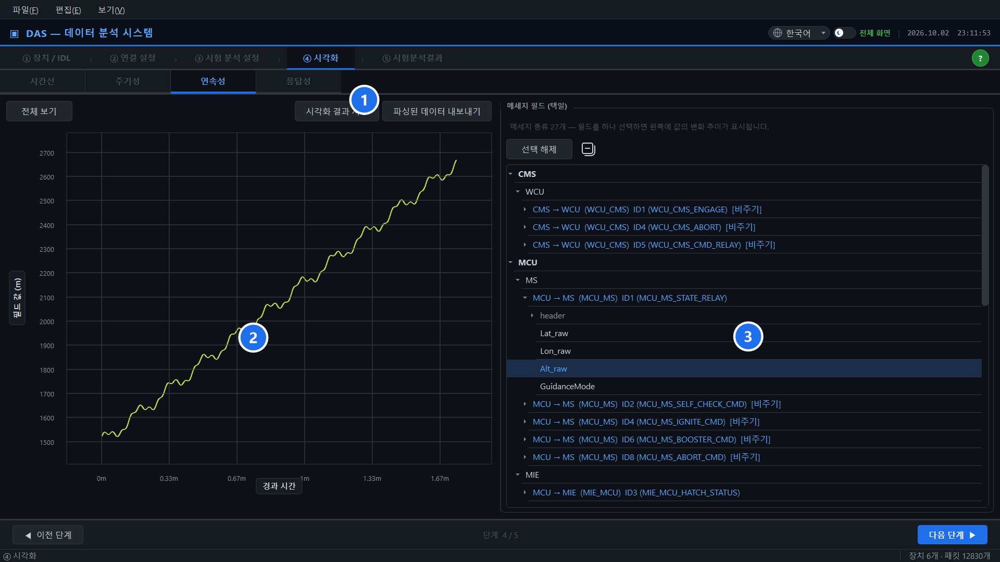

# ④ 시각화 · 연속성

주기 메시지 안의 숫자 필드 하나를 골라 시간에 따른 값 변화(추세·급변·결측)를 보는 탭입니다.

**사용 순서**

1. 오른쪽 필드 트리를 송신 장치 → 수신 장치 → 메시지 → 구조체 순으로 펼쳐 맨 끝의 숫자 필드를 클릭합니다.
2. 그래프의 점을 클릭하고 메뉴에서 그 발생의 값 또는 필드 전체 통계를 고릅니다.
3. 축 제목 글자를 눌러 범위를 좁히거나, Ctrl+휠로 확대합니다.
4. "선택 해제"를 누르면 필드 선택과 그래프가 비워집니다.

**주의사항**

- 한 번에 필드 하나만 볼 수 있으며, 구조체 노드를 골라서는 그래프가 그려지지 않습니다.
- lsb/msb가 있는 필드는 단위가 붙은 물리값으로 그려집니다.
- 다른 필드를 보다가 돌아오면 그 필드에서 띄운 팝업·확대·기준선이 그대로 남아 있습니다.
- 기준선(y=a), 이미지 저장, 데이터 내보내기는 주기성 탭과 같은 방식입니다.

- **1** 툴바. 전체 보기, 시각화 결과 저장, 선택한 필드의 데이터 내보내기가 있습니다.
- **2** 값 추이 그래프. 갑자기 끊기거나 0으로 떨어지는 곳은 결측이나 센서 이상 후보입니다.
- **3** 필드 트리(택일). 맨 끝의 숫자 필드를 골라야 그래프가 그려집니다.

---

[← ④ 시각화 · 주기성](07_step4-periodic.md) · [목차](../README.md#사용-가이드) · [④ 시각화 · 응답성 →](09_step4-response.md)
