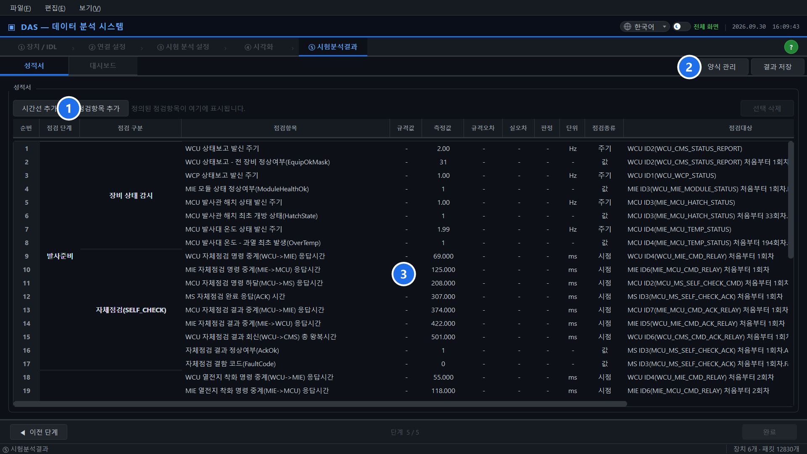

**한국어** | [English](en/10_step5.md)

# ⑤ 시험분석결과 · 성적서

로드한 캡처에서 시점·값·주기·응답시간을 뽑아 점검항목 표를 만들고 Excel/CSV 성적서로 저장하는 탭입니다. 구성은 양식 JSON으로 저장해 다시 씁니다.

**사용 순서**

1. 필요하면 오른쪽 위 "양식 관리"에서 양식 JSON을 불러옵니다.
2. "시간선 추가"로 기준 시각(장비·메시지·N번째 발생)을 만듭니다.
3. "점검항목 추가"로 점검대상과 점검종류(시점/값/주기/응답시간)를 고릅니다.
4. 판정이 필요하면 "규격값 사용"을 켜고 허용오차 또는 범위 조건을 넣습니다.
5. 탭 옆의 공통 "결과 저장"으로 XLSX 또는 CSV를 만듭니다("여러 양식 일괄"도 가능).

**주의사항**

- 규격값을 켠 항목만 정상/비정상이 자동 판정되고, 나머지는 측정값만 보여 줍니다.
- 양식을 불러오면 지금 구성이 통째로 바뀌며, 장치·IDL 이름이 양식과 다르면 불러오기가 실패합니다.
- 행을 더블클릭하면 편집, 순번 칸을 끌면 순서 변경, 인접한 여러 행을 우클릭하면 점검 단계/구분으로 묶습니다.
- 표 위 톱니바퀴 버튼에서 실수 값의 표시 자리수를 정합니다(판정은 원래 정밀도로 계산).

- **1** 왼쪽 위 "시간선 추가"/"점검항목 추가" 버튼으로 시간선과 점검항목(시점/값/주기/응답시간)을 추가합니다.
- **2** 오른쪽 위 "양식 관리"에서 이전에 저장해 둔 성적서 양식 JSON을 불러와 구성을 재사용하거나, 지금 구성을 양식으로 저장할 수 있습니다.
- **3** 정의된 점검항목과 실제 측정값이 표로 채워지며, 성적서/대시보드 탭 옆의 공통 "결과 저장"으로 XLSX/CSV 파일을 만듭니다.

---

[← ④ 시각화 · 응답성](09_step4-response.md) · [목차](../README.md#사용-가이드) · [⑤ 시험분석결과 · 대시보드 →](11_step5-composite.md)
