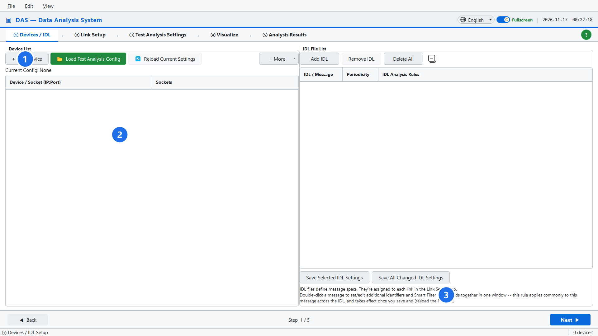

[한국어](../00_quick-start.md) | **English**

# Quick Start

DAS interprets a launch test network capture (PCAPNG) according to your device/IDL settings, then organizes it into visualizations and a report. Just work through the 5 steps at the top in order.

**How to use**

1. Register devices, sockets, and IDL files in ① Devices / IDL.
2. Link sending/receiving sockets to an IDL in ② Link Setup.
3. Load the PCAPNG and choose which messages to view in ③ Test Analysis Settings.
4. Check the data in ④ Visualize via Timeline, Periodicity, Continuity, and Response.
5. Create report check items and dashboard analysis results in ⑤ Analysis Results.

**Notes**

- Earlier steps' settings are the basis for how later steps interpret data -- skipping ahead can leave the ④/⑤ screens looking empty.

<picture>
  <source media="(prefers-color-scheme: dark)" srcset="images/01_step1_device_idl_empty__quick-start.png">
  <source media="(prefers-color-scheme: light)" srcset="images/01_step1_device_idl_empty__quick-start__light.png">
  
</picture>

- **1** Top-left button row. No device is registered yet, so "Reload Current Settings" is grayed out and the line below reads "Current config: none". Register devices one by one with "+ Add Device", or if you already have an endpoints.lua or DAS config JSON, fill everything in at once with the green "Load Test Analysis Config".
- **2** Device List (left). The list is empty because no devices exist yet, and the status bar at the bottom also reads "0 devices." This is exactly the screen you see the first time you open the program, or right after pressing "Delete All."
- **3** IDL File List and hint (right). No IDLs are registered yet either, so the list is empty; the hint below it, "IDL files define message specs. They are assigned to each link in the Link Setup step," previews the role IDLs will play. Once both devices and IDLs are filled in, the ② Link Setup step ties the two together.

---

[Contents](../../README.en.md#user-guide) · [Overall Workflow →](01_workflow.md)
