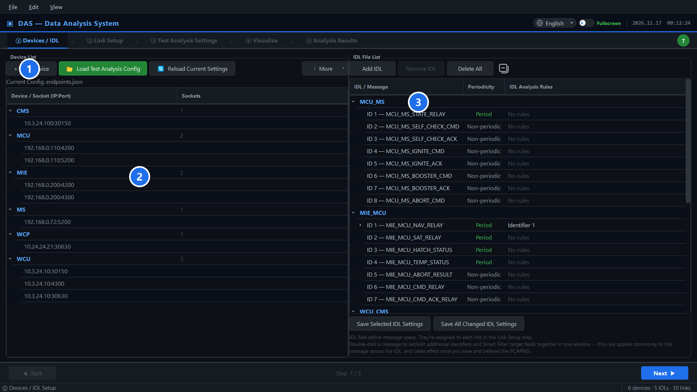

[한국어](../03_step1.md) | **English**

# ① Devices / IDL

Register the devices and sockets (IP:Port) taking part in the test and the IDL files that decode their payloads. If you already have a config file, one load fills everything in.

**How to use**

1. If you have a config file (endpoints.lua or a DAS config JSON), click the green "Load Test Analysis Config" and pick it.
2. Otherwise, enter a device name with "+ Add Device" and register its IP and Port with "+ Add Socket".
3. Register .idl files with "Add IDL".
4. Check that the device and IDL lists look as expected, then move on to ② Link Setup.

**Notes**

- An IP only matches if it is exactly the address in the capture. Leaving Port empty matches all traffic of that IP.
- Device names appear everywhere (timeline columns, report check targets), so keep them short and unique.
- Loading a config replaces the current devices, IDLs and links entirely. Save first if you want to keep them.
- Deleting a device or IDL leaves the links on tab ② that used it. Check tab ② afterwards.
- To edit or delete a device, double-click or right-click its row in the device list.

- **1** Button row: "+ Add Device", "Load Test Analysis Config" and "Reload Current Settings".
- **2** Device list. Each device lists its sockets (IP:Port) below it; double-click a row to edit it.
- **3** IDL list. A three-level tree of IDL file → message → rule field; double-click a message row to open "Edit IDL Message".

## Edit IDL Message

Opens when you double-click a message row (level 2) in the IDL list. Set the message description, periodicity, additional identifiers and smart filter targets in one place.

**How to use**

1. On "Message Info", write a description and, if needed, override periodic/aperiodic regardless of the IDL declaration.
2. On "Additional Identifiers", move the fields that split one message into variants to the right.
3. On "Smart Filter Targets", pin fields as "excluded" or "discrete change" (periodic messages only).
4. "Apply"/"OK" applies all three tabs at once; saving the IDL settings clears the "*" on the IDL row.

**Notes**

- Settings are stored in "<IDL file name>.das-idl.json" in the same folder, never in the original .idl.
- Changes other than the description take effect only after reloading the PCAPNG on tab ③ ("Reload Needed" notice).
- If a link shows more than 10 identifier combinations, the rule is not applied to that link.

---

[← Step 0: Test Config File Setup](02_config-files.md) · [Contents](../../README.en.md#user-guide) · [② Link Setup →](04_step2.md)
