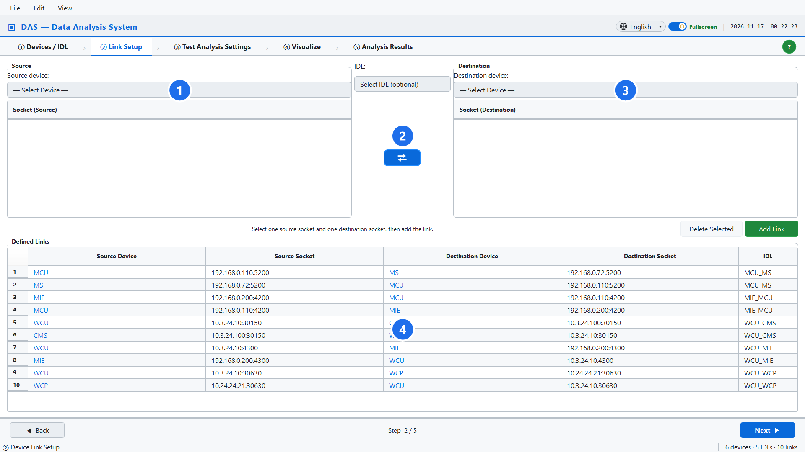

[한국어](../04_step2.md) | **English**

# ② Link Setup

Define, one direction at a time, "which IDL decodes packets from which socket to which socket". Every direction in the capture needs its own link to be decoded.

**How to use**

1. On the left, pick the source device and click one socket in the Socket (Source) list.
2. On the right, pick the destination device and socket the same way.
3. In the middle, choose the IDL that decodes this link's payload under "Select IDL" and click "Add Link".
4. For the reverse direction, swap source and destination with the middle swap button (⇄), check the IDL and add again.

**Notes**

- Swapping changes only devices and sockets, not the IDL. If the reverse direction uses a different IDL, pick it again.
- The same socket pair counts as a duplicate even with a different IDL. To change the IDL, double-click the row and edit it.
- A link without an IDL leaves its payload undecoded, as raw bytes.
- Remove a wrong row by selecting it and clicking "Delete Selected".

<picture>
  <source media="(prefers-color-scheme: dark)" srcset="images/06_step2_link_table_populated__step2.png">
  <source media="(prefers-color-scheme: light)" srcset="images/06_step2_link_table_populated__step2__light.png">
  
</picture>

- **1** Sender side. Choose the sending device and socket.
- **2** IDL selection and direction swap. Choose the spec that will decode this link's payload, and if needed, swap sender/receiver to quickly add the opposite-direction link.
- **3** Receiver side. Mirroring the sender side, choose the receiving device and socket.
- **4** Defined Link List. Every link added so far is stacked one row at a time, along with its sending/receiving sockets and IDL.

---

[← ① Devices / IDL](03_step1.md) · [Contents](../../README.en.md#user-guide) · [③ Test Analysis Settings →](05_step3.md)
