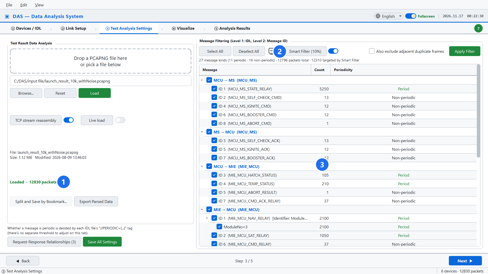

[한국어](../05_step3.md) | **English**

# ③ Test Analysis Settings

Load a PCAPNG, decode it with the settings from tabs ① and ②, and choose the messages tabs ④ and ⑤ will show. Request-response relationships and saving all settings also live here.

**How to use**

1. Pick a .pcapng with "Browse..." or drop it on the dashed area, then click "Load".
2. Check for "Loaded · N packets" and that the message tree on the right is filled.
3. Tick the messages you want to see and click the green "Apply Filter".
4. If there are many repeated status messages, turn on the "Smart Filter" toggle.
5. "Save All Settings" writes devices, IDL paths, links and request-response relationships to a JSON file.

**Notes**

- Supported: Ethernet + IPv4 + UDP/TCP. If far fewer packets load than expected, check the IP:Port of the links on tab ②.
- Checkbox changes need "Apply Filter", but the smart filter toggle and ratio take effect immediately.
- Periodic/aperiodic follows the IDL's //PERIODIC declaration (or the Edit IDL Message override), not the capture timing.
- With the "Live load" toggle on, DAS follows the file dumpcap is writing every 1-10 s and shows the latest packets.
- "Export Parsed Data" saves the decoded results as CSV/XLSX files per device pair.

<picture>
  <source media="(prefers-color-scheme: dark)" srcset="images/12_step3_pcapng_message_tree__step3.png">
  <source media="(prefers-color-scheme: light)" srcset="images/12_step3_pcapng_message_tree__step3__light.png">
  
</picture>

- **1** PCAPNG load panel. Pick a file and click "Load" to see its details and packet count.
- **2** Filter toolbar: select/deselect all, collapse/expand all, the smart filter toggle and ratio, and "Apply Filter".
- **3** Message tree. Level 1 is source → destination (IDL), level 2 the message ID, with counts and periodicity.

## Smart Filter

Hides repeated occurrences of periodic messages whose values did not change, to cut review work. No packet is deleted.

**Notes**

- Fields that change less often than the threshold ratio (default 10%) are "discrete fields"; an occurrence is hidden when all of them equal the previous one.
- Change the ratio with the "Smart Filter (N%)" button. Lower hides more, higher hides less.
- Right after loading it is computed in the background; until it finishes, the toggle, ratio button and report export are unavailable.

## Request-Response Relationships

Defines the request/response periodic message pairs the ④ Responsiveness tab analyzes. Add, edit and delete them only here.

**How to use**

1. Click "Add Relationship" and pick the periodic messages for request and response, and a color.
2. Select a row in the list to edit or delete it.

**Notes**

- If a device, IDL or message it points to is deleted later, the relationship stays as "Missing Reference".

---

[← ② Link Setup](04_step2.md) · [Contents](../../README.en.md#user-guide) · [④ Visualize · Timeline →](06_step4-timeline.md)
