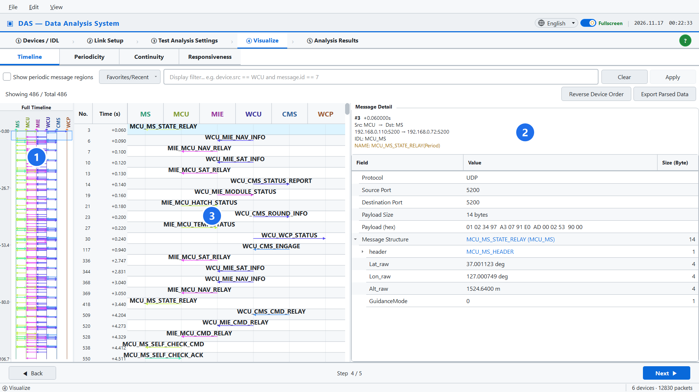

[한국어](../06_step4-timeline.md) | **English**

# ④ Visualize · Timeline

Lays messages out in device columns and time order to show "who sent what to whom, and when". Click a message to see its decoded fields on the right.

**How to use**

1. Click a message row in the middle list; the details on the right show frame, time, IP:Port and the IDL field values.
2. Drag the highlighted box in the minimap on the left to jump in time.
3. Click a device column header to turn that device off/on; drag it sideways to reorder the columns.
4. Click the "Time (s)" header to switch relative/absolute time, and the "No." header to go to a frame number.
5. Type a filter expression in the search box at the top (e.g. device.src == WCU and message.id == 7) and press Enter to narrow the view.

**Notes**

- If the screen is empty, check the PCAPNG load and "Apply Filter" on tab ③.
- Right-click a device column header and open "Manage Sent Messages Shown" to hide that device's message kinds in the timeline only (not saved).
- The search filter and shown-messages settings apply to the timeline only, not to other tabs or the report.
- Fields with lsb/msb are shown as physical values with units.
- Back/Forward (Ctrl+Z/Ctrl+Y) keeps a separate history for each visualization sub-tab.

<picture>
  <source media="(prefers-color-scheme: dark)" srcset="images/14_step4_timeline_message_detail__step4-timeline.png">
  <source media="(prefers-color-scheme: light)" srcset="images/14_step4_timeline_message_detail__step4-timeline__light.png">
  
</picture>

- **1** Minimap. Shows the whole capture compressed; the highlighted box is the part currently in view.
- **2** Message details. The selected message's header info and its IDL structure as field/value/size.
- **3** Message list. Each arrow runs from the sending device's column to the receiving one.

---

[← ③ Test Analysis Settings](05_step3.md) · [Contents](../../README.en.md#user-guide) · [④ Visualize · Periodicity →](07_step4-periodic.md)
