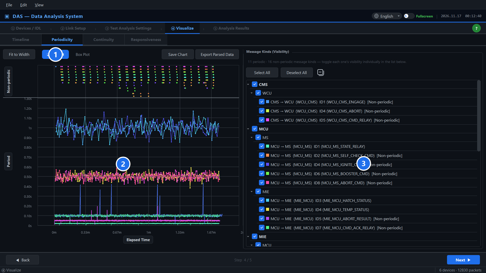

[한국어](../07_step4-periodic.md) | **English**

# ④ Visualize · Periodicity

Plots the interval between consecutive occurrences of IDL-declared periodic messages to find gaps, delays and jitter. View it as a line chart or a box plot.

**How to use**

1. Tick the message kinds to show in the list on the right.
2. Click a point and choose "View Info About This Node" (one occurrence) or "View Info About This Periodic Message" (statistics for the whole kind).
3. Switch to "Box Plot" to compare medians, quartiles and outliers per kind; click a box or outlier point for its statistics.
4. Click an axis title to open the axis settings for range and grid spacing.
5. "Save Chart" saves the graph as an image (PNG/JPG); "Export Parsed Data" saves the ticked kinds' data (CSV/Excel).

**Notes**

- If the graph is empty, check the IDL's PERIODIC declaration, the occurrence count (2 or more) and the filter on tab ③.
- Right-click an empty spot to add a y=a reference line; drag its icon to move it or right-click it to delete (line chart only).
- Ctrl+wheel zooms, dragging or Shift+wheel pans, and "Fit to Width" goes back to the start.
- Up to 3 info popups can be open; move one by its title bar and resize it by its bottom-right corner.

- **1** View switch and saving: Line Chart/Box Plot, Fit to Width, Save Chart, Export Parsed Data.
- **2** Line chart. X is elapsed time, Y the interval between two consecutive occurrences; sharp spikes are likely gaps or delays.
- **3** Message kind list. The color square is the line color; untick to remove it from the graph.

---

[← ④ Visualize · Timeline](06_step4-timeline.md) · [Contents](../../README.en.md#user-guide) · [④ Visualize · Continuity →](08_step4-continuity.md)
