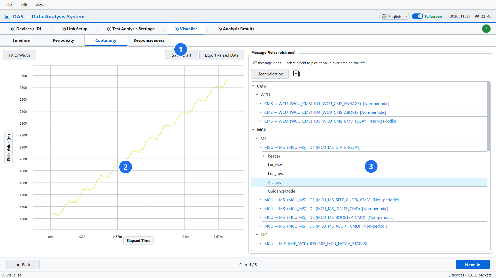

[한국어](../08_step4-continuity.md) | **English**

# ④ Visualize · Continuity

Pick one numeric field of a periodic message and see how its value changes over time (trends, jumps, gaps).

**How to use**

1. Expand the field tree on the right (sender → receiver → message → structure) and click a numeric field at the end.
2. Click a point and choose that occurrence's value or the statistics for the whole field.
3. Click an axis title to narrow the range, or zoom with Ctrl+wheel.
4. "Clear Selection" clears the field choice and the graph.

**Notes**

- Only one field at a time; choosing a structure node draws nothing.
- Fields with lsb/msb are plotted as physical values with units.
- Coming back to a field restores its popups, zoom and reference lines.
- Reference lines (y=a), image saving and data export work as on the Periodicity tab.

<picture>
  <source media="(prefers-color-scheme: dark)" srcset="images/30_step4_continuity_field_trend__step4-continuity.png">
  <source media="(prefers-color-scheme: light)" srcset="images/30_step4_continuity_field_trend__step4-continuity__light.png">
  
</picture>

- **1** Toolbar: Fit to Width, Save Chart, and export of the selected field's data.
- **2** Value trend. Sudden breaks or drops to 0 are likely missing data or sensor faults.
- **3** Field tree (pick one). Only a numeric field at the end draws a graph.

---

[← ④ Visualize · Periodicity](07_step4-periodic.md) · [Contents](../../README.en.md#user-guide) · [④ Visualize · Responsiveness →](09_step4-response.md)
