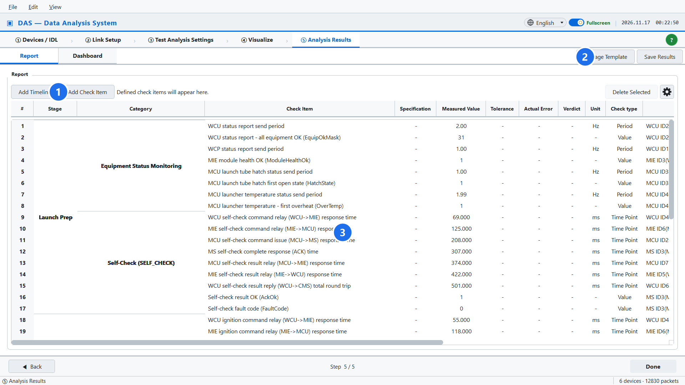

[한국어](../10_step5.md) | **English**

# ⑤ Analysis Results · Report

Extracts time points, values, periods and response times from the loaded capture into a check item table and saves it as an Excel/CSV report. Save the layout as a template JSON to reuse it.

**How to use**

1. If needed, load a template JSON with "Manage Template" at the top right.
2. Create a reference time (device, message, Nth occurrence) with "Add Timeline".
3. With "Add Check Item", choose the target and the check type (time point/value/period/response time).
4. For a pass/fail verdict, turn on the specification value and enter a tolerance or range condition.
5. Create the XLSX or CSV with the shared "Save Results" next to the tabs ("Batch by Format" also works).

**Notes**

- Only items with a specification value get an automatic Normal/Abnormal verdict; the rest just show the measurement.
- Loading a template replaces the current layout entirely, and fails if device or IDL names differ from the template.
- Double-click a row to edit, drag the No. cell to reorder, right-click adjacent rows to group them into a stage/category.
- The gear button above the table sets how many digits real values show (verdicts always use full precision).

<picture>
  <source media="(prefers-color-scheme: dark)" srcset="images/36_step5_report_checklist_populated__step5.png">
  <source media="(prefers-color-scheme: light)" srcset="images/36_step5_report_checklist_populated__step5__light.png">
  
</picture>

- **1** Add timelines and check items (timing/value/period/response time) with the "Add Timeline"/"Add Check Item" buttons at the top left.
- **2** With "Manage Template" at the top right you can load a previously saved report template JSON to reuse its setup, or save the current setup as a template.
- **3** The defined check items and their actual measured values fill the table, and the shared "Save Results" next to the Report / Dashboard tabs produces an XLSX/CSV file.

---

[← ④ Visualize · Responsiveness](09_step4-response.md) · [Contents](../../README.en.md#user-guide) · [⑤ Analysis Results · Dashboard →](11_step5-composite.md)
